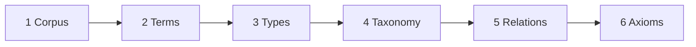
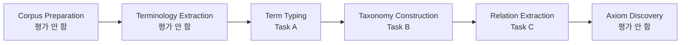
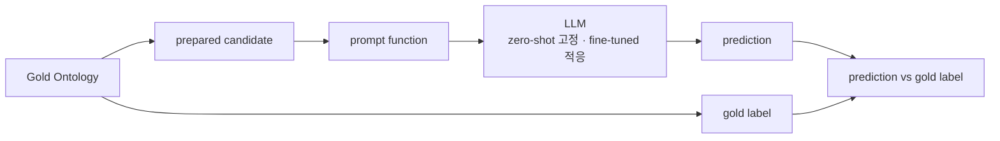

# S23 — LLMs4OL: LLM에게 온톨로지를 묻는다

> Ch.7 LLM 기반 온톨로지 구축 · Day 12
> 원자료: DSBA Lab Study 강의 슬라이드 (덱 34쪽, 2026-08-12)
> 참고 논문
> · Babaei Giglou, D'Souza, Auer (2023), _LLMs4OL: Large Language Models for Ontology Learning_,
>   ISWC 2023 ([arXiv:2307.16648](https://arxiv.org/abs/2307.16648))
>
> 📖 [강의 목차](README.md) · [YouTube 재생목록](https://www.youtube.com/watch?v=f0WV7b3lGqM&list=PLFHGWfB_kmrs)
> 이전 [S22B WKLM](S22B-WKLM-텍스트에서-직접-배우기.md) · 다음 S24 CQ 기반 Human-in-the-loop
> 📎 부록 [S23-1 읽는 데 필요한 것들](S23-1-읽는-데-필요한-것들.md) · [S23-2 벤치마크가 재지 않는 것](S23-2-벤치마크가-재지-않는-것.md)

**이 문서는 슬라이드 내용만 담는다.** 배경 설명은 [S23-1](S23-1-읽는-데-필요한-것들.md)에,
강의 밖 해석은 [S23-2](S23-2-벤치마크가-재지-않는-것.md)에 있다.

예문은 UMLS의 `myocardial infarction`으로 이어진다.

> 덱 3쪽 Index가 Conclusion을 35·36쪽으로 가리키는데 덱은 34쪽에서 끝난다. Threats to Validity와
> Final Summary가 실제 슬라이드에는 없다. 원표기 그대로 적어둔다.

---

## 1. 배경 — Ontology Learning의 병목

- **전문가 중심 구축** — 높은 시간·비용과 지속적인 유지보수 부담
- **Ontology Learning** — corpus의 언어 증거를 term·type·relation 구조로 변환하는 일
- **기존 자동화의 한계** — 도메인별 규칙과 자원을 반복 설계해야 한다
- **LLMs4OL의 출발점** — LLM은 주어진 ontology unit을 올바르게 판정할 수 있는가

| 기존 구축 방식 | LLM 가설 |
|---|---|
| 도메인 전문가의 반복적인 수작업 | 광범위한 텍스트에서 언어 패턴을 사전학습 |
| 규칙·패턴·클러스터링의 도메인 의존성 | 추가 학습 없이 주어진 입력을 zero-shot으로 판정 |
| 변화하는 지식에 대한 유지보수 비용 | 전문가 검토의 우선순위 지원 |

슬라이드가 한 줄로 요약한다. `Can language patterns become ontology structure?`

> 이 슬라이드 제목이 `Ontology Learning Bottleneckdsfsdfs`로 오타가 남아 있다.

## 2. 왜 벤치마크가 필요한가

- **Research gap** — 일반 NLP 성능만으로는 ontology 구조 판정 능력을 알 수 없다
- **Comparison gap** — model·domain·type granularity가 달라 결과를 일반화하기 어렵다
- **Need** — 공통 task·data·평가 절차로 OL 적용 조건과 실패 조건을 구분한다

네 단계로 놓으면 이렇다. 일반 LLM의 성공(QA 생성, 사실 기억 평가) → 전이 여부가 미해결
(언어 패턴이 ontology 구조가 되는가) → 공통 프로토콜(3 task 4 source) → 비교 가능한 증거
(model·domain·prompt adaptation).

목적은 최고 모델을 뽑는 것이 아니라 **OL 적용 조건과 실패 조건을 분리하는 것**이다.

## 3. 벤치마크 설계

| Research Question | Prediction Unit | Knowledge Source | Metric |
|---|---|---|---|
| RQ1 Term typing | Lexical term | WordNet · GeoNames · UMLS | MAP@1 |
| RQ2 Taxonomy | Type pair (a, b) | GeoNames · UMLS · schema.org | F1 |
| RQ3 Relation | Triple (h, r, t) | UMLS | F1 |

- **Task formulation** — term typing, taxonomy, non-taxonomic relation을 prediction 문제로 정의
- **Benchmark assets** — ontology source별 dataset과 model-facing prompt를 공개
- **Empirical baseline** — 11개 model configuration의 zero-shot과 Flan-T5 adaptation 비교

## 4. 이 벤치마크가 재는 것과 재지 않는 것

- **Gold ontology** — 평가 정답으로 사용하는 기존의 검증된 ontology
- **Candidate** — benchmark가 미리 구성해 LLM에 입력하는 term·type pair·relation triple
- **Local evaluation** — candidate 단위의 type 또는 correct / incorrect 판정

| 평가 단위 | 판단 가능 | 판단 불가 |
|---|---|---|
| Benchmark data | 기존의 검증된 ontology를 평가 정답으로 사용 | raw corpus의 end-to-end extraction |
| Term → type | type recovery granularity/domain 차이 | 새 concept의 open-world discovery |
| Type pair | local superclass/subclass 판별 | global cycle duplicate coherence |
| Relation triple | 주어진 relation candidate의 유효성 판정 | relation schema axiom 생성 |
| Model / prompt | model·domain·prompt 민감도 | scale·architecture의 인과 효과 |
| Fine-tuning | task/domain adaptation gain | expert-free construction |
| Metric | MAP@1 / F1 | provenance·consistency·expert cost |
| Bottom line | 세 하위 능력의 empirical benchmark | end-to-end autonomous builder |

슬라이드 제목이 그대로 결론이다. `Capability Benchmark, Not End-to-End Ontology Construction`.

## 5. 온톨로지 기초

- **Ontology** — 특정 domain의 개념·관계·논리적 제약을 명시한 지식 모델
- **Class / Instance** — 공통 특성의 집합 / 그 class에 속하는 실제 개체
- **Relation / Taxonomy** — 의미적 연결 / is-a 관계로 구성한 계층
- **Axiom** — domain·range·disjointness와 같은 허용 범위와 논리 규칙

```
Marie Curie ∈ Person                              (class assertion)
authorOf(Marie Curie, Paper A) · domain Person · range Paper   (relation assertion & axiom)
```

## 6. Ontology Learning 파이프라인



- **입력** — domain corpus
- **Lexical layer** — terminology extraction과 표기·동의어 정규화
- **Concept & structure** — term typing과 taxonomy 구성
- **Formal layer** — relation·axiom 추가와 전문가 검증

앞의 셋(1→2→3)이 언어 증거이고 뒤의 셋(4→5→6)이 온톨로지 구조다.

## 7. 구조에서 예측으로

- **입력 단위** — term, type pair, relation triple
- **Prompt** — ontology의 구조적 질문을 모델이 처리할 자연어 문장으로 표현
- **제한된 출력** — 하나의 type label 또는 correct / incorrect

```
Task A  f_prompt^A(L) :=  [S] [L] [P_domain] is a [MASK].     → one type label
Task B  [a] is the superclass of [b]. This statement is a [MASK].
```

`S`는 optional context, `L`은 lexical term, `P_domain`은 domain cue다.

프롬프트는 ontology 구조를 모델이 답할 수 있는 문장으로 바꾸는 인터페이스다. zero-shot은
gradient update 없이 내재 지식을 probing하고, fine-tuning은 소수 예제로 task·domain adaptation을
한다.

## 8. 연구 질문과 기여

- **LLMs4OL paradigm** — Ontology Learning의 여섯 단계를 LLM 문제로 바라보는 conceptual framework
- **이 논문의 실증 범위** — term typing, taxonomy, non-taxonomic relation의 세 과제
- **제공 결과** — benchmark data·prompt·baseline이며 완성 ontology 생성기는 아니다

핵심 질문은 `Can pretrained LLMs support Ontology Learning?`이고, 세 과제가 그 질문에 붙는다.

## 9. 평가하는 세 과제



- **전체 paradigm** — corpus 준비에서 axiom 발견까지 여섯 OL 단계를 개념적으로 포괄
- **Empirical proof-of-concept** — term typing, taxonomy construction, relation extraction만 평가
- **평가하지 않음** — 신규 용어 추출, axiom discovery, global ontology consistency

여섯 단계 중 가운데 셋만 실증한다.

## 10. candidate에서 prompt로



- **Gold ontology** — candidate와 gold label을 함께 제공한다
- **Candidate** — benchmark가 미리 만든 하나의 test item
- **Model state** — zero-shot은 frozen LLM, fine-tuning은 adapted Flan-T5

Task A는 term에서 type label로, Task B·C는 pair 또는 triple에서 binary verdict로 간다.
슬라이드가 밑에 적어둔 한 줄이 `Candidate scoring, not end-to-end graph generation`이다.

## 11. UMLS 통합 예시

- **Task A** — `myocardial infarction` → `Disease or Syndrome`
- **Task B** — `Pathologic Function` → `Disease or Syndrome` (supertype → subtype)
- **Task C** — `Pharmacologic Substance` treats `Pathologic Function`
- **해석 단위** — Task B·C는 개별 entity가 아니라 UMLS semantic type 사이의 구조다

`myocardial infarction`만 실제 lexical term이고 나머지는 semantic type(T046·T047·T121) 수준이다.

## 12. Task A — 용어 타이핑

- **입력** — lexical term + optional context / domain cue
- **출력** — source ontology의 label set에 속하는 하나의 generalized semantic type
- **Evaluation** — model 문자열을 accepted label·synonym과 대조해 canonical type 판정

```
The patient was diagnosed after chest pain.
myocardial infarction in medicine is a [MASK].     →  Disease or Syndrome
```

오른쪽에 함께 놓인 `Pathologic Function`·`Clinical Drug`·`Finding`·`Sign or Symptom`은
ontology label space의 예시이지 프롬프트에 준 선택지가 아니다.

## 13. Task B — 분류체계 방향 판정

- **입력** — 순서가 있는 type pair (supertype → subtype)
- **Positive** — direct edge 또는 hierarchy에서 유도한 transitive superclass relation
- **Negative** — 알려진 parent–child pair의 방향을 반전해 구성
- **Prompt** — top-down 4개 + bottom-up 4개의 wording variant

```
Pathologic Function is the superclass of Disease or Syndrome.   → correct
Disease or Syndrome is the superclass of Pathologic Function.   → incorrect
```

`A → B`, `B → C`이면 `A → C`도 positive이고, 뒤집으면 incorrect다.

## 14. Task C — 관계 트리플 판정

- **입력** — head semantic type + 주어진 relation + tail semantic type
- **출력** — candidate triple 1개마다 correct / incorrect를 한 번 판정
- **범위** — relation name은 생성하지 않으며 fixed template에 candidate를 하나씩 삽입

```
[h] is [r] [t].  This statement is a [MASK].
Candidate #k: Pharmacologic Substance —treats→ Pathologic Function  →  correct
```

여러 후보를 한 번에 주는 객관식이 아니라 하나씩 따로 점수를 매긴다.

## 15. 모델 계열별 프롬프트 인터페이스

| 계열 | 방식 | 모델 |
|---|---|---|
| Encoder | BERT `[MASK]`처럼 빈칸의 표현을 판별 | BERT · PubMedBERT |
| Encoder–decoder | 입력을 별도 출력으로 변환 | BART · Flan-T5 |
| Decoder-only | instruction이나 prefix 뒤를 이어 생성 | GPT · BLOOM · LLaMA |

```
CLOZE  (BERT · BART)                    PREFIX (Flan-T5 · GPT · BLOOM · LLaMA)
[L] in medicine is a [MASK].            [L] in medicine is a ?
                                        Perform a sentence completion…
```

같은 ontology 질문이라도 model-facing interface와 wording이 다르다. BART는 `[MASK]`를
`<mask>`로 바꿔 넣는다.

## 16. 템플릿 변형과 출력 매핑

- **Task A** — context·인용부호·domain cue를 변형해 source별 최대 8개
- **Task B/C** — taxonomy wording 8개, relation은 fixed template 1개
- **Output mapping** — Task A는 type label로, B/C는 binary verdict로 각각 정규화

Task A의 출력은 accepted alias·synonym과 대조해 canonical type label로 접고, B/C는
zero-shot 출력을 correct / incorrect로 접는다. fine-tuning의 target encoding은 yes / no다.

## 17. candidate와 gold label 구성

- **Task B** — direct/transitive superclass는 correct, reversed direction은 incorrect
- **Task C 공개 데이터** — 5,641 positive + 1,896 type-aware sampled negative
- **해석** — candidate 구성과 class distribution이 F1의 의미에 영향을 준다

## 18. 실험을 읽는 법

- **Evaluation unit** — term·type pair·triple의 세 prediction task
- **Comparison axes** — 4개 knowledge source, 11개 model configuration, prompt 조건
- **Reading rule** — 대표 score를 단일 model이 아니라 조건 조합으로 해석한다

네 축은 design coverage(task·source·model 비교 범위), zero-shot variation(task·source·label별
score), adaptation gain(task·source별 fine-tuning 개선 폭), reporting condition(metric·prompt
선택과 대표 score 구성)이다.

## 19. 데이터셋

| Knowledge Source | Applicable Task | Type Scale | Evaluation Size |
|---|---|---|---|
| WordNet | A | 4 POS types | 9,470 test terms |
| GeoNames | A · B | A 680 · B 689 | 702,510 terms · 1,088 pairs |
| UMLS / schema.org | A B C / B | UMLS A 87–125, B/C 127 · schema.org 797 | UMLS B 407, C 6,030 · schema.org B 4,727 |

- **WordNet** — 일반 영어 lexical network. noun/verb/adjective/adverb
- **GeoNames** — 지리명과 위치 type taxonomy
- **UMLS** — biomedical term·semantic type hierarchy·relation
- **schema.org** — 웹 구조화 데이터 vocabulary taxonomy

## 20. 모델과 프로토콜

| Architecture | Models | Prompt Form | Scale · Access |
|---|---|---|---|
| Encoder | BERT · PubMedBERT | Cloze `[MASK]` | 110M–340M open |
| Encoder–decoder | BART · Flan-T5 | Cloze / prefix | 400M–3B open |
| Decoder-only | BLOOM · LLaMA · GPT | Prefix completion | 1.7B+ mixed access |

- **11 model configurations**
- **Representative score** — Task A·B는 평가한 template 중 best test score를 보고한다
- **Fine-tuning baseline** — 공개 모델인 Flan-T5-Large / XL

## 21. 실험 설정

| Setting | Models | Prompt | Examples | Selection |
|---|---|---|---|---|
| Zero-shot A | 11 LLMs | ≤8 templates | 0 | best MAP@1 |
| Zero-shot B | 11 LLMs | ≤8 templates | 0 | best F1 |
| Zero-shot C | 11 LLMs | 1 template | 0 | F1 |
| Tuned A | Flan-T5 | instruction | 8 / class | MAP@1 |
| Tuned B/C | Flan-T5 | instruction | A-linked | F1 |

Optimization은 AdamW 1e-5, batch 8/4, source별 5–10 epochs다. Task B·C의 학습 항목은
Task A에서 선택된 instance/type과 연계된 것을 쓴다.

## 22. 지표와 프롬프트 선택

- **MAP@1** — term마다 1순위로 예측한 type이 accepted label과 맞는지의 평균
- **Macro-F1** — correct/incorrect 각 class의 precision과 recall을 함께 반영
- **Best-prompt reporting** — Task A·B에서 별도 validation 절차 없이 test 최고점을 보고한다

| Task | Prediction | Metric | Prompt search |
|---|---|---|---|
| A | top-1 type | MAP@1 | max 8 |
| B | correct / incorrect | F1 | max 8 |
| C | correct / incorrect | F1 | single |

> 슬라이드가 `Critical note prompt validation split not specified`를 적어두고, 발표자 해석으로
> `prompt search → best test score → optimistic reporting 가능성`을 덧붙였다.

## 23. Task A 결과 (MAP@1)

관찰 질문은 label space와 전문 domain이 세분화될 때 성능이 유지되는가다.

| Dataset | zero-shot 최고 | 모델 | tuned Flan-T5-XL |
|---|---:|---|---:|
| WordNet (4 types) | 91.7 | GPT-3.5 | 86.3 |
| GeoNames (680 types) | 43.3 | GPT-4 | 18.4 |
| NCI | 16.1 | GPT-4 | 32.8 |
| SNOMEDCT_US | 37.7 | BLOOM-3b | 43.4 |
| MEDCIN | 29.8 | BLOOM-3b | 51.8 |

- WordNet은 4-way typing에서 GPT-3.5가 91.7
- GeoNames는 680-way typing에서 GPT-4가 43.3
- Biomedical은 zero-shot best range 16.1–37.7, tuned Flan-T5-XL range 32.8–51.8

## 24. Task B·C 결과 (F1)

관찰 질문은 같은 Flan-T5의 fine-tuning 효과가 task와 source에서 일관적인가다.

| Task | Source | zero-shot | tuned |
|---|---|---:|---:|
| B | GeoNames | 59.6 | 62.5 |
| B | UMLS | 64.3 | 79.3 |
| B | schema.org | 54.8 | 91.7 |
| C | UMLS relation | 49.5 | 53.1 |

schema.org가 +36.9로 가장 크게 오르고 GeoNames는 +2.9에 그친다.

## 25. 정리

- **기존 한계** — 전문가 중심 ontology 구축은 시간·비용이 크고, 기존 자동화는 domain-specific
  rule·resource에 의존한다
- **해결 방식** — term typing·taxonomy·relation의 3개 OL task를 prompt-based prediction으로
  정식화하고 4개 source·11 configurations에서 비교했다
- **확인 결과** — known-label term typing과 prepared pair·triple 판정 능력을 측정했으며, 성능과
  tuning gain은 task·source별로 상이하다
- **남은 한계** — candidate 생성·provenance·axiom·global consistency·expert cost는 미평가이며,
  prompt selection과 pretraining exposure도 해석을 제한한다

---

## 관련 문서

- 부록 — [S23-1 읽는 데 필요한 것들](S23-1-읽는-데-필요한-것들.md) ·
  [S23-2 벤치마크가 재지 않는 것](S23-2-벤치마크가-재지-않는-것.md)
- 이전 회차 — [S22A COMET](S22A-COMET-언어모델로-KG를-만든다.md) ·
  [S22B WKLM](S22B-WKLM-텍스트에서-직접-배우기.md)
- 종합 — [01 Ch.4~6 무엇이 남고 무엇이 밀렸나](01-Ch4-6-무엇이-남고-무엇이-밀렸나.md)
