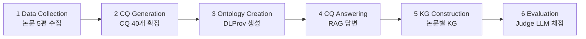

# S24 — CQ 기반 Human-in-the-loop 파이프라인

> Ch.7 LLM 기반 온톨로지 구축 · Day 12
> 원자료: DSBA Lab Study 강의 슬라이드 (덱 26쪽, 2026-08-12)
> 참고 논문
> · Kommineni, König-Ries, Samuel (2024), _From Human Experts to Machines: An LLM Supported
>   Approach to Ontology and Knowledge Graph Construction_
>   ([arXiv:2403.08345](https://arxiv.org/abs/2403.08345))
> · 코드 [fusion-jena/automatic-KG-creation-with-LLM](https://github.com/fusion-jena/automatic-KG-creation-with-LLM)
>
> 📖 [강의 목차](README.md) · [YouTube 재생목록](https://www.youtube.com/watch?v=f0WV7b3lGqM&list=PLFHGWfB_kmrs)
> 이전 [S23 LLMs4OL](S23-LLMs4OL-LLM에게-온톨로지를-묻는다.md) · 다음 S25 멀티에이전트 온톨로지 생성
> 📎 부록 [S24-1 읽는 데 필요한 것들](S24-1-읽는-데-필요한-것들.md) · [S24-2 사람을 어디에 남길 것인가](S24-2-사람을-어디에-남길-것인가.md)

**이 문서는 슬라이드 내용만 담는다.** 배경 설명은 [S24-1](S24-1-읽는-데-필요한-것들.md)에,
강의 밖 해석은 [S24-2](S24-2-사람을-어디에-남길-것인가.md)에 있다.

예문은 `Klein et al. (2015)` 논문의 딥러닝 파이프라인으로 이어진다.

---

## 1. 온톨로지와 지식그래프

- **온톨로지** — 특정 도메인의 개념(클래스)과 관계를 정의한 스키마
- **지식그래프** — 온톨로지 틀에 실제 데이터(인스턴스)를 채운 것
- **TBox** = 스키마(개념·관계 정의) / **ABox** = 인스턴스(실제 데이터)
- KG는 이종 정보의 연결, 추론, 시맨틱 검색의 기반이다 (예: 구글 검색의 지식 패널)

이 논문의 목표는 **두 산출물을 LLM으로 반자동 생성하는 것**이다.

```
도메인 개념 정의  →  온톨로지 / TBox  →  지식그래프 / ABox  →  활용
무엇을 표현할 것인가   클래스·관계·공리     실제 인스턴스 채우기    추론·시맨틱 검색
```

## 2. 논문의 온톨로지·KG 예시

온톨로지는 클래스와 관계만 정의하고, KG는 특정 논문의 실제 값을 인스턴스로 채운다.

| 온톨로지 — 틀 (TBox) | 지식그래프 — 내용물 (ABox) |
|---|---|
| `DeepLearningPipeline` | `Klein2015_Pipeline` |
| `hasDataFormat → DataFormat` | `hasDataFormat → "Audio Spectrogram"` |
| `hasModel → Model` | `hasModel → "CNN"` |
| `hasHyperparameter → Hyperparameter` | `hasHyperparameter → "lr 0.001"` |

클래스·관계는 재사용하고 논문마다 달라지는 값만 인스턴스로 채워 넣는 구조다.

## 3. Competency Question

- 완성된 온톨로지·KG가 **반드시 답할 수 있어야 하는 질문 목록**이다. 소프트웨어 개발의 요구사항
  명세서에 해당한다
- 질문에서 필요한 개념(클래스)과 관계가 자연스럽게 도출된다
- 설계의 출발점이자 구축 완료 후 검증 기준으로도 쓰인다
- 전통적으로 도메인 전문가 인터뷰를 통해 수집했다. 이 논문은 LLM으로 생성한다
- CQ는 온톨로지 설계의 핵심 중 하나라서, 이 논문에서도 여기에 사람이 개입한다

```
CQ  "어떤 모델 아키텍처를 사용했는가?"
      →  도출 클래스 Model        도출 관계 hasArchitecture
```

## 4. Motivation — 사람·시간·비용에 대한 높은 의존도

- 도메인 전문가 + 온톨로지 엔지니어 + 컴퓨터 과학자의 장기 협업이 필수다
- CQ 수집 → 온톨로지 설계 → 데이터 구조화 → 인스턴스 채우기까지 전 과정이 수작업이다
- 표현력이 높은 온톨로지일수록 설계 결정이 복잡해지고 비용이 급증한다

세 가지로 정리된다. **다자간 협업**(전문가·엔지니어·연구자의 반복 협의), **긴 구축 기간**(전
단계 수작업), **높은 비용**(도메인이 바뀌면 사실상 처음부터 재구축).

연구 질문은 이것이다. `자원 집약적인 온톨로지 구축과 도메인 지식 활용 사이의 균형을 어떻게
잡을 것인가?`

## 5. 기여 — 오픈소스 LLM만으로 구성한 전체 구축 파이프라인

| | 내용 |
|---|---|
| 01 6단계 파이프라인 | CQ 생성 → 온톨로지 → RAG 답변 → KG → 평가를 단계별로 분해 |
| 02 오픈소스 LLM 전용 | GPT-3.5/4 의존 없이 Mixtral 8x7B로 구성. 비용·투명성·모델 제어권 확보 |
| 03 도메인 적용 검증 | 생물다양성 × 딥러닝 논문 5편에 실제 적용 |
| 04 Judge LLM 평가 설계 | 사람이 만든 정답 기준으로 생성 결과를 자동 채점 |

코드·프롬프트·데이터를 전면 공개했다.

## 6. 대상 도메인 — 딥러닝 연구의 재현성

- 생물다양성 연구에서 딥러닝 활용이 급증했고, 결과의 신뢰·검증을 위해 재현성 확보가 필수다
- 재현에 필요한 정보는 모델, 아키텍처, 하이퍼파라미터, 데이터 출처, 소프트웨어·하드웨어 환경이다
- 이 정보를 구조화된 KG로 저장하면 검색·비교·검증이 쉬워진다

| 61편 | 5편 | 40개 | 1개 |
|---|---|---|---|
| 선행 연구의 체계적 문헌 리뷰 대상 | 본 파이프라인 적용 대상 논문 | 도메인 전문가가 검증한 CQ | 논문 1편당 생성되는 KG |

재현성 정보는 논문 본문에 흩어져 있다. 이를 자동으로 추출·구조화하는 것이 파이프라인의 목표다.

## 7. 파이프라인 여섯 단계



- ② CQ 생성은 ChatGPT-3.5, ③~⑥은 오픈소스 Mixtral 8x7B가 전담한다
- **사람이 개입하는 곳은 ②와 ⑥ 두 군데**다
- 처음에는 논문 전체를 한 번에 넣어 KG 생성을 시도했으나 실패해서 6단계 분해로 전환했다

슬라이드가 핵심으로 적어둔 문장이 `작업 분해(task decomposition)가 성능의 전제조건이었다`이다.

## 8. ① 데이터 수집과 ② CQ 생성

- **데이터 수집** — 선행 연구의 체계적 문헌 리뷰 데이터셋을 재사용한다. 전문가 2명이 재현성
  변수를 수작업 추출한 61편 중 5편을 선정했다
- **CQ 생성** — ChatGPT-3.5에 DL 파이프라인의 출처(provenance)를 묻는 추상 수준 질문 생성을
  요청한다
- **도메인 전문가 2명이 검토** — 기존 질문 개선 + 신규 질문 추가로 최종 40개 CQ를 확정한다

```
ChatGPT-3.5          →   도메인 전문가 2명              →   최종 40개 CQ
CQ 초안 자동 생성          검토·수정·추가 (human-in-the-loop)    데이터·전처리·아키텍처·HW/SW·윤리 포괄
```

CQ 예시는 `딥러닝 파이프라인에서 사용한 데이터의 출처는 무엇인가?`와
`모델 학습에 사용한 하이퍼파라미터 설정은 무엇인가?`다.

## 9. ③ 개념·관계 추출과 온톨로지 구성

- **Step 1** — 40개 CQ에서 개념·관계를 추출한다. 프롬프트에 지시문 + 예시 CQ와 기대 출력
  1쌍(in-context)을 포함한다
- **Step 2** — 추출된 개념·관계로 온톨로지를 구성한다. 기본 구조 예시를 제공하고 W3C 표준
  **PROV-O 재사용을 지시**한다

결과물이 DLProv 온톨로지다.

| 45 | 41 | 365 |
|---|---|---|
| 클래스 | 관계 (Object Properties) | 공리 (Axioms) |

## 10. ④ RAG로 CQ 답변 생성

- 논문 5편 × CQ 40개 = **200개 질문**에 대해 RAG로 답변을 생성한다
- RAG는 질문과 관련된 논문 청크만 검색해 LLM에 제공한 후 답변하게 한다. 오픈북 시험에 비유된다
- 설정은 청크 2,500 토큰 / 오버랩 100 토큰, zero-shot, temperature 1e-5
- 생성 답변의 중복·반복은 텍스트 후처리로 제거한다

```
논문 PDF 5편 → 청킹 2,500/100 → 벡터 검색 → Mixtral 8x7B → 후처리
```

슬라이드의 핵심 문장이다. **온톨로지는 무엇을 담을지를, RAG 답변은 무엇을 담을 값인지를
결정한다.** 두 입력이 다음 단계인 KG 구축의 재료가 된다.

## 11. ⑤ 온톨로지 매핑과 논문별 KG

- **입력** — CQ + RAG 답변 + DLProv 온톨로지
- LLM이 핵심 엔티티·관계를 추출해 온톨로지에 매핑한다
- **출력** — 논문 1편당 1개의 KG (RDF / Turtle 형식)

```turtle
dlprov:DeepLearningPipeline1  rdf:type  dlprov:DeepLearningPipeline ;
    dlprov:hasDataFormat  dlprov:DataFormat_1 , dlprov:DataFormat_2 .

dlprov:DataFormat_1  rdfs:label  'Audio Spectrogram' .
dlprov:DataFormat_2  rdfs:label  'Image data' .
```

온톨로지의 클래스(`DataFormat`)에 논문 고유의 값(`Audio Spectrogram`)이 인스턴스로 붙는다.

## 12. ⑥ LLM 기반 평가

- 오픈소스 모델로 **Judge LLM을 자체 설계**한다
- 사람 전문가가 논문 5편에 대한 정답(ground truth)을 작성한다 (human-in-the-loop)

| 평가 ① RAG 답변 품질 | 평가 ② KG 개념 정합성 |
|---|---|
| 정답과 생성 답변의 일치도를 0~10점으로 채점 | KG의 각 인스턴스가 해당 CQ 답변에 실제로 등장하는지 검증 |
| 6점 이상 → Right / 3~6점 → Partial / 3점 미만 → Wrong | 정합 인스턴스 수 ÷ 전체 인스턴스 수 → 논문별 KG 품질 점수(%) |

생성도 평가도 오픈소스 LLM이다.

## 13. 모델 선정

- 후보 3종을 수동 비교 후 출력 품질이 가장 우수한 **Mixtral 8x7B**(Sparse Mixture-of-Experts)를
  선정했다
- 추론 설정은 zero-shot, temperature 1e-5(사실상 결정적 출력), 최대 출력 25,000 토큰

| 후보 | 결과 |
|---|---|
| Llama 2-70B (Meta · Dense) | 미선정 |
| **Mixtral 8x7B** (Mistral AI · Sparse MoE) | 선정 |
| Falcon-40B (TII · Dense) | 미선정 |
| 인프라 | 대학 클러스터. NVIDIA A100 80GB × 1 |

상용 API 없이 GPU 한 장으로 전체 파이프라인을 돌린 점이 실용적 강점이다.

## 14. 생성 결과

| 40 | 45 | 41 | 79% |
|---|---|---|---|
| CQs | Classes | Relations | 사람 대 Judge LLM 일치율 |

- CQ 40개는 데이터 → 전처리 → 모델 → 평가 → 윤리까지 DL 파이프라인 전 단계를 포괄한다
- **PROV-O 재사용은 제한적이다.** 클래스 3개만 하위 클래스로 연결했고 객체 속성 재사용은 0건이다
- MLSchema 온톨로지로 대체한 실험에서도 클래스 1개만 재사용했다. LLM의 온톨로지 재사용 능력
  한계다
- RAG 답변 200개 중 사람–Judge LLM 불일치가 42건이다 (일치율 79%)

슬라이드 해석이다. `LLM이 신규 생성은 잘하지만 안정적인 재사용에 약함 — 온톨로지의 핵심
미덕인 재사용이 약점.`

## 15. 프롬프트와 답변 조합에 따른 성능

프롬프트 2종 × CQ 답변 2종 = 4개 조합으로 논문 5편의 KG를 생성했다. 최고 조합 기준 인스턴스
203개 중 142개(70%)가 CQ 답변과 정합했다.

| 논문 | P1 + A1 | P1 + A2 | P2 + A1 | P2 + A2 |
|---|---:|---:|---:|---:|
| Klein et al. 2015 | **24.32** | x | x | 9.42 |
| Khalighifar et al. 2021 | **85.71** | x | x | 68.06 |
| Choe et al. 2021 | **73.21** | 64.41 | 59.26 | 64.29 |
| Mahmood et al. 2016 | **91.53** | 81.48 | 82.76 | 77.55 |
| Younis et al. 2020 | 66.67 | x | **67.51** | 61.67 |

`x`는 의미 있는 KG 생성 실패다. Klein 논문이 24.3%에서 9.4%로 갈리는 것이 프롬프트 민감성의
정량적 증거다. 최고 성적(Mahmood 91.5%)과 최저(Klein 9.4%)의 격차가 파이프라인의 안정성 한계를
보여준다.

## 16. 파이프라인 구조의 효과

- **최초 시도** — 논문 전체를 통째로 넣고 "KG를 만들어 달라" → 쓸모 있는 결과가 거의 없었다
- **6단계로 분해한 뒤에야** 유의미한 KG 생성이 가능해졌다

| 단일 프롬프트 접근 | 6단계 분해 접근 |
|---|---|
| 논문 전체 PDF + "KG 만들어줘" | CQ → 온톨로지 → 답변 → KG → 평가 |
| 구조 없는 출력, 온톨로지 미준수 | 단계별 검증 가능, 유의미한 KG 생성 |

- LLM 출력의 과도한 부연 설명은 텍스트 후처리로 제거해 평가 불일치를 줄였다 (최종 42/200)
- 불일치 42건의 대부분은 사람이 `Partial`로 준 답을 Judge LLM이 `Wrong`으로 처리한 것이다.
  Judge가 더 엄격하다

## 17. LLM의 한계 넷

1. **결측 처리 일관성 문제** — 정보가 없을 때 `Not Specified` 라벨을 넣기도 하고 인스턴스를
   통째로 생략하기도 한다. 처리 방식이 뒤섞인다
2. **중복 인스턴스** — 동일 클래스에 같은 값을 반복 생성해 의미 없는 KG가 만들어진 사례가 있다
3. **프롬프트 민감성** — 사소한 문구 변경은 물론 입력 순서(답변 ↔ 온톨로지)만 바꿔도 결과가
   달라진다. in-context example로 완화 가능하다
4. **형식 호환성** — 생성된 KG가 SPARQL 엔진·라이브러리에서 바로 동작하지 않아 수동 수정이
   필요한 경우가 있다

네 가지 모두 "생성은 되지만 신뢰할 수 없다"는 문제이고, human-in-the-loop이 여전히 필요한
이유다.

## 18. 결론 — 사람의 검증을 전제로 한 LLM 보조 파이프라인

- 오픈소스 LLM만으로 온톨로지·KG 구축 파이프라인이 실현 가능함을 입증했다
- 구축 노력과 시맨틱 웹 전문성 요구 수준을 크게 낮췄다. **다만 대체가 아니라 보조다**
- 생성 품질의 편차 때문에 human-in-the-loop 검증은 여전히 권장된다

```
도메인 전문가                    LLM co-pilot
CQ 검토 · 정답 작성 · 최종 판단   ↔   초안 생성 · 추출 · 매핑 · 1차 채점
```

슬라이드의 한 줄 요약이다. `"전 과정을 자동화했다"가 아니라 "사람이 개입할 지점을 두 곳으로
줄였다"가 이 논문의 성과.`

Future Work는 다양한 하드웨어·오픈소스 LLM에서의 결과 변동성 평가, 프롬프트 민감성 대응,
타 ML·DL 온톨로지와의 매핑이다.

## 19. 한계와 기여

| 한계 | 내용 |
|---|---|
| 규모 | 논문 5편으로 검증했다. 수백 편 규모의 확장성과 도메인 전이 가능성은 미검증이다 |
| 평가의 순환성 | LLM 생성물을 LLM이 평가하는 구조다. 사람과의 불일치 21%는 여전히 큰 오차다 |
| 재현성의 부족 | 재현성을 위한 KG를 만드는 파이프라인이 프롬프트·하드웨어에 민감하다 |

| 기여 | 내용 |
|---|---|
| 의의 | 상용 API 없이 로컬 LLM으로 전 과정을 구성한 선구적 시도다. 코드·프롬프트를 전체 공개했다 |

---

## 관련 문서

- 부록 — [S24-1 읽는 데 필요한 것들](S24-1-읽는-데-필요한-것들.md) ·
  [S24-2 사람을 어디에 남길 것인가](S24-2-사람을-어디에-남길-것인가.md)
- 앞 회차 — [S23 LLMs4OL](S23-LLMs4OL-LLM에게-온톨로지를-묻는다.md)
