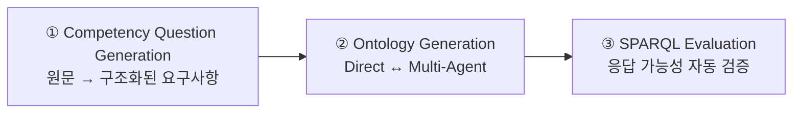
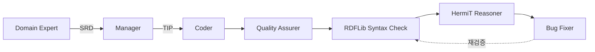
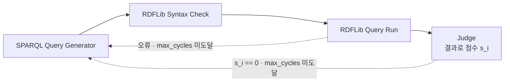

# S25 — 멀티에이전트: 계획을 문서로 외부화하기

> Ch.7 LLM 기반 온톨로지 구축 · Day 13
> 원자료: DSBA Lab Study 강의 슬라이드 (덱 40쪽)
> 참고 논문
> · Talukder, Mridul, Seneviratne, _Towards Automated Ontology Generation from Unstructured Text:
>   A Multi-Agent LLM Approach_, LLMS4KGOE @ ESWC'26
>
> 📖 [강의 목차](README.md) · [YouTube 재생목록](https://www.youtube.com/watch?v=f0WV7b3lGqM&list=PLFHGWfB_kmrs)
> 이전 [S24 CQ 기반 Human-in-the-loop](S24-CQ-기반-Human-in-the-loop-파이프라인.md) · 다음 S26 Schema-grounded KG 구축
> 📎 부록 [S25-1 읽는 데 필요한 것들](S25-1-읽는-데-필요한-것들.md) · [S25-2 통제를 절반만 한 실험](S25-2-통제를-절반만-한-실험.md)

**이 문서는 슬라이드 내용만 담는다.** 배경 설명은 [S25-1](S25-1-읽는-데-필요한-것들.md)에,
강의 밖 해석은 [S25-2](S25-2-통제를-절반만-한-실험.md)에 있다.

예문은 생명보험 약관의 한 조항으로 이어진다.
`The beneficiary is entitled to a one-time payment of $50,000 upon the policyholder's death.`

---

## 1. 한 장 요약

**연구 질문** — LLM에게 복잡한 문서를 주고 온톨로지를 만들라고 할 때, 바로 코드를 쓰게 하는
것보다 먼저 설계 문서를 작성하게 하면 더 좋은 온톨로지가 나오는가.

**주장** — 계획을 문서로 외부화하면 온톨로지 품질이 오른다.

| | Direct Generation | Multi-Agent |
|---|---|---|
| 방식 | 해석 + 설계 + 온톨로지 작성을 한 번에 | 요구사항 문서 → 기술 구현 계획 → Turtle 구현 → 품질 검증 |
| 설계 품질 Overall | 1.33 / 2.33 | **3.33 / 3.00** |

Competency Question 생성과 평가를 양쪽에 고정한 채 온톨로지 구축 방식만 바꿔 끼워 비교했다.
한계는 SPARQL CQ 커버리지가 40~63%에 머물고 중복 문제가 개선되지 않는다는 점이다.

## 2. 온톨로지가 하는 일 — 문장을 질의 가능한 구조로

```
"The beneficiary is entitled to a one-time payment of $50,000 upon the policyholder's death."

DeathEvent (계약자 사망)  → triggers →  PaymentEvent (지급 사건)
PaymentEvent → hasBeneficiary → Beneficiary (수익자 역할)
PaymentEvent → hasMonetaryAmount → MonetaryAmount (value = 50000, currency = USD)
```

사람은 위 문장을 그냥 읽으면 바로 이해한다. 그러나 텍스트 그대로 저장하면 컴퓨터는 누가,
얼마를, 왜 받는가를 질의하거나 추론할 수 없다.

질의와 추론이 가능하려면 의미 요소를 각각 명시하고 서로 연결해야 한다.

- 계약자의 사망 사건이 지급 사건을 촉발한다는 관계를 명시한다
- 수익자를 사람이 아니라 계약 안에서 수행하는 **역할(Role)**로 모델링한다
- 금액은 숫자 하나가 아니라 값(50000)과 통화(USD)를 분리한 MonetaryAmount로 표현한다

## 3. 대상 — 생명보험 약관

- 밀도 높은 법률 문장 안에 계약 당사자(Entity), 생애주기 사건(Event), 금액·기간 제약이 뒤섞여
  있다
- 조항 하나를 옮기려면 PaymentEvent, Beneficiary(사람이 아니라 역할), policyholder의 DeathEvent,
  금액·통화 제약을 동시에 다뤄야 한다
- 전문가가 개념을 찾고 적합한 온톨로지 설계 패턴을 골라 OWL로 인코딩하는 전통적 방식은 수백
  조항 규모가 되면 현실적으로 불가능하다

보험 약관 데이터는 여러 조항에 흩어져 암묵적으로 표현되므로 온톨로지 생성의 stress test로
적합하다.

## 4. 온톨로지 구축의 병목

사람이 직접 만들면 시간이 오래 걸리고 오류가 잦으며 도메인 전문가와 지식 공학자의 협업이
필요하다. 지식 기반 시스템 전체의 확장을 가로막는 병목이다.

LLM을 쓴다면 두 질문이 남는다.

- LLM이 비정형 텍스트에서 형식적으로 타당하고 의미적으로 충실한 온톨로지를 얼마나 믿을 만하게
  만들어내는가
- 그 품질을 실제로 좌우하는 설계 선택은 무엇인가

## 5. 단순 LLM 생성의 한계

```turtle
# Turtle 문법은 완벽하지만 설계가 빈약한 온톨로지
ex:payment1  a  ex:Payment ;  ex:amount  50000 .
```

LLM은 문법에 맞는 코드를 잘 만든다. 위 Turtle은 문법 검사와 논리 일관성 검사를 모두 통과할 수
있다.

문제는 좋은 온톨로지를 만드는 일과 문법에 맞는 코드를 쓰는 일이 다른 문제라는 것이다.

| 질문 | 위 코드로는 |
|---|---|
| 50000의 통화는 무엇인가 | 답할 수 없다 |
| 이 지급은 어떤 사건 때문에 발생했는가 | 연결이 없어 추적 불가 |
| 수익자는 사람인가, 계약 안에서 수행하는 역할인가 | 구분되지 않는다 |

그래서 검증된 모델링 관행, 곧 온톨로지 설계 패턴을 따르게 해야 한다.

## 6. 연구 설계 — 통제 실험

생명보험 약관을 LLM으로 온톨로지화하는 과제에는 두 가지가 동시에 필요하다. 언어 이해(계약서·규제
문서·기술 명세는 필요한 지식이 문장 속에 녹아 있어 스키마에 적혀 있지 않고 읽어 추론해야 한다)와
온톨로지 설계 패턴 준수다.

핵심은 통제 실험이다.

1. Direct generation 기준선을 세운다
2. 어디서 무너지는지 확인한다
3. 그 지점을 겨냥해 multi-agent 구조를 설계하고 평가한다

요구사항 추출(Competency Question)과 평가는 양쪽에 똑같이 고정하고, **바뀌는 변수는 온톨로지를
만드는 방식 하나**다.

## 7. 기여 셋

- **통제된 구축 전략 비교** — Direct Generation과 artifact-driven Multi-Agent를 동일한 CQ·평가
  조건에서 비교해 ontology construction strategy의 영향을 분리해 관찰한다
- **CQ 기반 자동 평가 프레임워크** — CQ를 요구사항이자 평가 기준으로 사용하고,
  feedback-driven SPARQL과 RAG를 통해 functional usability를 자동 평가한다
- **실패 유형 진단과 설계 시사점** — 중복, context degradation, iterative repair 실패를 분석하고
  front-loaded planning과 external class registry 같은 향후 개선 방향을 제시한다

## 8. 3단계 파이프라인



두 실험 모두 같은 함수 `F`를 구현한다. 비정형 문서 `Doc`을 넣으면 도메인 온톨로지 `On`과 평가
산출물 `Eval`이 나온다.

- 세 단계 중 ①과 ③은 양쪽이 완전히 동일하고 ②만 Direct와 Multi-Agent로 바꿔 끼운다
- 따라서 성능 차이를 온톨로지 구축 방식 하나로 한정할 수 있다
- 다만 **가운데 블록 전체가 통째로 교체되었기 때문에 다중 에이전트 안의 어떤 요소가 실제
  원인인지는 분리되지 않는다.** 논문도 요소별 제거 실험을 향후 과제로 남긴다

## 9. Competency Question의 세 가지 역할

CQ는 온톨로지가 담아야 할 지식 범위와 답할 수 있어야 하는 질문을 규정한다.

1. 온톨로지에 필요한 최소한의 사실·관계·제약을 명시한다
2. **온톨로지 설계 패턴 사용을 강제한다** — 사건을 객체로 만들기(Event Reification), 참여자
   연결(Participation), 수치와 단위 분리(Quantities), 기간 표현(Time Intervals) 등
3. 추가 해석 없이 곧바로 SPARQL로 옮겨지도록 작성한다. 객관적이고 기계가 검증 가능한 평가가
   성립한다

## 10. CQ 생성 절차

문서를 페이지 단위로 잘라서 처리한다. LLM이 감당할 수 있는 맥락 안에서 CQ가 만들어지고, 어느
조항에서 나온 CQ인지 추적할 수 있다.

출력은 **competency question + expected answer** 쌍이다.

- 모호함이 줄고 추가 해석 없이 SPARQL로 변환 가능하다 (자연어 question → SPARQL → Ontology에서
  답 검색)
- 출력에 온톨로지 설계 패턴 주석이나 메타데이터는 포함하지 않는다

```
보험약관  →  CQ 생성  →  CQ: 수익자가 받는 돈은?  정답: 50,000 USD
          →  [Ontology 생성] "이 질문에 답할 수 있게 만들어"
          →  Ontology  →  [평가] "진짜 50,000 USD라고 답할 수 있나?"
```

이렇게 만든 CQ는 생성기를 가이드하고, 평가의 고정 기준이 되며, 출처를 보존해 사람이 감사할 수
있게 한다.

## 11. 기준선 — Direct Ontology Generation

설계 의도는 에이전트 간 상호작용을 최소화한 통제 조건이고, multi-agent 방식이 얼마나 이득인지
재기 위한 기준선이다.

구조적 특징은 이렇다.

- 생성 단계와 검증 단계는 분리되어 있으며 검증 결과가 생성기로 되돌아가지는 않는다
- 다만 검증 단계 내부에는 반복적인 오류 수정 루프가 존재한다
- 형식화하면 `Generate(T, C) → O_raw → Validate(O_raw) → O_final`
- 즉 형식적 오류는 반복 수정할 수 있지만 생성 단계의 개념적 누락·중복·잘못된 모델링까지
  되돌아가 고치는 구조는 아니다

## 12. 기준선 ① — 생성 단계와 취약점

```turtle
ex:payment1  a  ex:PaymentEvent ;
    ex:hasAmount  "50000" .      # 통화 단위(currency)가 누락된 모델링 오류
```

- 계약 텍스트와 CQ로부터 온톨로지 파일(Turtle)을 직접 생성한다
- 페이지를 돌며 하나의 파일에 triple을 추가·수정한다. **뒤에서 어떤 검증이 이뤄지는지 전혀
  모르는 상태로 작동한다**
- 생성이 끝나면 모델링 오류·중복 엔티티·누락 구조가 고쳐지지 않는다. Payment에 필요한 클래스를
  빠뜨리면 그 누락이 다음 단계로 그대로 이월된다

완화 장치로 Memoryless CQbyCQ / Ontogenia에서 가져온 프롬프팅 예시를 넣어 흔한 설계 실수와
온톨로지 설계 패턴을 제공한다.

## 13. 기준선 ② — 검증과 버그 수정

```turtle
Listing 3   ex:hasBeneficiary  rdfs:range  ex:Beneficiary ;   # 블록 종료 '.' 누락
Listing 4   ex:hasBeneficiary  rdfs:range  ex:Beneficiary .   # 세미콜론 → 마침표 (문법만 교정)
```

생성기로부터 온톨로지 파일만 넘겨받는 독립 프로세스다. 생성기와 대화하지 않고, 다시 만들어
달라고 요청할 수도 없다.

| 검사 | 도구 |
|---|---|
| Syntax Check | RDF 파서(RDFLib)로 문법 확인 |
| Semantic Consistency Check | OWL 추론기(HermiT)로 논리 모순 확인 |

Bug Fixer는 오류가 나면 해당 부분만 읽는 에이전트로 넘겨 최소한만 수정한 뒤 검증을 다시
시작하고, 두 검사를 통과하거나 최대 1,000회에 도달할 때까지 반복한다.

**Bug Fixer는 계약서나 CQ를 다시 읽지 않고 형식 오류만 고친다.** 생성기가 만든 개념적 누락(빠진
엔티티·관계)은 다루지 못한다.

## 14. Multi-Agent 아키텍처 — 네 개의 역할



- 에이전트는 한 번에 계약서 한 페이지만 처리하며 구조화된 산출물을 주고받는다
- 설계 원칙은 역할별 관심사 분리, 단계마다 다음 단계가 바로 쓸 수 있는 산출물 남기기, 무한
  루프를 막는 반복 횟수 상한이다

산출물 두 개가 파이프라인을 잇는다.

| 약어 | 무엇인가 |
|---|---|
| SRD | 의미 요구사항 문서 (Semantic Requirements Document) |
| TIP | 기술 구현 계획 (Technical Implementation Plan) |

## 15. Role 1 — Domain Expert (의미 요구사항 문서)

CQ에 답하려면 어떤 개념·관계·시간 제약·업무 규칙이 필요한지 계약서에 근거해 정리한 의미 요구사항
문서를 작성한다.

- 페이지 텍스트와 그 페이지의 CQ를 읽고 개념에 라벨을 붙인다.
  Entity / Role / Event / State / Attribute / TimeInterval / MonetaryAmount
- 조건이 붙은 관계(trigger, exception), 업무 규칙, 시간·금액 제약, 정책 생애주기의 상태 전이까지
  잡아낸다

**왜 필요한가.** LLM은 도메인의 표현과 온톨로지 개념을 자주 혼동한다. 요구사항부터 압축해
정리하게 하면 뒤 단계에서 설계가 표류할 가능성이 줄어든다. 없는 정보를 지어내지 말 것이
명시되며, 이 문서가 다음 에이전트에 대한 형식적 계약 역할을 한다.

## 16. Role 2 — Manager (기술 구현 계획)

의미 요구사항 문서를 받아, 코드를 쓰기 전에 모델링 결정을 미리 확정해 두는 기술 구현 계획으로
바꾼다. 세 부분으로 이뤄진다.

1. **개념 모델과 패턴 지정** — 그 페이지의 중심 개념 2~4개를 서술하고 쓸 온톨로지 설계 패턴을
   지정한다
2. **재사용·확장 계획** — 이미 있는 클래스·속성 중 무엇을 다시 쓸지 나열하고, 새로 만들 최소
   목록만 근거와 함께 명시한다
3. **Competency Question 정렬** — CQ마다 어떤 클래스가 관여하고 어떤 설계 패턴을 쓰며, 그 연결이
   SPARQL 응답을 어떻게 가능하게 하는지 적는다

온톨로지 결함의 상당수는 설계 없이 바로 코딩하는 데서 발생한다. 기술 구현 계획은 설계 결정을
앞으로 당겨 의도와 구현 사이에 계약을 만들고 중복 클래스 증식도 억제한다.

## 17. Role 3 — Coder (계획의 구현)

기술 구현 계획을 실제 Turtle 수정으로 옮기고, 계약서 페이지의 사실을 인스턴스로 만들어 CQ에
답할 수 있게 한다.

- **줄 번호가 붙은 현재 온톨로지 스냅샷을 먼저 읽는다.** 새로 만들기 전에 이미 있는 것을 다시
  쓰도록 유도하는 장치다
- 기술 구현 계획의 지시에 따라 클래스, 속성, 제약(restriction), 사건·역할 구조를 구현한다

## 18. Role 4 — Quality Assurer (세 단계 검증 관문)

| 단계 | 내용 |
|---|---|
| ① 설계 리뷰 | 코드가 기술 구현 계획과 원문 계약서에 맞는지 LLM이 판정한다. domain/range 오류, 누락 클래스, 설계 패턴 오용을 잡고 줄 번호에 고정된 피드백을 남긴다 |
| ② 문법 검증 | Turtle 파서로 확인 |
| ③ 논리 검증 | OWL 추론기로 모순 확인 |

기준선과의 차이는 **앞 단계 산출물(기술 구현 계획, Coder의 구현)을 참조할 수 있으므로 설계 품질
자체를 평가할 수 있다**는 점이다. 에이전트들이 공유된 설계 의도대로 작업했는지 확인 가능하고,
개별 정확성뿐 아니라 단계 간 정렬과 전체 모델링 충실도까지 본다.

## 19. 평가 — SPARQL 응답 가능성

CQ마다 고정된 SPARQL 하나로 끝내지 않는다. 실패하면 진단 피드백을 보고 질의를 고쳐 다시
시도하게 한다.



- ① Query Generation — 온톨로지, 자연어 CQ, 기대 정답을 입력받아 SPARQL을 만든다. 출력 형식을
  강제해 문법 무결성을 확보한다
- ② Syntax Validation과 ③ Query Execution — 파싱이나 실행이 실패하면 오류 내용을 그대로 되돌려
  질의를 다시 만들게 한다
- ④ Judge Agent — 두 번째 LLM이 실행 결과를 기대 정답과 비교해 1.0 / 0.x / 0.0으로 채점하고,
  0.0이면 판단 근거를 질의 수정에 다시 넣는다
- ⑤ Failure Handler — 정해진 횟수를 다 써도 답이 나오지 않으면 낮은 점수로 종료한다

인스턴스는 스키마가 질의를 지탱하는지 확인하는 테스트일 뿐, CQ가 특정 인스턴스를 평가하는 것은
아니다. 평가 철학은 답할 수 있는가에 더해 **그 답에 얼마나 쉽게 도달하는가**를 보는 것이고,
수정 횟수가 적을수록 쓰기 좋은 온톨로지로 간주한다.

## 20. 실패한 질의의 수정 과정

```sparql
SELECT ?amount WHERE {
    ex:payment1  ex:hasAmount  ?amount .     ← 빈 결과 (실패)
}
```

실제 속성 이름은 `ex:hasMonetaryAmount`인데 에이전트가 `ex:hasAmount`로 가정했다. **지식이
없어서가 아니라 이름이 어긋나서 실패한 것이다.**

```sparql
SELECT ?v ?c WHERE {
    ex:payment1  a  ex:PaymentEvent ;
        ex:hasEntitledParty  ex:beneficiary1 ;
        ex:hasMonetaryAmount  ?m .
    ?m  ex:hasValue  ?v ;  ex:hasCurrency  ?c .
}
```

프레임워크가 이 사실을 알려주면 에이전트가 질의를 다시 쓴다. 최종 질의는 prefix 선언, 사건 구조,
금액과 통화 분리까지 정확히 반영하고, 실행 결과 50000 USD가 Judge로 전달되어 기대 정답과 같으므로
1.0점이다.

모든 CQ에 최종 질의, 결과, 판단 근거, 점수가 기록되고 온톨로지 전체의 CQ 평균 점수를 리포트로
남긴다.

## 21. RAG 평가

SPARQL 점수만으로는 부족하다. SPARQL은 문법·URI·어휘 일치에 민감해서, 질의가 실패하거나 결과가
비었다고 해서 지식이 없다는 뜻이 아니라 질의를 잘못 썼다는 뜻일 수 있다.

RAG 평가는 OWL의 논리를 검사하지 않고 **필요한 노드와 그 연결이 검색되고 따라갈 수 있는지**를
본다. 이름이 조금 어긋나도 통과하는 관대한 측정치다.

- 방법론은 KGGen의 MINE-2에서 가져오되 오픈 도메인 데이터가 아니라 도메인 특화 CQ 집합을 쓴다
- 온톨로지를 방향 그래프 `G = (V, E)`로 바꾸고 전체 triple을 추출한 뒤 이름 표기를 통일하는
  정규화 함수를 적용한다
- 노드와 엣지를 각각 따로 all-MiniLM-L6-v2로 임베딩한다

## 22. RAG 평가 — hybrid search에서 dense-only로

처음에는 하이브리드로 설계했다. `Score(q, e) = α · BM25(q, e) + β · CosineSimilarity(q, e)`로
BM25와 임베딩 유사도를 가중합하는 방식이다.

실험 결과 단어 일치가 오히려 방해했다. α와 β를 바꿔 가며 실험한 결과 **온톨로지 식별자에서는
단어 빈도 신호를 믿을 수 없음**이 드러났고, 최종 설정은 임베딩 유사도만 사용한다. 어휘 노이즈가
사라지면서 평가 점수가 올라갔다.

CQ는 대개 여러 관계를 거쳐야 답이 나오므로, 상위 k개 요소를 찾은 뒤 각 요소에서 2-hop까지
확장해 연결된 triple을 모아 컨텍스트 블록으로 만든다.

이 점수가 의미하는 것은 구조적 모델링의 완성도다. 구조가 부실하면(끊긴 조각, 얕은 별 모양) 탐색이
일찍 끝나 답이 나오지 않는다. SPARQL과 경쟁이 아니라 상보 관계다.

## 23. 실험 설정과 평가 지표

**평가 축 ① 설계 품질** — 최신 LLM 5개를 evaluator로 사용한다 (Gemini 3.1 Pro, Claude Sonnet 4.6,
Grok 4.1, Deepseek-V3.2, Llama 4). 1~5점 척도로 세 지표를 채점한다.

| 지표 | 무엇을 보나 |
|---|---|
| Extensibility | 패턴을 강제한 결과, 도메인이 늘어나도 견딜 유연한 구조가 나왔는가 |
| Redundancy | 의미가 겹치는 클래스·속성을 새로 만들지 않고 기존 것을 다시 썼는가 |
| ODP Usage | 결과물이 LLM의 임의 발명이 아니라 시맨틱 공학 관행에 부합하는가 |

**평가 축 ② 실용적 사용성** — SPARQL과 검색 증강 생성 프레임워크로 온톨로지별 CQ 평균 점수를
산출한다.

데이터는 공개된 합성 생명보험 약관 2건이다. 넓은 벤치마킹이 아니라 통제된 심층 진단이 목적이라
2건으로 제한했다.

## 24. 두 약관 비교

| Metric | Contract 1 (Equivita) | Contract 2 (Sentinel) |
|---|---|---|
| Insurer | Equivita Mutual Life Insurance | Sentinel Life Assurance Co. |
| Policy Type | 20-Year Level Term | 20-Year Level Term |
| Word Count | 2331 | 1953 |
| Major Clauses | 9 | 8 |
| Defined Terms | 13 | 10 |
| Named Roles/Parties | 3 | 5 |
| Riders Attached | None | 1 (Accelerated Death Benefit) |
| Governing Law | New York | Colorado |
| Number of CQs Evaluated | 161 | 149 |

둘 다 20년 만기 정기보험이고 사망보험금과 계약 취소 불가 기간 같은 핵심 조항을 공유한다.
복잡성의 종류가 다른데, Equivita는 법적 깊이가 크고(동시사망 처리, 철회불능 수익자, 만기 전환권)
Sentinel은 사건과 제약이 많다(중대질병 선지급 특약이 중첩된 자격 조건과 지급 상한 50%).

## 25. 결과 — 구조 품질에서 Multi-Agent 우위

| Sample | Metric | Direct Generation | Multi-Agent |
|---|---|---:|---:|
| Equivita | Extensibility | 1.60 | **3.80** |
| | Redundancy | 1.00 | **2.40** |
| | ODP Usage | 1.40 | **3.80** |
| | Overall | 1.33 | **3.33** |
| Sentinel | Extensibility | 2.80 | **3.80** |
| | Redundancy | **2.00** | 1.80 |
| | ODP Usage | 2.20 | **3.40** |
| | Overall | 2.33 | **3.00** |

- 온톨로지 설계 패턴 Usage가 3.80 대 1.40으로 두 배 이상이다. Manager의 기술 구현 계획이 품질을
  끌어올린 주 요인이고, 설계를 모델 밖으로 빼내니 Coder는 남은 맥락을 Turtle 문법 변환에만 쓸 수
  있게 됐다
- Extensibility 3.80 대 1.60은 사건을 객체로 만드는 패턴을 강제한 결과다
- 심사자 간 합의도(Krippendorff α)는 Extensibility .784 / ODP .706 / Overall .755로 무난하다

## 26. 중복 문제가 개선되지 않는 이유

구조가 좋아져도 중복은 모든 방식에서 취약하다. 최고 점수가 2.40(Equivita, multi-agent)이고
baseline은 1.00이다. Sentinel에서는 multi-agent가 오히려 낮다(1.80 대 2.00). 유일하게 뒤집힌
지표다.

원인은 문제의 성질이 다르기 때문이다.

- 온톨로지 설계 패턴 적용은 그 페이지 안에서 끝나는 국소적 결정이다
- **중복 회피는 지금까지 쌓인 온톨로지 전체와 비교해야 하는 일이다**
- 이 수준의 전역 상태 추적은 모델의 attention 범위를 넘어선다. 기존 구성물을 쓰는 대신 조금
  변형된 개념을 새로 만들어 버린다

구조를 나눠서 풀리는 문제가 아니라 맥락·메모리 층위의 문제다.

## 27. SPARQL과 RAG의 결과 차이

| Sample | Metric | Direct Generation | Multi-Agent |
|---|---|---:|---:|
| Equivita | Processed SPARQL CQ Coverage | **.6304** | .6196 |
| Sentinel | Processed SPARQL CQ Coverage | .4027 | **.4383** |
| Equivita | RAG CQ Coverage | .5994 | **.7112** |
| Sentinel | RAG CQ Coverage | .4450 | **.5510** |

- SPARQL은 약관별로 결과가 갈린다. Equivita는 baseline이 약 1%p 앞서고 Sentinel은 multi-agent가
  앞선다
- RAG는 양쪽 모두 multi-agent 우위다. 두 약관 모두 10%p 내외의 격차다
- 차이의 원인은 SPARQL에서 문제였던 이름 불일치가 RAG에서 완화되기 때문이다

## 28. 결과 요약

- **설계 품질** — Multi-Agent 우위가 뚜렷하다. Equivita 1.33 → 3.33, Sentinel 2.33 → 3.00
- **SPARQL 질의 응답률** — 방향이 갈린다. Equivita는 63.04% → 61.96%로 Direct가 근소 우위,
  Sentinel은 40.27% → 43.83%로 Multi-Agent 우위. 약관의 복잡성 종류에 따라 개선 방향이 달라진다
- **RAG 기반 평가** — Multi-Agent가 일관되게 우위다. 어휘 이름을 정확히 맞히지 못해도 구조가
  좋으면 답에 도달할 수 있다는 뜻이다

결론은 이렇다. **구조적 품질과 실제 질의 가능성은 부분적으로만 정렬된다.** "Multi-Agent가 더
좋다"가 아니라, 더 잘 설계된 온톨로지를 만들지만 엄격한 질의 성능 개선으로 항상 이어지지는
않는다.

## 29. 성능 차이의 발생 지점

**계획하는 것처럼 보이는 baseline** — baseline도 단계별 추론을 요구받아 계획하는 것처럼 보이지만,
실제로는 한 번의 호출로 최종 온톨로지를 즉시 내놓아야 한다. 계획과 구현이 한 단계로 압축된다.
법률 문장 해석 + 필요한 스키마 결정 + Turtle 문법 작성을 동시에 하다 보니 제약이 누락되고 CQ에
답할 수 없게 된다.

**추론을 밖으로 꺼낸 multi-agent** — Manager의 기술 구현 계획이 모델링 결정을 적어 두고, CQ 정렬
섹션이 각 CQ를 필요한 클래스·설계 패턴에 연결한다. 코딩을 시작하기 전에 만들 구조가 명시되므로
Coder는 설계와 인코딩을 동시에 하지 않고 Turtle 작성에만 집중한다.

차이를 만든 것은 에이전트의 수가 아니라 **계획을 문서로 외부화했다는 점**이다.

## 30. 실험 설계의 한계

저자의 해석은 기술 구현 계획이 품질 향상의 핵심 요인이라는 것이다. 앞단에서 설계를 명시적으로
확정해 두는 것이 뒤에서 계속 고치는 것보다 효과적이었다는 주장이다.

그런데 실험 설계를 보면 이렇다.

| | 단계 |
|---|---|
| Direct | 생성기 → 검증기, 단 두 단계 |
| Multi-Agent | 도메인 전문가 → 관리자 → 코더 → 설계 품질 검증 → 검증기 |

즉 의미 요구사항 문서, 기술 구현 계획, 역할 분업, 설계 리뷰가 동시에 도입됐다. 이 다중 에이전트
파이프라인 전체가 Direct 파이프라인보다 구조적 품질이 좋았다는 것까지가 확인된 사실이다.

원인을 분리하려면 Baseline / + 의미 요구사항 문서 / + 기술 구현 계획 / + 설계 리뷰 조합을 각각
비교해야 한다. 그래야 어떤 중간 산출물이 얼마나 기여했는가를 말할 수 있다. 원인 귀속과 별개로,
계획을 문서로 남기는 구조가 한 번에 생성하는 구조보다 나았다는 관찰 자체는 유효하다.

## 31. 결론

**기여**

- 같은 조건에서 비교했을 때 계획을 문서로 외부화한 쪽이 설계 품질을 일관되게 끌어올렸다.
  전단의 설계가 후단의 수정보다 강력한 성능 요인이다
- 이러한 온톨로지 설계 계획을 multi-agent로 구현한 연구다
- 평가를 SPARQL / RAG / LLM-as-a-Judge로 구분해 설계의 구조적 장단점을 분석했다

**한계**

- SPARQL 성능의 한계가 존재한다
- Future Work는 external class registry로 전역 재사용 지원, 스키마와 인스턴스 검증 분리, 반복
  실행으로 분산 측정이다
- 정답 온톨로지와 human evaluation이 없으며 비용도 보고되지 않는다
- Redundancy 역전(1.80 대 2.00)과 Equivita의 SPARQL 결과는 논문 주장에 대한 반례로 볼 여지가 있다

---

## 관련 문서

- 부록 — [S25-1 읽는 데 필요한 것들](S25-1-읽는-데-필요한-것들.md) ·
  [S25-2 통제를 절반만 한 실험](S25-2-통제를-절반만-한-실험.md)
- 앞 회차 — [S24 CQ 기반 Human-in-the-loop](S24-CQ-기반-Human-in-the-loop-파이프라인.md)
