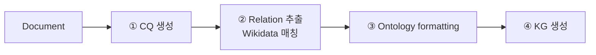

# S26B — Wikidata 스키마에 묶기

> Ch.7 LLM 기반 온톨로지 구축 · Day 13
> 원자료: DSBA Lab Study 강의 슬라이드 중 `03 Ontology-grounded KGC` · `04 Conclusion` (덱 21~33쪽)
> 참고 논문
> · Feng, Wu, Meng (2024), _Ontology-grounded Automatic Knowledge Graph Construction by LLM under
>   Wikidata Schema_, Human-Interpretable AI Workshop @ KDD 2024
>
> 📖 [강의 목차](README.md) · [YouTube 재생목록](https://www.youtube.com/watch?v=f0WV7b3lGqM&list=PLFHGWfB_kmrs)
> 이전 [S26A CodeKGC](S26A-CodeKGC-코드-구조에-묶기.md) · 다음 S27 KGOE 가속화
> 📎 부록 [S26-1 읽는 데 필요한 것들](S26-1-읽는-데-필요한-것들.md) · [S26-2 무엇에 묶느냐가 정한다](S26-2-무엇에-묶느냐가-정한다.md)

**한 회차를 두 문서로 나눴다.** [S26A](S26A-CodeKGC-코드-구조에-묶기.md)가 도입부와 CodeKGC를,
이 문서가 Wikidata 스키마 논문과 회차 결론을 다룬다.

예문은 `Douglas Adams was an author, humourist, and screenwriter`로 이어진다.

---

## 1. Why Wikidata

LLM을 KGC에 직접 사용하는 경우의 문제가 셋이다.

1. 통일된 schema가 부재하다
2. 학습 데이터의 편향으로 특정 도메인에 대한 커버가 부족할 수 있다
3. 기존 KB와 정합되지 않아 표준 온톨로지와 misalignment가 생긴다

**핵심 아이디어는 Wikidata schema 기반 ontology에 grounding하는 것이다.** LLM의 추론력과
Wikidata의 구조화된 schema를 결합한다.



얻는 것은 redundancy 감소, interpretability 확보, Wikidata와의 상호운용성이다. 최소한의 개입으로
확장 가능한 KGC 파이프라인을 만드는 것이 목표다.

## 2. ① Competency Question 생성

CQ는 해당 문서로 답할 수 있는, 도메인의 핵심 정보를 묻는 질문이다. `Douglas Adams의 출생일은?`
같은 것이다.

- LLM에게 문서를 주고 CQ와 answer를 생성하도록 한다
- 문서당 최대 3개의 CQ-A pair를 생성한다
- **KG 구축 범위를 문서 안의 실제 지식으로 한정한다**
- 사용자가 새 CQ를 추가하여 ontology를 점진적으로 확장할 수 있다

프롬프트는 문서를 주고 추상 수준 개념에 기반해 질문을 쓰게 하며, 문서만으로 답할 수 있는 질문을
문서당 최대 3개까지 쓰도록 형식을 고정한다.

## 3. ② Relation 추출과 Wikidata 매칭

핵심 목표는 CQ에서 relation을 추출해 Wikidata 표준 property에 정합시키는 것이다.

| 단계 | 하는 일 |
|---|---|
| Step 1 Relation 추출 | CQ에서 relation과 usage(relation에 대한 설명)를 추출한다. 예: `(date of birth, The date on which the subject was born.)` — Wikidata 편집 가이드라인 형식으로 서술한다 |
| Step 2 후보 준비 | Wikidata 전체 property에서 외부 DB/KB ID 관련 property를 필터링한다 |
| Step 3 Vector Similarity 매칭 | property 설명을 sentence embedding으로 표현하고, 추출 relation과 후보 property 간 유사도를 검색해 각 relation당 top-1 후보를 찾는다 |
| Step 4 LLM judge | top-1 후보가 의미상 동일한지 LLM이 판단한다. `nationality ↔ country of citizenship → Yes!` 이면 채택한다 |

매칭에 실패한 경우는 두 조건으로 갈린다. **확장 허용**이면 새로운 relation을 온톨로지에 추가하고,
**확장 불허**면 버린다. 이 갈래가 뒤의 실험 조건(constrained / no constraint)이 된다.

## 4. ③ Ontology Formatting

매칭된 혹은 신규 relation을 공식 OWL 온톨로지로 정형화한다.

- Wikidata와 매칭된 property는 Wikidata의 description·domain·range를 복사한다
- 신규 property는 LLM이 domain·range에 해당하는 class를 생성한다

```turtle
wdt:Occupation  a  wikibase:Property ;
    schema:description  "The occupation of a person" ;
    rdfs:domain  wd:human ;
    rdfs:range   wd:occupation .
```

읽는 법은 이렇다. 직업은 하나의 property이고, description이 그 설명이며, domain은 주어가 될 수
있는 대상(`wd:human`), range는 값이 될 수 있는 종류(`wd:occupation`)다.

출력은 완전한 OWL 온톨로지이고 Wikidata semantic을 따른다.

## 5. ④ KG Construction

온톨로지에 근거해 KG(RDF triple)를 생성한다.

- 각 (CQ, A) pair에 대하여 LLM이 관련 entity를 추출한다
- 추출한 entity를 온톨로지에 정의된 property로만 매핑한다
- 최종 출력은 RDF triple의 집합, 곧 최종 KG다

핵심 제약이 둘이다.

- **온톨로지에 없는 property는 사용하지 않는다**
- **문서와 QA에 없는 내용은 생성을 금지한다**

```turtle
wd:Douglas_Adams  rdfs:label  "Douglas Adams"@en ;
    wdt:Occupation  wd:writer ;
    wdt:Occupation  wd:comedian ;
    wdt:Occupation  wd:screenwriter .
```

## 6. 실험 설정

| 데이터셋 | relation 수 | 비고 |
|---|---:|---|
| Wiki-NRE | 45 | |
| SciERC | 7 | Wikidata 기반은 아니지만 Wikidata에 없는 relation을 포함하기에 추가했다 |
| WebNLG | 159 | |

- **Backbone** — Mistral-7B-instruct, GPT-4o
- **평가 지표** — KG triple 기반 partial F1
- **Baseline** — Non-LLM(각 데이터셋에 맞춰 학습된 fine-tuned SOTA), LLM(기존 KG 구축 방법론 결과)
- **평가 조건** — Target schema constrained(Wikidata에만 있는 property 생성) /
  No schema constraint(매칭 결과를 필터링하지 않아 Wikidata에 없는 property도 생성 가능)

## 7. 결과

| Method | Wiki-NRE | SciERC | WebNLG |
|---|---:|---:|---:|
| Non-LLM Baseline | 0.484 | 0.532 | **0.767** |
| LLM Baseline | 0.647 | 0.07 | 0.728 |
| Proposed (Mistral) | 0.66 / 0.60 | 0.73 / 0.58 | 0.74 / 0.68 |
| Proposed (GPT-4o) | **0.71** / N/A | **0.77** / N/A | 0.76 / N/A |

슬래시 앞이 constrained, 뒤가 no constraint다.

- constrained 세팅에서 Wiki-NRE와 SciERC는 baseline을 상회하고 WebNLG는 경쟁력을 유지한다
- 특히 SciERC(Wikidata 비호환 relation 포함)에서 큰 우위를 보인다
- GPT-4o 사용 시 추가적인 성능 향상이 있다. 다만 no constraint 조건은 실험하지 않았다 (비용 문제)

## 8. 논의

**constrained와 no constraint의 성능 차이는 무엇인가.** no constraint가 constrained보다 낮게
나오는데 이것은 성능 저하가 아니다. no constraint가 더욱 풍부한 온톨로지를 발견하기 때문에,
테스트셋의 좁은 relation 목록을 기준으로 채점하면 감점되는 것이다. 스키마의 완전성과 목표 스키마
준수 사이의 trade-off이고, 후자를 택하면 문서의 고유한 지식을 놓친다.

**KG의 활용도.** LLM의 응답을 검증 가능하게 만들어 hallucination에 대응할 수 있고, Wikidata와
상호 운용이 가능하다.

**계산 자원.** 문서당 LLM 3회 호출에 relation당 1회 호출이 더해진다. 가장 작은 규모의
Mistral-7B조차 T5 계열 baseline보다 10배 이상 크다. GPT-4o의 no constraint 조건을 실험하지 않은
이유가 여기 있다.

## 9. 정리

**기여** — LLM 생성을 Wikidata 기반 ontology에 grounding해 일관되고 해석 가능하며 상호운용되는
KG를 만든다. 네 단계는 CQ 생성으로 지식 범위를 확정하고, Relation 추출과 Wikidata 매칭으로 표준
property로 정규화하며, Ontology Formatting으로 OWL 온톨로지를 authoring하고, KG Construction으로
온톨로지에 근거해 RDF triple을 생성하는 것이다.

**논의** — triple 생성뿐 아니라 재사용 및 검증 가능한 ontology와 KG 생성이 가능하다. LLM 호출
비용에 대한 고민은 추가로 필요하다 (fine-tuning, guided decoding 등).

## 10. 회차 결론 — 무엇에 묶을 것인가

`LLM의 자유 생성(free generation)을 무언가에 묶는다(grounding)`가 이 회차의 한 줄이다.

| | 논문 1: CodeKGC | 논문 2: Wikidata schema |
|---|---|---|
| Grounding | 표현 (Representational) | 의미 (Referential) |
| 무엇에 묶는가 | 코드 구조 (Python class) | 외부 온톨로지 (Wikidata) |
| 해결하는 문제 | 구조 손실 (overlapping) | 표준 부재 (redundancy·정합) |
| 스키마 취급 | 주어진 것으로 가정 | 스스로 authoring |
| 핵심 강점 | 구조적 정확도 (fidelity) | 상호운용·해석가능성 |

공통 원리는 **생성을 통제 가능한 대상에 제한한다**는 것이다. 무엇에 grounding하느냐가 곧 무엇을
잘하게 될지를 결정한다.

---

## 관련 문서

- 앞 본편 — [S26A CodeKGC: 코드 구조에 묶기](S26A-CodeKGC-코드-구조에-묶기.md)
- 부록 — [S26-1 읽는 데 필요한 것들](S26-1-읽는-데-필요한-것들.md) ·
  [S26-2 무엇에 묶느냐가 정한다](S26-2-무엇에-묶느냐가-정한다.md)
