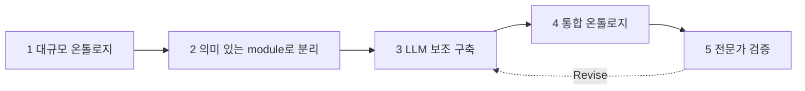
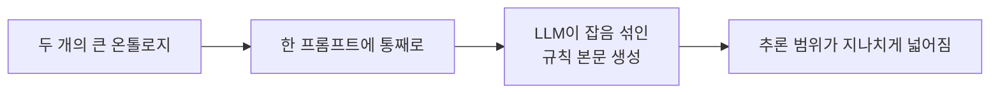
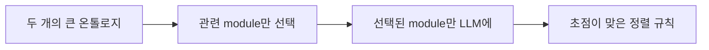
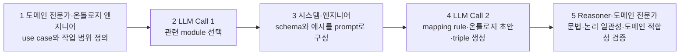

# S27A — 모듈로 쪼개 범위를 좁히기

> Ch.7 LLM 기반 온톨로지 구축 · Day 14
> 원자료: DSBA Lab Study 강의 슬라이드 중 `01 Introduction` · `1st Paper` (덱 1~30쪽, 2026-08-31)
> 참고 논문
> · Shimizu, Hitzler (2024), _Accelerating Knowledge Graph and Ontology Engineering with Large
>   Language Models_ ([arXiv:2411.09601](https://arxiv.org/abs/2411.09601))
>
> 📖 [강의 목차](README.md) · [YouTube 재생목록](https://www.youtube.com/watch?v=f0WV7b3lGqM&list=PLFHGWfB_kmrs)
> 이전 [S26B Wikidata 스키마](S26B-Wikidata-스키마에-묶기.md) · 다음 [S27B OntoEKG](S27B-OntoEKG-기업-온톨로지-구축.md)
> 📎 부록 [S27-1 읽는 데 필요한 것들](S27-1-읽는-데-필요한-것들.md) · [S27-2 Ch.7이 남긴 것](S27-2-Ch7이-남긴-것.md)

**한 회차를 두 문서로 나눴다.** 이 문서가 도입부와 첫째 논문을, S27B가 둘째 논문과 회차 결론을
다룬다.

> 덱 표지가 이 회차를 `LLM 기반 온톨로지 구축 ⑦`로 적는데 챕터 안 순서로는 다섯째다. 영상 제목도
> ⑤로 되어 있다. 원표기를 남긴다.

---

## 1. Ontology Engineering의 간극

| 간극 | 무엇이 벌어져 있나 |
|---|---|
| Human ↔ Machine | 사람이 아는 것과 기계가 처리할 수 있는 형식 |
| Natural Language ↔ Logic | 자연어 서술과 형식 논리 |
| Local ↔ Enterprise | 부서 단위의 용어와 전사 공통 어휘 |

두 논문의 공통 해법이 LLM 기반 온톨로지 구축이다. 개념 추출, 관계 정의, 계층 구성, 공리 정의,
온톨로지 검증에 LLM을 붙인다.

## 2. RDF · RDFS · OWL — 표현력의 세 층

**RDF**는 모든 지식을 (주어, 서술어, 목적어) 3개짜리 문장으로 쪼개서 표현하는 가장 기본적인
데이터 모델이다.

```
"이우준, 이한결, 김선민은 강필성 교수님의 지도를 받는다"
(이우준, advised_by, 강필성) · (이한결, advised_by, 강필성) · (김선민, advised_by, 강필성)
```

한계는 `advised_by`가 어떤 의미와 제약을 갖는 관계인지를 RDF만으로 표현할 수 없다는 것이다.

**RDFS**는 RDF 위에 클래스 계층과 속성의 domain/range 두 가지를 추가해 기본적인 추론을
가능하게 한다.

```
PhDStudent  rdfs:subClassOf  Researcher
written_by  rdfs:domain  Paper ;  rdfs:range  Researcher
```

`(naPINN, written_by, 김한결)`이 있으면 written_by의 domain이 Paper이므로 naPINN이 Paper라는
결론이 나온다. 한계는 복잡한 논리(AND, OR, NOT, 존재 제약)를 이용한 추론이 불가능하다는 것이다.

**OWL**은 RDFS에 네 가지 요소를 추가해 더 복잡한 논리적 추론을 가능하게 한다.

| 종류 | 역할 | 예시 |
|---|---|---|
| EquivalentClass | 조건으로 클래스를 정의 | pub_year 있는 Paper = RecentPaper |
| FunctionalProperty | 값의 유일성 강제 | 논문 제목은 하나만 |
| some / only | 존재·전칭 제약 | 최소 1명 참여, 참여자는 전부 Researcher |
| disjointWith | 클래스 간 배타성 선언 | JournalPaper ≠ ConferencePaper |

## 3. Ontology Engineering이란

자연어로 표현된 도메인 지식을 컴퓨터가 처리하고 추론할 수 있도록 RDF/OWL 등의 형식으로
구조화하는 과정이다.

```
민감 데이터는 일반 데이터 자산의 한 종류다.
직원이 데이터 자산에 접근하려면 접근 요청이 필요하며, 데이터 담당자의 승인이 필요하다.

1. 개념 정의        2. 관계 정의                              3. OWL 구조화
Employee            AccessRequest — requestedBy → Employee     DataSteward ⊑ Employee
DataSteward         AccessRequest — targetsAsset → DataAsset   SensitiveDataAsset ⊑ DataAsset
DataAsset           AccessRequest — approvedBy → DataSteward   AccessRequest ⊑
SensitiveData                                                    requestedBy some Employee
AccessRequest                                                    and targetsAsset some DataAsset
                                                                 and approvedBy some DataSteward
```

## 4. Why LLM

- 기존 온톨로지 구축은 주로 도메인 전문가와 온톨로지 엔지니어의 수작업에 의존한다. 도메인
  전문가는 업무 의미를 알지만 OWL과 논리 모델링에 익숙하지 않을 수 있고, 온톨로지 엔지니어는
  형식 논리를 알지만 기업 업무의 세부 의미는 모를 수 있다. 두 전문가가 문서를 함께 검토해야
  하므로 작업이 느리고 비용이 크다
- Rule-based 자동화 방식은 도메인 변화에 취약하다. 새로운 개념과 규칙을 추가하면서 전체 구조가
  충돌하지 않는지 확인이 필요한데, 실제 온톨로지는 수백에서 수만 개 class와 property를 포함할 수
  있어 기존 자동화 방식에 부담이 크다
- LLM을 활용하는 이유는 초기 온톨로지를 만드는 비용을 크게 줄일 수 있기 때문이다. 반복적인 후보
  추출과 초안 작성을 자동화해 전문가가 중요한 모델링 판단에 집중하도록 만드는 것이 목표다

| 기존 한계 | LLM의 이점 |
|---|---|
| 사람이 문서를 모두 읽어야 함 | 문서에서 개념과 관계 후보를 빠르게 추출 |
| 표현이 바뀌면 규칙을 수정해야 함 | 다양한 자연어 표현을 의미적으로 해석 |
| 도메인마다 별도 모델이 필요함 | prompt와 예시를 통해 새로운 도메인에 적용 |
| OWL/RDF 작성에 전문 지식 필요 | JSON, RDF, OWL 형태의 초안 생성 |
| 온톨로지 정렬이 어려움 | 개념 설명을 비교해 대응 관계 후보 생성 |

## 5. LLM의 약점

- 문서에 존재하지 않는 class 또는 property를 그럴듯하게 생성할 수 있다
- 자연어의 의미를 이해하더라도 OWL의 논리적 일관성을 보장하지 못한다
- class와 individual의 차이 또는 개념의 적절한 추상화 수준을 판단하기 어렵다
- 전체 온톨로지처럼 많은 정보를 한 번에 제공하면 관련 정보를 정확히 선택하기 어렵다
- 동일한 입력과 prompt를 사용하더라도 결과가 달라질 수 있다

LLM은 온톨로지 후보를 빠르게 생성하는 데 강하지만 범위 설정과 논리적 정확성을 보장하는 데
약점이 있다.

## 6. 두 논문의 약점 완화 방식

| | 방식 |
|---|---|
| Paper 1 | 대규모 온톨로지 전체를 한 번에 제공하면 불필요한 정보가 늘어난다. 온톨로지를 Person, Organization, Event 등 의미 있는 module 단위로 분리하고, 현재 작업과 관련된 module을 먼저 선택한 후 해당 정보만 LLM에 제공한다. 제한된 class와 property 안에서 모델링·정렬·추출을 수행하게 한다 |
| Paper 2 | 문서에서 완성된 온톨로지를 한 번에 생성하도록 하지 않는다. 구축 과정을 개념 추출, 계층 추론, RDF 변환 단계로 분리하고 LLM별로 역할을 나눠 정해진 작업만 수행하게 한다. RDF 생성은 LLM이 아닌 rdflib으로 처리해 문법 오류를 줄인다 |

전자는 **LLM이 참고하는 지식의 범위를 좁히려는 것**이고 후자는 **LLM의 역할과 출력 형식을
단계별로 제한하려는 것**이다.

## 7. 첫째 논문 — 다섯 단계 개요



대규모 온톨로지를 한 번에 LLM에 제공하지 않고 의미 있는 module로 나누어 KGOE 작업을 수행한다.
전문가 검증 항목은 Coverage, Hierarchy, Relations, Consistency, Missing Links, Ambiguities이고
결과는 Approve 또는 Revise다.

다루는 KGOE 작업이 다섯이다.

| Task | 내용 |
|---|---|
| Ontology Modeling | 도메인의 핵심 개념, 관계, 계층, 제약을 정의하여 새로운 온톨로지를 설계 |
| Extension & Modification | 새로운 요구사항이나 지식을 반영하여 기존 온톨로지의 개념과 관계를 추가·수정 |
| Ontology Alignment | 서로 다른 온톨로지에서 동일하거나 관련된 개념과 관계 사이의 대응 관계를 파악 |
| Ontology Population | 문서나 데이터베이스에서 실제 개체와 관계를 추출하여 온톨로지 기반 KG에 추가 |
| Entity Disambiguation | 이름이 같거나 표현이 다른 개체가 동일한 대상인지 구분하고 연결 |

## 8. KGOE는 왜 어려운가

- 온톨로지 구축과 유지에 도메인 전문가의 반복적인 판단이 필요하다
- 온톨로지마다 별도의 규칙과 스크립트를 작성해야 하는 경우가 많다
- 수백 개 class만 존재해도 property와 OWL axiom까지 고려하면 인간과 LLM 모두 전체 구조를 한 번에
  처리하기 어렵다
- LLM이 초안 생성을 가속할 수 있지만 전문가 검증 없이 결과를 신뢰하기 어렵다

**KGOE에서의 병목은 정보 추출이 아니라 대규모 온톨로지 구조를 일관되게 설계하고 관리하는 데
있다.**

실제 온톨로지의 규모가 근거다.

| Ontology | Class 수 | Triple 수 |
|---|---:|---|
| KnowWhereGraph | 약 300 | 약 280억 |
| DBpedia Core | 약 800 | 약 9억 |
| ENVO | 2,100 이상 | |
| Gene Ontology | 40,000 이상 | |
| Wikipedia hierarchy | 200만 이상 | |

## 9. Modularity가 필요한 이유

대규모 온톨로지 전체를 LLM에 제공하면 관련 없는 정보까지 함께 처리해 잘못된 개념과 관계를
선택할 가능성이 커진다.



정렬 규칙을 만들 때 관련 있는 조건(River, flowsThrough, Wetland)과 무관한 조건(Person, bornIn,
publication, Vehicle, Company)이 섞여 들어가고, 핵심 부분그래프 대신 관련 없는 후보가 잔뜩 붙는다.

모듈을 먼저 고르면 이렇게 바뀐다.



현재 작업과 관련된 개념과 관계만 제공해 LLM의 판단 범위를 줄이고 결과의 정확성과 일관성을 높인다.

## 10. Ontology Modules

모듈이란 특정 use case 또는 도메인의 핵심 notion을 중심으로 관련 class, property, axiom을 모은
온톨로지의 부분집합이다. 하나의 모듈 안에 다른 모듈이 포함될 수 있으며, 도메인과 use case에 따라
모듈은 유동적으로 바뀔 수 있다.

Person module, Organization module, Event module, Place module 같은 것들이다.

## 11. 제안하는 작업 흐름



5단계의 검증은 셋이다. 문법 검증(Syntax Check), 논리적 일관성 검증(Logical Consistency Check),
도메인 적합성 검토(Domain-fit Review). 결과는 통과 또는 보완 필요다.

## 12. 네 가지 Use Case

관련 module을 선택해 LLM이 작업할 범위를 구성한 뒤, 실제로 수행하는 KGOE task에 따라 LLM의 작업과
출력이 달라진다. Task는 달라도 관련 module만 context로 제공하고 LLM의 결과를 전문가가 검증한다는
공통 원리를 쓴다.

| KGOE Task | LLM이 수행하는 작업 | 주요 출력 |
|---|---|---|
| Modeling·Extension·Modification | 개념·관계·axiom을 설계하거나 기존 module을 수정 | Ontology / OWL Draft |
| Ontology Alignment | 서로 다른 ontology의 개념과 관계를 연결 | Mapping / Alignment Rule |
| Ontology Population | 텍스트에서 schema에 맞는 entity와 relation을 추출 | RDF / ABox Triples |
| Entity Disambiguation | 서로 다른 표현이 동일한 entity를 가리키는지 판단 | Identity Decision / Score |

**[1] Modeling/Extension/Modification** — LLM 입력은 자연어 요구사항과 기존 온톨로지·모듈이고,
LLM은 핵심 개념을 식별하고 계층 구조를 정의하며 class·property·axiom을 수정한다. 출력은 새로
생성되거나 수정된 OWL 모듈 초안이다.

**[3] Ontology Population** — LLM 입력은 자연어 문서, 관련 모듈의 schema, RDF triple 추출
예시다. LLM은 실제 entity를 식별하고 각 entity를 ontology class에 연결하며 문장의 관계를 모듈
속성에 연결한다. 출력은 Ontology Schema에 맞는 RDF Triples다.

**[4] Entity Disambiguation** — 서로 다른 이름이나 설명으로 표현된 두 entity가 실제로 동일한
대상을 의미하는지 판단한다. 이름뿐 아니라 속성, type, 주변 관계를 함께 비교한다. 입력은 비교할
두 Entity 정보, 관련 Ontology 모듈, 비교에 사용할 주요 속성이고 출력은 Entity Identity Decision이다.

## 13. 실험 — Ontology Alignment와 Population

**Complex Ontology Alignment**

- Dataset은 해양학 분야의 GeoLink 벤치마크(40~150개의 클래스)다
- 방법은 온톨로지 전체를 프롬프트에 넣는 방식과 본 논문에서 제안한 모듈화 방식을 비교하는 것이다
- **대조군은 완전히 실패하여 사용할 수 없는 결과를 냈지만, 제안 방식은 총 109개의 Target mapping
  중 104개(95%)를 정확히 식별했다**

**Ontology Population**

- 자연어 텍스트에서 정보를 추출하여 온톨로지 구조에 맞는 Triple 데이터로 변환하는 실험이다
- 모듈의 스키마 표현과 Few-shot Example을 포함한 프롬프트를 사용하여 모듈 단위로 정보를 추출한다
- 약 90%의 Triple 추출 성공률을 보인다

## 14. 한계

1. **모듈 정의와 구성 기준이 명확하지 않다.** 모듈의 경계가 도메인 전문가와 use case에 따라
   달라지고, 어떤 크기와 구성이 LLM에 가장 효과적인지 정량적인 기준이 없다
2. **기존 Modular Ontology가 필요하다.** 문서에서 모듈을 자동 생성하는 방법은 제시되지 않으며,
   모듈을 설계하고 유지하는 전문가 비용이 별도로 필요하다
3. **통제된 비교 실험이 부족하다.** 다양한 온톨로지, 도메인, LLM에서 결과가 재현되는지 확인되지
   않았다

---

## 관련 문서

- 이어지는 본편 — [S27B OntoEKG: 기업 온톨로지 구축](S27B-OntoEKG-기업-온톨로지-구축.md)
- 부록 — [S27-1 읽는 데 필요한 것들](S27-1-읽는-데-필요한-것들.md) ·
  [S27-2 Ch.7이 남긴 것](S27-2-Ch7이-남긴-것.md)
