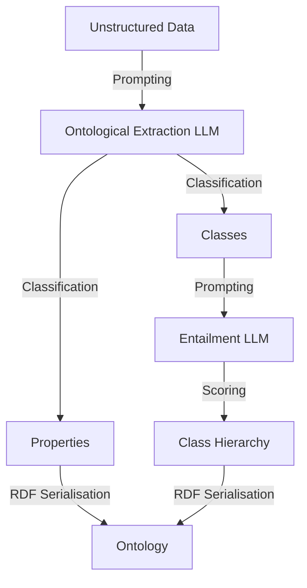

# S27B — OntoEKG: 기업 온톨로지 구축

> Ch.7 LLM 기반 온톨로지 구축 · Day 14
> 원자료: DSBA Lab Study 강의 슬라이드 중 `2nd Paper` · `04 Conclusion` (덱 31~42쪽)
> 참고 논문
> · Oyewale, Soru (2026), _LLM-Driven Ontology Construction for Enterprise Knowledge Graphs_,
>   Liber AI Research ([arXiv:2602.01276](https://arxiv.org/abs/2602.01276))
>
> 📖 [강의 목차](README.md) · [YouTube 재생목록](https://www.youtube.com/watch?v=f0WV7b3lGqM&list=PLFHGWfB_kmrs)
> 이전 [S27A 모듈로 쪼개 범위를 좁히기](S27A-모듈로-쪼개-범위를-좁히기.md) · 다음 S28 REBEL 관계 추출
> 📎 부록 [S27-1 읽는 데 필요한 것들](S27-1-읽는-데-필요한-것들.md) · [S27-2 Ch.7이 남긴 것](S27-2-Ch7이-남긴-것.md)

**한 회차를 두 문서로 나눴다.** [S27A](S27A-모듈로-쪼개-범위를-좁히기.md)가 도입부와 첫째 논문을,
이 문서가 둘째 논문과 회차 결론을 다룬다.

---

## 1. Motivation

- 기업 데이터가 문서, DB, API, 시스템에 분산되어 있는데 부서마다 동일한 개념을 서로 다른 용어로
  표현한다
- 따라서 공통 ontology가 필요한데 기존 구축 방식은 도메인 전문가와 엔지니어의 수작업에 의존한다
- 문서가 증가할수록 scope와 개념의 일관성을 유지하기 어렵다

기존 벤치마크로는 이 문제를 잴 수 없다는 것이 이 논문의 출발점이다.

| Benchmark | 주요 Task | 본 논문 평가에 부족한 점 |
|---|---|---|
| OntoURL | 주어진 class·property 목록 활용 | 비정형 문서에서의 추출 과정이 없다 |
| Text2KGBench | Schema 기반 triple 추출 | Ontology가 아닌 instance extraction 중심 |
| OSKGC | Ontology-constrained KG construction | 기존 ontology 안에서 KG를 구성한다 |
| LLMs4OL | Text2Onto, taxonomy discovery | Task가 end-to-end로 연결되지 않는다 |
| LLMs4OL Task C | Class 및 taxonomy 판단 | Class와 individual이 혼재한다 |

**비정형 문서에서 class·property를 추출하고 hierarchy를 구성하는 전체 pipeline을 평가할
benchmark가 부족하다.**

## 2. 방법 — OntoEKG 파이프라인

비정형 기업 데이터를 RDF 기반의 도메인별 Ontology로 자동 변환하기 위한 LLM 기반 2단계
Pipeline이다. 추출(Extraction)과 함의(Entailment)라는 두 개의 모듈로 구성된다.

Pipeline은 크게 4단계다.

## 3. [1] 데이터 입력 및 모델 정의

- 입력된 비정형 데이터로부터 출력 결과가 구조적으로 보장될 수 있도록 **Pydantic**을 사용하여
  엄격한 데이터 모델을 정의한다
- 이를 통해 LLM이 클래스, 속성, Domain, Range를 포함한 유효한 JSON 형태를 출력하도록 강제한다

## 4. [2] 온톨로지 요소 추출

Ontological Extraction LLM이 텍스트에서 두 가지 요소를 식별한다.

1. **클래스(Classes)** — `직원` 또는 `차량`과 같은 Entity를 의미한다
2. **속성(Properties)** — `operates` 또는 `hasAccessTo`와 같은 Entity 간의 관계를 의미한다

## 5. [3] 함의를 통한 계층 구조 구축

- 추출한 개념들 사이의 부모–자식 관계를 설정하여 Taxonomy를 만드는 과정이다
- Entailment LLM이 두 클래스의 정의와 설명을 비교 분석한다. Apple의 설명과 Fruit의 설명을
  대조하여 `Apple은 Fruit에 포함되는가?`라는 논리적 함의(Entailment)를 판단한다
- LLM Reasoning을 통해 반복적으로 클래스 쌍을 분석하여 논리적 모순이 없는 계층 구조를 도출한다

## 6. [4] RDF 직렬화

완성된 온톨로지를 컴퓨터가 처리할 수 있는 표준 데이터 형식으로 만드는 과정이다.

1. **데이터 통합(Merge)** — 추출한 Properties 정보와 Hierarchy를 하나의 모델로 합친다
2. **표준 규격 변환(Map)** — rdflib 라이브러리를 사용하여 데이터를 RDF 형식으로 변환한다
3. **최종 파일 저장(Save)** — 컴퓨터가 즉시 처리 가능한 Turtle(.ttl) 파일 형식으로 최종
   온톨로지를 저장한다

Data use case에서 생성된 온톨로지는 `DataAsset`을 중심에 두고 `RegulatoryStandard`,
`AnalyticsPlatform`, `Contractor`, `Employee`, `Policy`, `ThirdParty`, `GovernanceStandard`,
`SecurityPrinciple`, `StructuredDatabase`, `UnstructuredFile`이 `appliesTo`·`hasAccessTo`·
`isTypeOf`·`maintains` 등으로 연결된 형태다.

## 7. 실험

| | 내용 |
|---|---|
| 실험 환경 | Google Colab |
| 요소 추출 | Google Gemini 1.5 Flash |
| 계층 추론 | Anthropic Claude 3.5 Opus |
| Dataset | 기존 벤치마크 부재로 자체 데이터셋 구축 (Data, Finance, Logistics 3개 산업 분야) |
| 구성 | 실제 기업 내부에서 사용하는 정책 문서의 발췌본(비정형 문장) |

> 계층 추론 모델명이 슬라이드에 `Anthropic Claude 3.5 Opus`로 적혀 있다. 원표기를 남긴다.

평가 방식은 정답과 100% 일치 여부를 따지는 Extract Match와 임베딩 유사도를 측정하는 Fuzzy Match
두 가지다.

## 8. 결과

**TABLE I — Exact Match**

| Use case | Precision | Recall | F1 |
|---|---:|---:|---:|
| Data | 0.083 | 0.133 | 0.102 |
| Finance | 0.000 | 0.000 | 0.000 |
| Logistics | 0.040 | 0.062 | 0.048 |

**TABLE II — Fuzzy Match**

| Use case | Precision | Recall | F1 |
|---|---:|---:|---:|
| Data | 0.656 | 0.807 | **0.724** |
| Finance | 0.095 | 0.166 | 0.121 |
| Logistics | 0.366 | 0.523 | 0.431 |

- 제안 방식이 Data 도메인에서 우수한 성능을 보인다
- Finance 도메인은 특히 저조한 성능을 보인다
- **모든 도메인에서 Exact Match 점수가 매우 낮다.** 이는 LLM이 정답과 동일한 의미를 지니더라도
  다른 단어를 선택하기 때문이다

## 9. 결론과 한계

**기여**

- Enterprise text에서 ontology를 생성하는 단계별 pipeline을 제안한다
- Extraction과 hierarchy reasoning을 분리한다
- Pydantic schema를 사용해 구조적 출력을 안정화한다
- End-to-end ontology construction benchmark의 공백을 지적한다

**한계**

- 3개 use case만 사용하여 일반화 가능성을 판단하기 어렵다
- Fuzzy Match가 hierarchy와 logical consistency를 평가하지 못한다
- 최종으로 생성된 온톨로지에 논리적 모순이 있는지 검사하는 단계가 없다

## 10. 회차 결론

- Ontology Engineering은 자연어로부터 온톨로지의 구성 요소인 class, property, hierarchy, axiom으로
  구조화하는 과정이다
- LLM을 활용하면 ontology 구축, 정렬, population 등의 초안을 빠르게 생성할 수 있다
- **LLM은 의미적 후보 생성에는 강하지만 scope 설정과 논리적 일관성을 보장하지 못한다**
- 따라서 LLM의 작업 범위를 제한하고 전문가의 검증을 결합해야 한다

---

## 관련 문서

- 앞 본편 — [S27A 모듈로 쪼개 범위를 좁히기](S27A-모듈로-쪼개-범위를-좁히기.md)
- 부록 — [S27-1 읽는 데 필요한 것들](S27-1-읽는-데-필요한-것들.md) ·
  [S27-2 Ch.7이 남긴 것](S27-2-Ch7이-남긴-것.md)
