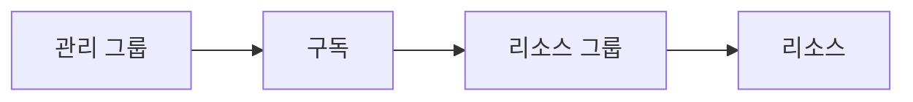

# ID·거버넌스

시험 영역 중 ID·거버넌스 관리(20~25%)에 해당하는 내용이다.

## Entra ID 인증과 동기화

### RBAC와 조건부 액세스

둘은 묻는 질문이 다르다.

| 구분 | 묻는 것 | 예 |
|---|---|---|
| RBAC(IAM) | 이 사용자가 이 리소스에 이 작업을 할 수 있는가 | VM을 끌 수 있는가 |
| 조건부 액세스 | 이 사용자가 지금 안전한 조건에서 로그인하는가 | 회사 기기인가, 위험한 로그인인가 |

### 조건부 액세스 정책 구조

정책은 할당과 액세스 제어로 나뉜다. 할당은 누가, 어떤 앱에, 어떤 조건에서 로그인하는지를 정한다. 액세스 제어는 그때 무엇을 요구할지를 정한다.

Grant Control은 로그인을 허용하기 전에 통과해야 할 요구 사항을 정하는 곳이다. 다음 조건은 모두 Grant Control에서 설정한다.

- 다단계 인증(MFA) 요구
- 디바이스가 규정 준수로 표시되어야 함
- Microsoft Entra 하이브리드 조인 디바이스 요구
- 승인된 클라이언트 앱, 앱 보호 정책 요구

MFA를 강제하거나 회사 기기로만 접속하게 하라는 문제는 Grant Control이 답이다.

### 온프레미스 AD 동기화

Entra Connect의 기본 동기화 주기는 30분이다. 새로 만든 계정을 바로 올리려면 Entra Connect 서버에서 델타 동기화를 수동으로 실행한다.

```powershell
Start-ADSyncSyncCycle -PolicyType Delta
```

도메인 컨트롤러의 NetLogon 서비스를 재시작하는 선택지는 함정이다. NetLogon은 온프레미스 도메인 인증용 서비스라서 클라우드 동기화와 관계가 없다.

### 헷갈리는 것

- RBAC는 리소스 작업 권한, 조건부 액세스는 로그인 조건이다
- 즉시 동기화는 Entra Connect 서버에서 실행한다. 도메인 컨트롤러 쪽 작업이 아니다

## 셀프 서비스 암호 재설정(SSPR)

| 사용자 | SSPR | 이유 |
|---|---|---|
| 회원, 클라우드 전용 | 된다 | Entra에만 있는 계정이다 |
| 회원, 온프레미스에서 동기화 | 비밀번호 쓰기 저장이 켜져 있으면 된다 | 바꾼 비밀번호가 온프레미스 AD에 저장된다. 꺼져 있으면 AD가 원본이라 안 된다 |
| 게스트 | 안 된다 | 게스트 비밀번호는 원래 소속 조직(홈 테넌트)이 관리한다 |

## 라이선스 할당

Microsoft 365 같은 라이선스를 할당하려면 사용자의 사용 위치(Usage location)가 먼저 있어야 한다. 나라마다 쓸 수 있는 서비스가 법 규제와 수출 제한 때문에 달라서다. 비어 있으면 할당이 실패하고, 그룹 기반 라이선스에서도 그 사용자만 오류로 남는다. 사용자 유형, 이름, 성, 기타 이메일은 라이선스 조건이 아니다.

## 게스트와 외부 협업

B2B로 초대한 게스트의 UPN은 원래 메일의 `@`를 `_`로 바꾸고 `#EXT#@우리 테넌트 도메인`을 붙인 형식이다. 예: `bsmith_contoso.com#EXT#@fabrikam.com`. UPN에 `#EXT#`가 있으면 게스트다.

| 기능 | 영어 | 정하는 것 |
|---|---|---|
| 외부 협업 설정 | External collaboration settings | 테넌트 전체. 누가 게스트를 초대하나, 게스트가 디렉터리에서 무엇을 보나, 허용·차단 도메인 |
| 테넌트 간 액세스 설정 | Cross-tenant access settings | 상대 조직별. 그 조직의 MFA를 신뢰하나, 그 조직 사용자를 막나 |
| 액세스 검토 | Access reviews | 게스트나 그룹 멤버가 아직 권한이 필요한지 주기적으로 재확인 |
| 조건부 액세스 | Conditional Access | 로그인 때 위치, 기기, MFA 조건 |

게스트 초대자, 사용자 관리자, 전역 관리자만 게스트를 초대하게 하라는 문제는 외부 협업 설정이다. 이 문구가 게스트 초대 제한 옵션 하나와 그대로 같다. 한 사용자가 게스트를 초대하게 하면서 최소 권한이면 그 사용자에게 게스트 초대자 역할을 준다.

## 역할 체계

역할 체계가 둘이다.

| 체계 | 다루는 것 | 역할 예 |
|---|---|---|
| Azure RBAC | Azure 리소스(관리 그룹, 구독, RG, 리소스) | 소유자, 기여자, 읽기 권한자, 청구 읽기 권한자 |
| Entra 역할 | 테넌트의 사용자, 그룹, 앱 | 전역 관리자, 사용자 관리자, 게스트 초대자, 보안 관리자 |

### RBAC 기본 제공 역할

시험 번역이 섞여 나온다. 판독기와 읽기 권한자는 둘 다 Reader다.

| 시험 한국어 | 영어 | 할 수 있는 것 |
|---|---|---|
| 소유자 | Owner | 전부. 다른 사람에게 역할도 할당한다 |
| 기여자 | Contributor | 리소스 생성·변경·삭제. 역할 할당은 못 한다 |
| 읽기 권한자, 판독기 | Reader | 모든 리소스 보기만 |
| 사용자 액세스 관리자 | User Access Administrator | 역할 할당만 |
| 태그 기여자 | Tag Contributor | 태그만. 리소스 자체에는 접근하지 못한다 |
| 청구 읽기 권한자 | Billing Reader | 청구서와 결제 정보 보기 |
| Cost Management 읽기 권한자 | Cost Management Reader | 비용 보기 |
| Cost Management 기여자 | Cost Management Contributor | 비용 보기와 예산 관리 |

| 문제의 요구 | 답 |
|---|---|
| 리소스를 볼 수 있게, 최소 권한 | 읽기 권한자 |
| 모든 리소스를 만들고 관리, 역할 할당은 못 하게 | 기여자 |
| 리소스는 못 바꾸고 비용 보기와 예산 관리 | Cost Management 기여자 |

### 범위와 상속



위에서 준 역할은 아래로 상속된다. 구독 여러 개가 관리 그룹 MG1, MG2에 나뉘어 있으면 두 관리 그룹에 읽기 권한자를 주면 모든 구독의 리소스를 볼 수 있다.

### 사용자 지정 역할

권한은 `Actions`에서 `NotActions`를 뺀 것이다.

```json
"Actions": [
  "Microsoft.Compute/*/read",
  "Microsoft.Compute/snapshots/write",
  "Microsoft.Compute/snapshots/read"
],
"NotActions": [ "Microsoft.Compute/snapshots/delete" ]
```

이 역할로는 모든 Compute 리소스 읽기(VM 설정 포함)와 스냅샷 만들기·읽기가 된다. 스냅샷 삭제는 빠지고, VM을 만드는 `virtualMachines/write`는 없다. `NotActions`는 거부가 아니라 빼기라서 다른 역할이 삭제 권한을 주면 삭제된다. 확실히 막는 건 거부 할당(Deny assignment)이다. `AssignableScopes`는 이 역할을 할당할 수 있는 범위다.

스크립트로 역할을 할당할 때 `Get-AzRoleDefinition -Name`에는 역할 이름을 넣는다. ID를 넣으면 찾는 역할이 없어서 `$Role`이 비고, 이어지는 `New-AzRoleAssignment`가 실패한다.

```powershell
$Role = Get-AzRoleDefinition -Name "CustomRole1"
New-AzRoleAssignment -SignInName user1@contoso.com -RoleDefinitionName $Role.Name -ResourceGroupName RG1
```

ID로 찾으려면 `-Id`를 쓴다. 역할 정의를 만드는 명령은 `New-AzRoleDefinition`이고, `Get-AzRoleAssignment`와 `Set-AzRoleAssignment`는 할당을 다루는 명령이다.

## 리소스 잠금

| 잠금 | 막는 것 |
|---|---|
| 삭제(CanNotDelete) | 삭제만 막는다. 수정은 된다 |
| 읽기 전용(ReadOnly) | 삭제와 수정을 둘 다 막는다 |

잠금은 구독, 리소스 그룹, 개별 리소스에 걸 수 있고 아래로 상속된다. 관리 그룹에는 걸 수 없다. 잠금은 관리 작업(Azure Resource Manager)만 막는다. 스토리지 계정에 삭제 잠금을 걸어도 계정을 못 지울 뿐 안의 Blob은 지울 수 있다. 데이터는 일시 삭제나 불변성 정책으로 지킨다.

## 리소스 태그

태그는 리소스에 붙이는 이름-값 쌍 메타데이터다. 한 리소스 그룹에 여러 부서의 VM이 섞여 있을 때 부서를 구분하는 수단이 태그다.

- Cost Management에서 비용을 태그별로 나눠 볼 수 있다
- 스크립트나 Azure Policy로 특정 환경(Dev, Prod)의 리소스만 골라 다룰 수 있다

### 헷갈리는 것

- 태그는 리소스 그룹에서 리소스로 자동 상속되지 않는다. 상속이 필요하면 Azure Policy의 태그 상속 정책을 따로 건다
- 사용자에게 태그만 붙이게 하라는 문제는 IAM에서 기본 제공 역할인 태그 기여자를 할당한다. `virtualMachines/*/write` 사용자 지정 역할은 VM 설정까지 바꿀 수 있어서 최소 권한이 아니고, 만들기만 해서는 할당되지 않는다. Azure Policy는 태그를 강제하거나 자동으로 붙이는 기능이라 사람에게 권한을 주지 못한다
- 리소스를 부서별로 표시해 보고하라는 문제는 태그다. 이름이 비슷한 것과 구분한다

| 이름 | 묶는 것 | 체계 |
|---|---|---|
| 관리 단위(Administrative unit) | 사용자, 그룹, 기기. 일부에만 관리 권한을 위임한다. 예: 영업부 사용자만 비밀번호를 재설정하는 사용자 관리자 | Entra |
| 관리 그룹(Management group) | 구독. 정책과 RBAC를 상속시킨다 | Azure 리소스 |
| 태그 | 개별 리소스에 이름=값 표시 | Azure 리소스 |
