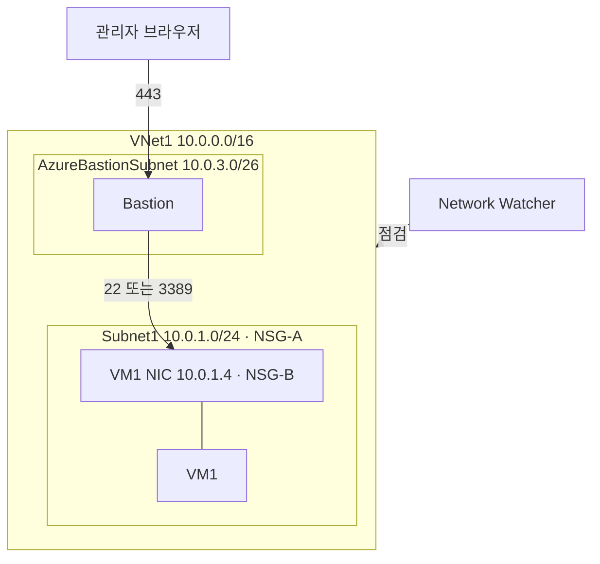
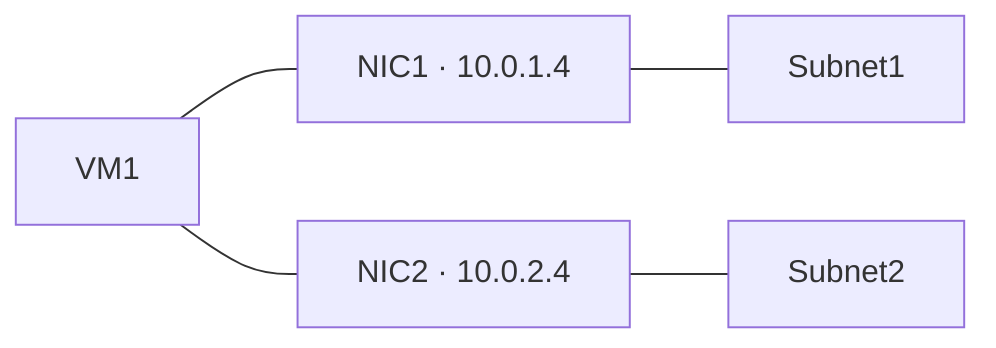
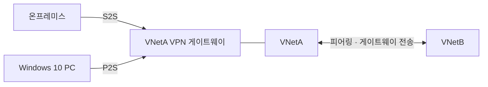
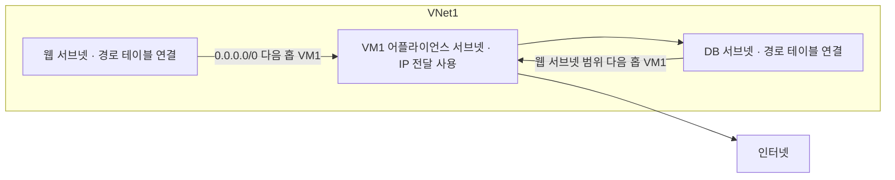
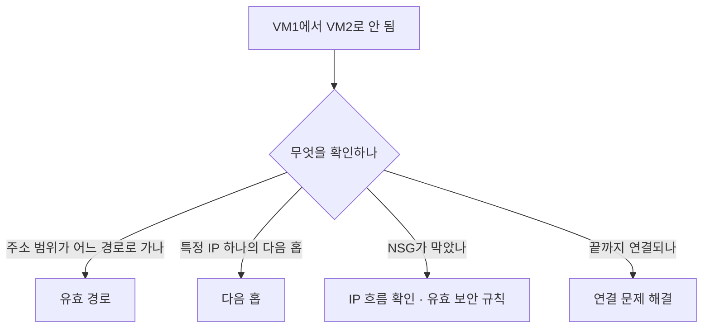

# 가상 네트워킹 1

시험 영역 중 가상 네트워킹 구현·관리(15~20%)에 해당하는 내용이다. 1편은 VNet 구성, 연결, 경로, 진단을 다룬다. 부하 분산은 [2편](가상-네트워킹-2.md)에 있다.

## VNet 구성 요소

| 이름 | 하는 일 | 붙는 곳 |
|---|---|---|
| VNet | 격리된 사설 네트워크 전체 | 구독·리전 |
| 서브넷 | VNet 주소 범위를 잘라 나눈 구역. NSG와 경로 테이블을 여기에 건다 | VNet |
| NIC | VM이 서브넷에 연결되는 가상 랜카드. 사설 IP와 공용 IP는 VM이 아니라 NIC에 붙는다 | VM |
| NSG | 출발지, 목적지, 포트를 보고 허용·거부하는 규칙 목록 | 서브넷이나 NIC |
| Bastion | 관리자가 VM에 RDP·SSH로 들어가는 출입구 | VNet 안 AzureBastionSubnet |
| Network Watcher | 네트워크 진단 도구 모음. 트래픽을 막거나 통과시키지 않는다 | 리전. VNet을 만들면 자동으로 켜진다 |



### NIC 여러 개

NIC 하나는 서브넷 하나에만 속한다. NIC에 IP 구성을 여러 개 넣어도 전부 같은 서브넷 주소다. 그래서 VM을 두 서브넷에 직접 연결하려면 다른 서브넷에 NIC를 하나 더 만들어 붙인다.



- NIC를 추가하려면 VM을 중지(할당 취소)해야 한다. VM 크기마다 붙일 수 있는 NIC 수가 정해져 있다
- 두 NIC는 같은 VNet의 서브넷이어야 한다
- 첫 번째 NIC가 기본 NIC다. 기본 게이트웨이로 나가는 트래픽은 기본 NIC로 나간다
- NSG는 NIC마다 따로 붙일 수 있다

기존 NIC의 IP 구성을 고치는 건 같은 서브넷 안의 일이라 오답이다. IP 그룹은 Azure Firewall 규칙용 IP 묶음이고, Windows 네트워크 브리지는 OS 안의 기능이라 관계없다.

### 주소 범위와 서브넷

10.0.0.0/16 같은 표기를 CIDR라고 한다. IP 주소는 8비트짜리 숫자 4칸이고, 슬래시 뒤 숫자는 앞에서부터 고정하는 비트 수다.

| 표기 | 고정 부분 | 주소 수 | 범위 |
|---|---|---|---|
| 10.0.0.0/16 | 10.0 | 65,536 | 10.0.0.0 ~ 10.0.255.255 |
| 10.0.1.0/24 | 10.0.1 | 256 | 10.0.1.0 ~ 10.0.1.255 |
| 10.0.3.0/26 | 10.0.3과 마지막 칸 앞 2비트 | 64 | 10.0.3.0 ~ 10.0.3.63 |

VNet을 /16으로 크게 잡고 그 안을 /24 같은 서브넷으로 자른다. 서브넷은 VNet 범위 안에 있어야 하고 서로 겹치면 안 된다. 슬래시 뒤 숫자가 클수록 범위가 작다.

Azure는 서브넷마다 주소 5개를 예약한다. 10.0.1.0/24라면 10.0.1.0(네트워크 주소), 10.0.1.1(기본 게이트웨이), 10.0.1.2와 10.0.1.3(Azure DNS), 10.0.1.255(브로드캐스트)를 쓸 수 없다. VM에 줄 수 있는 주소는 10.0.1.4부터 251개다.

같은 VNet 안의 서브넷끼리는 기본으로 통신된다. 서브넷을 나누는 이유는 웹과 DB처럼 구역마다 다른 NSG와 경로를 걸기 위해서다. 정해진 이름의 전용 서브넷이 필요한 서비스도 있다.

| 서브넷 이름 | 들어가는 것 |
|---|---|
| GatewaySubnet | VPN·ExpressRoute 게이트웨이 |
| AzureBastionSubnet | Bastion. 최소 /26 |
| AzureFirewallSubnet | Azure Firewall |

### NSG와 경로 테이블을 붙이는 곳

| 리소스 | 연결 대상 |
|---|---|
| NSG | 서브넷, NIC |
| 경로 테이블 | 서브넷만 |

NSG를 서브넷과 NIC에 둘 다 걸면 들어오는 트래픽은 둘 다 통과해야 한다. VNet에는 NSG를 직접 걸 수 없다. VNet 전체에 같은 규칙을 적용하려면 NSG 하나를 서브넷마다 연결한다. 여러 VNet의 서브넷에 같은 NSG를 연결할 수 있지만 NSG와 서브넷은 같은 리전이어야 한다.

포털의 VM 네트워킹 화면에서도 NSG를 설정할 수 있지만 실제로는 그 VM의 NIC에 연결된다. IP가 VM이 아니라 NIC에 붙는 것과 같다. 그래서 NSG를 연결할 수 있는 리소스를 고르는 문제에서 가상 머신과 가상 네트워크는 오답이다.

PowerShell로 NSG를 만들 때는 두 명령이 필요하다. 이름이 `Config`로 끝나는 명령은 PowerShell 메모리에 설정 객체만 만들고, `Config`가 없는 `New-Az...`가 Azure에 실제 리소스를 만든다.

```powershell
$rdp  = New-AzNetworkSecurityRuleConfig -Name "allow-rdp" -Protocol Tcp -Direction Inbound `
          -Priority 100 -SourceAddressPrefix * -SourcePortRange * `
          -DestinationAddressPrefix * -DestinationPortRange 3389 -Access Allow
$http = New-AzNetworkSecurityRuleConfig -Name "allow-http" -Protocol Tcp -Direction Inbound `
          -Priority 110 -SourceAddressPrefix * -SourcePortRange * `
          -DestinationAddressPrefix * -DestinationPortRange 80 -Access Allow

New-AzNetworkSecurityGroup -Name "NSG1" -ResourceGroupName "RG1" -Location "koreacentral" `
  -SecurityRules $rdp, $http
```

VM(`New-AzVMConfig` 다음 `New-AzVM`), 부하 분산 장치(`New-Az...Config` 여러 개 다음 `New-AzLoadBalancer`)도 같은 순서다.

### NSG 규칙 우선순위

NSG는 우선순위 숫자가 작은 규칙부터 보고, 처음 맞는 규칙에서 멈춘다. 같은 포트에 차단 900과 허용 1000이 있으면 차단이 이긴다. 허용되게 하려면 허용 규칙의 숫자를 900보다 작게 바꾼다. 이름이나 원본을 바꿔도 평가 순서는 그대로다.

한 VNet 안에 개발, 테스트, 운영 VM이 있고 그 사이 트래픽을 특정 포트로 제한하라는 문제도 NSG다. 환경마다 서브넷을 나누고 NSG를 붙인다. Azure Firewall은 UDR까지 붙여야 하고 비용이 커서 포트 제한 정도에는 과하다.

### Bastion과 원격 접속

| 프로토콜 | 이름 | 화면 | 주로 쓰는 OS | 포트 |
|---|---|---|---|---|
| RDP | Remote Desktop Protocol. Microsoft가 만들었다 | 원격 PC 화면 전체 | Windows | 3389 |
| SSH | Secure Shell | 텍스트 터미널 | Linux | 22 |

Bastion이 없으면 VM에 공용 IP를 붙이고 3389나 22를 인터넷에 열어야 한다. Bastion을 쓰면 관리자는 443(HTTPS)으로 Bastion까지만 오고, Bastion이 VNet 안에서 VM 사설 IP의 22나 3389로 연결한다. VM에는 공용 IP가 필요 없다.

| 접속 방법 | 방식 | 조건 |
|---|---|---|
| 포털 | VM에서 연결, Bastion을 고르면 브라우저 새 탭에 Linux는 터미널, Windows는 바탕화면이 뜬다 | 모든 등급 |
| 네이티브 클라이언트 | 내 PC에서 `az network bastion ssh`나 `az network bastion rdp`로 붙는다 | Standard 등급 이상 |

NSG 규칙 문제에 자주 나오는 포트다.

| 포트 | 용도 |
|---|---|
| 22 | SSH |
| 80 | HTTP |
| 443 | HTTPS |
| 3389 | RDP |
| 25 | SMTP. 메일 서버끼리 전달. Azure는 VM에서 나가는 25번을 기본으로 막는다 |
| 587 | SMTP 제출. 메일 앱이 서버로 보낼 때 |

RDP 포트를 인터넷에 열지 않고 VM에 접속하라는 문제는 Bastion이다. 같이 나오는 오답 보기와의 차이는 다음과 같다.

| 서비스 | 하는 일 |
|---|---|
| Bastion | 관리자가 이미 있는 VM에 RDP·SSH로 들어가는 출입구 |
| Azure Virtual Desktop | 직원에게 Windows 데스크톱이나 앱을 나눠 주는 가상 PC 서비스 |
| Front Door | 전 세계 사용자의 웹 트래픽을 받는 HTTP 진입점 |
| Network Watcher | 진단 도구 모음. 접속 기능은 없다 |

Cloud Shell은 Bastion과 다르다. 포털 위쪽 `>_`로 여는 Azure 쪽 임시 리눅스 환경이고 `az` 같은 관리 명령을 치는 곳이다. 우리 VNet 밖에 있어서 따로 VNet에 넣는 설정을 하지 않으면 VM 사설 IP로 SSH가 닿지 않는다.

외부 계약자가 내부 전용 VM에 접속해야 하고 관리 노력을 최소화하라는 문제는 VM에 공용 IP를 붙이는 것이 답이다. NSG에서 계약자 IP와 접속 포트만 허용한다. S2S VPN은 VPN 게이트웨이와 상대편 VPN 장비가 필요해서 회사 네트워크끼리 이을 때 쓴다. 두 번째 개인 IP는 여전히 VNet 안에서만 보이고, Azure Firewall은 설정과 비용이 크다. 보기에 Bastion이 있으면 Bastion이 더 안전한 답이다.

### Network Watcher 비용과 기록

기본 상태에서는 트래픽 기록을 남기지 않고 실시간 트래픽 화면도 없다.

| 종류 | 기능 | 비용 |
|---|---|---|
| 그때그때 테스트 | IP 흐름 확인, 다음 홉, 연결 문제 해결 | 월 무료 횟수 안에서 무료 |
| 켜야 쌓이는 기록 | VNet 흐름 로그 | 수집량과 저장량만큼 |
| 필요할 때 쓰는 것 | 패킷 캡처, 연결 모니터(정해 둔 경로 주기 점검) | 사용량만큼 |

평소에는 테스트 도구로 문제를 확인하고, 접속 기록이 필요한 곳만 흐름 로그를 켠다. 누가 NSG 규칙을 바꿨는지 같은 설정 변경 기록은 Network Watcher가 아니라 활동 로그에 90일 동안 무료로 남는다.

## VPN 종류

| 종류 | 연결하는 것 | 쓰는 경우 |
|---|---|---|
| 사이트 간(S2S) | 온프레미스 네트워크 전체와 VNet | 회사 사무실이나 데이터센터를 Azure와 상시 연결 |
| 지점 및 사이트 간(P2S) | 개별 PC 한 대와 VNet | 원격 근무자가 자기 PC에서 VNet에 접속 |
| VNet 간(VNet-to-VNet) | VNet과 VNet | 두 VNet을 VPN 게이트웨이로 연결. 지금은 보통 피어링을 쓴다 |

원격 근무자가 VNet의 VM에 접속해야 한다는 문제는 P2S가 답이다. S2S는 온프레미스 쪽에 VPN 장비가 있는 네트워크를 연결할 때 쓴다.

온프레미스와 VNet을 암호화해 연결하려면 VNet에 가상 네트워크 게이트웨이(유형 VPN)를 만든다. 게이트웨이는 GatewaySubnet이라는 이름의 전용 서브넷에 들어가고, 만들 때 공용 IP도 같이 붙는다. 그래서 공용 IP 주소라는 보기는 게이트웨이의 구성 요소일 뿐 답이 아니다. 프라이빗 엔드포인트는 PaaS 서비스를 VNet에 붙이는 것이라 온프레미스 연결과 관계없다.

P2S는 경로 기반(route-based) VPN 게이트웨이에서만 된다. 문제에 나오는 정적 라우팅(static routing)은 옛 이름으로 정책 기반, 동적 라우팅은 경로 기반을 가리킨다.

## 피어링과 게이트웨이 전송

VNet은 기본적으로 서로 격리되어 있다. 피어링은 두 VNet을 Microsoft 백본망으로 직접 이어서 서로의 사설 IP로 통신하게 한다. VPN 게이트웨이를 거치지 않아 빠르고, 리전이 달라도(글로벌 피어링) 된다. 피어링은 전이되지 않는다. A-B, B-C를 피어링해도 A와 C는 통신하지 못한다.

VNetA에만 VPN 게이트웨이가 있고 VNetB가 VNetA와 피어링되어 있을 때, VNetB가 VNetA의 게이트웨이를 같이 쓰려면 양쪽에 설정이 하나씩 필요하다.

| 위치 | 설정 |
|---|---|
| 게이트웨이가 있는 VNetA 쪽 피어링 | 게이트웨이 전송 허용(Allow gateway transit) |
| 게이트웨이가 없는 VNetB 쪽 피어링 | 원격 게이트웨이 사용(Use remote gateways) |



### P2S 클라이언트는 피어링 뒤에 다시 받아야 한다

P2S VPN 클라이언트 구성 패키지에는 접속할 수 있는 주소 범위(경로)가 들어 있다. 패키지를 받은 뒤에 피어링을 추가하면 PC 쪽 클라이언트는 VNetB 주소 범위를 모른다. 그래서 온프레미스에서는 VNetB에 닿는데 P2S PC만 안 닿는 상황이 생긴다. 해결은 VPN 클라이언트 구성 패키지를 다시 내려받아 다시 설치하는 것이다.

같은 상황을 두고 해결책만 바꿔 묻는 Yes/No 문항이 연달아 나온다.

| 해결책 | 답 | 이유 |
|---|---|---|
| VNetA에서 게이트웨이 전송 허용 | No | 온프레미스에서 VNetB에 이미 닿으므로 게이트웨이 전송은 이미 켜져 있다 |
| VNetB에서 게이트웨이 전송 허용 | No | VNetB에는 게이트웨이가 없다. VNetB 쪽에 필요한 건 원격 게이트웨이 사용이다 |
| VPN 클라이언트 구성 패키지 다시 받아 설치 | Yes | 클라이언트에 VNetB 경로가 추가된다 |

### 헷갈리는 것

- 게이트웨이 전송 허용은 게이트웨이가 있는 쪽, 원격 게이트웨이 사용은 없는 쪽이다
- 네트워크 구성(피어링, 주소 공간)이 바뀌면 P2S 클라이언트 패키지를 다시 받아야 한다
- 두 VNet이 다른 구독에 있어도 피어링은 된다. 구독이 다르다는 조건은 답을 바꾸지 않는다
- 주소 범위가 겹치는 VNet끼리는 피어링할 수 없다. 192.168.0.0/24는 192.168.0.0/16 안에 들어가므로 겹친다
- 인증서를 새로 만드는 `New-SelfSignedCertificate`는 오답 보기로 나온다. P2S 클라이언트가 이미 설치되어 있으면 인증서도 이미 있다

## 사용자 정의 경로로 트래픽을 어플라이언스에 보내기

경로(route)는 "목적지 주소가 이 범위면 다음에 여기로 넘긴다"는 규칙 한 줄이다. 패킷이 나갈 때마다 목적지 IP를 경로 테이블과 비교하고, 맞는 경로가 여럿이면 범위가 가장 좁은 것을 고른다. 리눅스에서 `ip route`로 보이는 것과 같은 개념이다.

| 주소 접두사 | 다음 홉 | 목적지 10.0.2.5 | 목적지 8.8.8.8 |
|---|---|---|---|
| 10.0.0.0/16 | 가상 네트워크 | 맞음, /16이 더 좁아서 이 경로 | 안 맞음 |
| 0.0.0.0/0 | 인터넷 | 맞음 | 맞음, 이것밖에 없어서 이 경로 |

0.0.0.0/0은 모든 주소를 뜻하므로 다른 경로에 안 걸린 트래픽이 마지막으로 가는 곳이 된다. 이 경로를 기본 경로라고 부른다.

Azure는 서브넷마다 경로 테이블을 자동으로 만들고 시스템 경로를 채운다. VNet 주소 범위는 VNet 안으로, 0.0.0.0/0은 인터넷으로 가는 식이다. 피어링이나 VPN 게이트웨이가 붙으면 그 경로도 시스템이 추가한다. 시스템 경로는 사용자가 고치거나 지울 수 없다.

경로를 바꾸려면 경로 테이블 리소스를 만들어 사용자 정의 경로(UDR)를 넣고 서브넷에 연결한다. 주소 범위가 같은 경로가 둘이면 사용자 정의 경로가 시스템 경로를 이긴다. 범위가 다르면 더 좁은 범위(긴 접두사)가 먼저다.

VM을 방화벽이나 검사 장비(네트워크 가상 어플라이언스, NVA)로 쓰고 모든 트래픽을 거치게 하는 설정이다.

| 단계 | 설정 |
|---|---|
| 경로 테이블에 경로 추가 | 주소 접두사 0.0.0.0/0이나 상대 서브넷 범위, 다음 홉 유형은 가상 어플라이언스, 다음 홉 주소는 VM1의 사설 IP |
| 서브넷에 연결 | 트래픽을 보내는 서브넷마다 연결한다. VM1이 있는 서브넷에 같은 경로를 걸면 VM1이 내보낸 패킷이 다시 VM1로 돌아온다 |
| VM1 NIC의 IP 전달 사용 | VM1이 자기 주소가 아닌 패킷을 받아 넘기려면 켜야 한다. VM1 OS에서도 라우팅을 켠다 |



다음 홉 유형은 가상 어플라이언스, 가상 네트워크 게이트웨이, 가상 네트워크, 인터넷, 없음이 있다. 없음은 해당 범위로 가는 트래픽을 버린다.

### 헷갈리는 것

- 기본 경로를 수정한다, 시스템 경로를 수정한다는 보기는 오답이다. 시스템 경로는 수정할 수 없고 사용자 정의 경로로 덮어쓸 뿐이다
- 가상 네트워크 게이트웨이는 VPN이나 ExpressRoute로 외부 네트워크를 연결하는 장비다. VNet 안 트래픽을 VM으로 돌리는 것과 관계없다
- 경로 테이블은 서브넷에 연결한다. VM이나 NIC에 연결하지 않는다

## 연결 문제 진단 도구

VM끼리 연결이 안 될 때 쓰는 도구들이다. 위치가 두 군데로 나뉜다. VM의 NIC 화면에 있는 유효 경로와 유효 보안 규칙은 지금 걸린 설정 목록을 보여 준다. Network Watcher의 도구는 IP와 포트 같은 조건을 넣고 결과를 테스트한다. 묻는 것이 무엇이냐에 따라 답이 갈린다.

| 도구 | 어디서 | 입력 | 보여 주는 것 |
|---|---|---|---|
| 유효 경로(Effective routes) | VM의 네트워크 인터페이스 | 없음 | 그 NIC에 실제로 적용된 경로 전체. 시스템 경로, UDR, BGP 경로가 합쳐진 결과와 주소 범위별 다음 홉 유형(가상 네트워크, VNet 피어링, 가상 어플라이언스 등) |
| 유효 보안 규칙(Effective security rules) | VM의 네트워크 인터페이스 | 없음 | 서브넷 NSG와 NIC NSG가 합쳐진 실제 규칙 |
| 다음 홉(Next hop) | Network Watcher | 출발 VM과 목적지 IP 하나 | 그 IP로 가는 패킷의 다음 홉과 걸린 경로 테이블 |
| IP 흐름 확인(IP flow verify) | Network Watcher | 출발 VM, 목적지 IP와 포트, 방향 | 허용인지 거부인지, 걸린 NSG 규칙 이름 |
| 연결 문제 해결(Connection troubleshoot) | Network Watcher | 출발 VM과 목적지 | 실제로 연결되는지, 거쳐 간 홉과 지연, 막힌 지점 |



### IP 흐름 확인은 패킷을 보내지 않는다

IP 흐름 확인은 입력한 출발지, 목적지, 포트, 방향을 NSG 규칙 목록에 대입해 어느 규칙에 걸리는지 계산만 한다. 그래서 허용이 나와도 VM 안의 앱이 포트를 열고 있는지, OS 방화벽이 막는지는 모른다. NSG가 원인이 아니라는 것까지만 확인된다. curl이나 telnet처럼 실제로 보내 보는 건 연결 문제 해결이고, VM에 Network Watcher 에이전트 확장이 필요하다(포털이 자동으로 설치한다).

| 문제의 요구 | 답 | 오답인 이유 |
|---|---|---|
| NSG가 통신을 막는지 확인, 관리 노력 최소 | IP 흐름 확인 | VNet 흐름 로그, 진단 로그는 켜고 쌓인 기록을 조회해야 한다. 패킷 캡처는 파일을 따로 분석해야 한다 |
| 누가 언제 어디로 통신했는지 기록, 트래픽 분석 | VNet 흐름 로그 | IP 흐름 확인은 기록을 남기지 않는다 |
| 연결이 되는지, 어디서 끊기는지 | 연결 문제 해결 | IP 흐름 확인은 NSG만 본다 |

### Azure Monitor와 Network Watcher

| | Azure Monitor | Network Watcher |
|---|---|---|
| 범위 | Azure 리소스 전체 | 네트워크만 |
| 하는 일 | 메트릭 수집, Log Analytics 로그, 알림, 대시보드 | 연결 테스트, 경로·NSG 확인, 흐름 로그, 패킷 캡처, 토폴로지 |

포털에서 Network Watcher는 Azure Monitor 안의 네트워크 인사이트로 들어간다. 문제에 리소스의 네트워크 상태를 모니터링한다는 말이 콕 집어 나오면 더 구체적인 Network Watcher가 답이다. 일반 리소스 모니터링이나 알림이면 Azure Monitor다. NSG는 보안 기능이고 Azure Resource Manager는 배포·관리 기반이라 모니터링 답이 아니다.

### 헷갈리는 것

- 10.20.0.0/16 같은 주소 범위가 VNet 피어링을 다음 홉으로 쓰는지 확인하라는 문제는 유효 경로가 답이다. 경로 목록에 해당 범위와 다음 홉 유형 VNet 피어링이 한 줄로 보인다
- 연결 문제 해결은 연결이 되는지와 막힌 지점을 알려 준다. 어느 경로를 탔는지 확인하는 용도가 아니다
- 다음 홉은 범위가 아니라 목적지 IP 하나를 넣어 확인한다
- 네트워크 컨트롤러 역할은 Windows Server의 SDN 기능으로 Azure VNet과 관계없다
- VM 안의 웹 서버가 80번에서 수신 대기 중인지는 VM 안에서 `netstat -an`으로 본다. 80번이 LISTENING으로 보이면 된다. `Test-NetConnection localhost`는 `-Port`가 없으면 ping만 하고, `nbtstat`은 NetBIOS 이름 조회다
