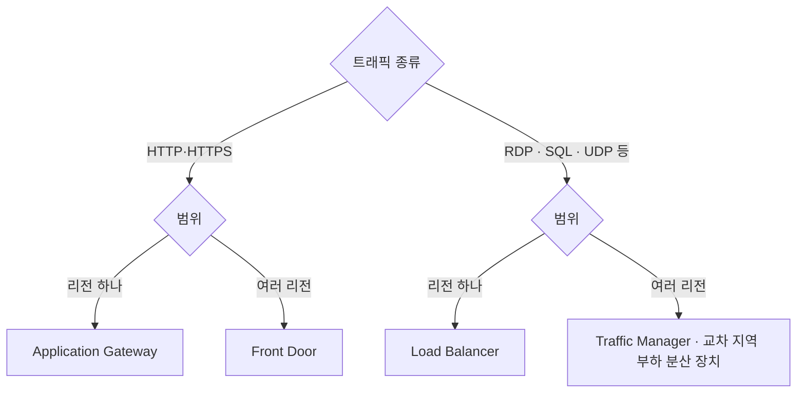
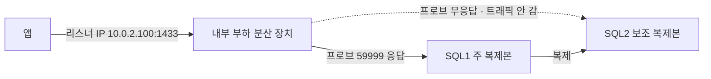

# 가상 네트워킹 2

시험 영역 중 가상 네트워킹 구현·관리(15~20%)에 해당하는 내용이다. 2편은 부하 분산을 다룬다. VNet 구성, 연결, 경로, 진단은 [1편](가상-네트워킹-1.md)에 있다.

## 부하 분산 서비스 고르기

네 서비스 모두 트래픽을 여러 대상에 나눠 준다. 패킷을 어디까지 읽는지(L4냐 L7이냐)와 범위(리전 하나냐 여러 리전이냐)로 나뉜다.

| 범위 | L4, 모든 TCP·UDP | L7, HTTP·HTTPS |
|---|---|---|
| 리전 하나 | Load Balancer | Application Gateway |
| 여러 리전 | Traffic Manager(DNS), 교차 지역 부하 분산 장치 | Front Door |

### Load Balancer와 Application Gateway

Load Balancer는 IP와 포트만 보고 패킷을 열지 않은 채 VM으로 넘긴다. Application Gateway는 HTTP 요청을 열어 URL, 호스트 이름, 헤더, 쿠키를 읽고 보낼 곳을 정한다. Azure가 관리해 주는 Nginx 리버스 프록시에 가깝다.

| | Load Balancer | Application Gateway |
|---|---|---|
| 받는 트래픽 | TCP·UDP 전부 | HTTP·HTTPS |
| URL 경로별 분배 | 안 된다 | 된다 |
| 호스트 이름별 분배 | 안 된다 | 된다 |
| TLS 종료 | 안 된다. VM이 한다 | 된다 |
| WAF | 없다 | WAF_v2 등급에서 붙는다 |
| 같은 사용자를 같은 VM으로 | 세션 지속성(클라이언트 IP) | 쿠키 기반 선호도 |
| 전용 서브넷 | 필요 없다 | 필요하다 |

URL 경로, 호스트 이름, WAF, TLS 종료, 쿠키 선호도가 나오면 Application Gateway다. HTTP가 아닌 트래픽이거나 VM 여러 대에 나눠 주기만 하면 Load Balancer다.

### Traffic Manager와 Front Door

| | Traffic Manager | Front Door |
|---|---|---|
| 방식 | DNS 응답으로 정상 리전 주소를 알려 준다. 트래픽은 거치지 않는다 | 전 세계 Microsoft 엣지에서 요청을 직접 받아 전달한다 |
| 트래픽 | 종류 상관없다 | HTTP·HTTPS |
| 장애 전환 | DNS TTL이 지나야 바뀌어 느리다 | 다음 요청부터 바뀐다 |
| 추가 기능 | 없다 | CDN 캐시, WAF, TLS 처리 |

Traffic Manager가 먼저 나왔고 웹용으로 Front Door가 나중에 나왔다. 여러 리전 웹 서비스는 Front Door, HTTP가 아닌 서비스는 Traffic Manager나 교차 지역 부하 분산 장치를 쓴다.

### APIM

API Management(APIM)도 HTTP 요청을 받아 뒤로 넘기지만 목적이 다르다. 구독 키나 JWT로 호출자를 구분하고, 키별 호출 횟수 제한, 요청·응답 변환, API 버전 관리, 개발자 포털, 호출 통계를 제공한다. 보통 Front Door나 Application Gateway(WAF) 뒤에 APIM을 두고 그 뒤에 API 서버를 둔다. 주로 AZ-204 범위이고, AZ-104에서는 API 키, 호출 제한, 개발자 포털이 나오면 APIM이라는 정도만 알면 된다.

## 부하 분산 장치의 일시적 연결 문제

공용 Load Balancer 뒤의 앱에 가끔 연결이 안 된다는 문제는 상태 프로브 구성과 SKU 일치를 확인하는 것이 답이다.

| 확인할 것 | 이유 |
|---|---|
| 상태 프로브 구성 | VM 하나가 고장 났는데 프로브가 정상으로 보면 그 VM으로 가는 요청만 실패한다. 그래서 가끔 안 되는 증상이 된다. TCP 80 프로브는 포트만 보므로 앱이 500 에러를 내도 정상으로 본다. HTTP 프로브로 /health 같은 경로를 확인한다 |
| 부하 분산 장치와 공용 IP의 SKU | Basic과 Standard는 같은 등급끼리만 연결된다. Basic은 2025년 9월에 서비스가 끝나 지금은 둘 다 Standard지만 시험에는 정답으로 나온다 |

### 헷갈리는 것

- 배포 모드를 원본 IP 선호도(세션 지속성)로 바꾸는 건 오답이다. 같은 클라이언트를 같은 VM으로 묶을 뿐 연결 문제를 고치지 못한다. 고장 난 VM에 묶이면 그 사용자는 계속 실패한다
- NSG가 막으면 항상 안 된다. 일시적이라는 증상과 맞지 않는다

연습 평가에서 같은 상황을 표현만 바꿔 여러 번 묻는다. 원본 IP 선호도(세션 지속성)를 켜는 보기는 연결 문제에서 항상 오답이다. 끄는 보기(5-튜플 해시로 바꾸기)는 정답이 될 수 있다. 5-튜플 해시가 기본값이고 세션 지속성 없음과 같은 뜻이다.

| 문제 표현 | 정답 |
|---|---|
| 공용 LB, 일시적 연결 문제, 두 가지 | 상태 프로브 구성 확인, LB와 공용 IP SKU 일치 확인 |
| Standard LB, 일시적 연결 문제, 세 가지 | 상태 프로브 구성 확인, VM이 그 포트에 응답하는지 확인, NSG가 인바운드를 허용하는지 확인 |
| 시간 초과와 분산 확인, 일부 VM에 몰림 | 배포 모드를 5-튜플 해시로 바꾸기, 세션 지속성 끄기 |

Standard LB는 기본이 닫혀 있어서 NSG에서 허용해야 트래픽이 들어간다. 그래서 Standard 문제에는 NSG 확인이 정답에 들어간다. 시간 제한 늘리기, VM 다시 시작은 원인을 고치지 않는다.
- 트래픽이 일부 VM에만 몰려 고르지 않다는 문제는 세션 지속성을 끄는 것이 답이다. 원본 IP 선호도가 켜져 있으면 같은 IP에서 오는 요청이 한 VM에 묶인다. 회사 NAT처럼 많은 사용자가 공용 IP 하나로 나오면 그 VM에만 몰린다. 끄면(없음) 연결마다 5-튜플 해시로 나뉘어 고르게 간다

## SQL Server Always On 리스너용 내부 부하 분산 장치

Always On 가용성 그룹은 SQL Server 여러 대가 같은 DB를 복제해 들고 있는 구성이다. 쓰기를 받는 주 복제본은 한 대이고, 나머지 보조 복제본은 복제를 받다가 주 복제본이 죽으면 승격된다. 리스너는 클라이언트가 접속하는 대표 이름과 IP다. 주 복제본이 바뀌어도 클라이언트는 리스너로만 접속하면 된다.

Azure VM에 SQL Server Always On 가용성 그룹을 올리면 리스너 IP를 내부 부하 분산 장치의 프런트엔드 IP로 만든다. Azure 가상 네트워크는 IP를 서버 사이에서 옮기는 방식을 지원하지 않기 때문이다. 이때 부하 분산 규칙에 필요한 설정은 다음과 같다.

| 설정 | 값 | 문제 답 |
|---|---|---|
| 부동 IP(Floating IP) | 사용 | 켠다는 해결책은 Yes |
| 상태 프로브 | TCP, 전용 프로브 포트(예: 59999) | 1433 포트에 HTTP 프로브는 No |
| 세션 지속성 | 없음(None) | Client IP로 설정은 No |

### 부동 IP가 필요한 이유

부하 분산 장치는 보통 패킷의 목적지 주소를 프런트엔드 IP에서 백엔드 VM IP로 바꿔서 넘긴다. 부동 IP를 켜면 목적지를 프런트엔드 IP 그대로 둔 채 넘긴다. SQL 리스너는 그 프런트엔드 IP를 자기 주소로 갖고 응답해야 하므로 부동 IP를 켜야 한다.

### 프로브 포트를 따로 두는 이유

1433은 모든 복제본의 SQL Server가 열어 두는 포트라서, 여기로 프로브를 보내면 주 복제본과 보조 복제본을 구분하지 못한다. 클러스터의 IP 리소스에 전용 프로브 포트를 설정하면 현재 주 복제본인 노드만 그 포트에 응답한다. 그래서 트래픽이 주 복제본으로만 간다. 프로브 형식도 HTTP가 아니라 TCP다.
