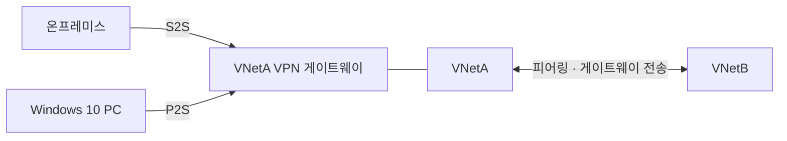

# 가상 네트워킹

시험 영역 중 가상 네트워킹 구현·관리(15~20%)에 해당하는 내용이다.

## VPN 종류

| 종류 | 연결하는 것 | 쓰는 경우 |
|---|---|---|
| 사이트 간(S2S) | 온프레미스 네트워크 전체와 VNet | 회사 사무실이나 데이터센터를 Azure와 상시 연결 |
| 지점 및 사이트 간(P2S) | 개별 PC 한 대와 VNet | 원격 근무자가 자기 PC에서 VNet에 접속 |
| VNet 간(VNet-to-VNet) | VNet과 VNet | 두 VNet을 VPN 게이트웨이로 연결. 지금은 보통 피어링을 쓴다 |

원격 근무자가 VNet의 VM에 접속해야 한다는 문제는 P2S가 답이다. S2S는 온프레미스 쪽에 VPN 장비가 있는 네트워크를 연결할 때 쓴다.

P2S는 경로 기반(route-based) VPN 게이트웨이에서만 된다. 문제에 나오는 정적 라우팅(static routing)은 옛 이름으로 정책 기반, 동적 라우팅은 경로 기반을 가리킨다.

## 피어링과 게이트웨이 전송

VNet은 기본적으로 서로 격리되어 있다. 피어링은 두 VNet을 Microsoft 백본망으로 직접 이어서 서로의 사설 IP로 통신하게 한다. VPN 게이트웨이를 거치지 않아 빠르고, 리전이 달라도(글로벌 피어링) 된다. 피어링은 전이되지 않는다. A-B, B-C를 피어링해도 A와 C는 통신하지 못한다.

VNetA에만 VPN 게이트웨이가 있고 VNetB가 VNetA와 피어링되어 있을 때, VNetB가 VNetA의 게이트웨이를 같이 쓰려면 양쪽에 설정이 하나씩 필요하다.

| 위치 | 설정 |
|---|---|
| 게이트웨이가 있는 VNetA 쪽 피어링 | 게이트웨이 전송 허용(Allow gateway transit) |
| 게이트웨이가 없는 VNetB 쪽 피어링 | 원격 게이트웨이 사용(Use remote gateways) |

### P2S 클라이언트는 피어링 뒤에 다시 받아야 한다

P2S VPN 클라이언트 구성 패키지에는 접속할 수 있는 주소 범위(경로)가 들어 있다. 패키지를 받은 뒤에 피어링을 추가하면 PC 쪽 클라이언트는 VNetB 주소 범위를 모른다. 그래서 온프레미스에서는 VNetB에 닿는데 P2S PC만 안 닿는 상황이 생긴다. 해결은 VPN 클라이언트 구성 패키지를 다시 내려받아 다시 설치하는 것이다.

같은 상황을 두고 해결책만 바꿔 묻는 Yes/No 문항이 연달아 나온다.

| 해결책 | 답 | 이유 |
|---|---|---|
| VNetA에서 게이트웨이 전송 허용 | No | 온프레미스에서 VNetB에 이미 닿으므로 게이트웨이 전송은 이미 켜져 있다 |
| VNetB에서 게이트웨이 전송 허용 | No | VNetB에는 게이트웨이가 없다. VNetB 쪽에 필요한 건 원격 게이트웨이 사용이다 |
| VPN 클라이언트 구성 패키지 다시 받아 설치 | Yes | 클라이언트에 VNetB 경로가 추가된다 |

### 헷갈리는 것

- 게이트웨이 전송 허용은 게이트웨이가 있는 쪽, 원격 게이트웨이 사용은 없는 쪽이다
- 네트워크 구성(피어링, 주소 공간)이 바뀌면 P2S 클라이언트 패키지를 다시 받아야 한다

## SQL Server Always On 리스너용 내부 부하 분산 장치

Always On 가용성 그룹은 SQL Server 여러 대가 같은 DB를 복제해 들고 있는 구성이다. 쓰기를 받는 주 복제본은 한 대이고, 나머지 보조 복제본은 복제를 받다가 주 복제본이 죽으면 승격된다. 리스너는 클라이언트가 접속하는 대표 이름과 IP다. 주 복제본이 바뀌어도 클라이언트는 리스너로만 접속하면 된다.

Azure VM에 SQL Server Always On 가용성 그룹을 올리면 리스너 IP를 내부 부하 분산 장치의 프런트엔드 IP로 만든다. Azure 가상 네트워크는 IP를 서버 사이에서 옮기는 방식을 지원하지 않기 때문이다. 이때 부하 분산 규칙에 필요한 설정은 다음과 같다.

| 설정 | 값 | 문제 답 |
|---|---|---|
| 부동 IP(Floating IP) | 사용 | 켠다는 해결책은 Yes |
| 상태 프로브 | TCP, 전용 프로브 포트(예: 59999) | 1433 포트에 HTTP 프로브는 No |
| 세션 지속성 | 없음(None) | Client IP로 설정은 No |

### 부동 IP가 필요한 이유

부하 분산 장치는 보통 패킷의 목적지 주소를 프런트엔드 IP에서 백엔드 VM IP로 바꿔서 넘긴다. 부동 IP를 켜면 목적지를 프런트엔드 IP 그대로 둔 채 넘긴다. SQL 리스너는 그 프런트엔드 IP를 자기 주소로 갖고 응답해야 하므로 부동 IP를 켜야 한다.

### 프로브 포트를 따로 두는 이유

1433은 모든 복제본의 SQL Server가 열어 두는 포트라서, 여기로 프로브를 보내면 주 복제본과 보조 복제본을 구분하지 못한다. 클러스터의 IP 리소스에 전용 프로브 포트를 설정하면 현재 주 복제본인 노드만 그 포트에 응답한다. 그래서 트래픽이 주 복제본으로만 간다. 프로브 형식도 HTTP가 아니라 TCP다.
