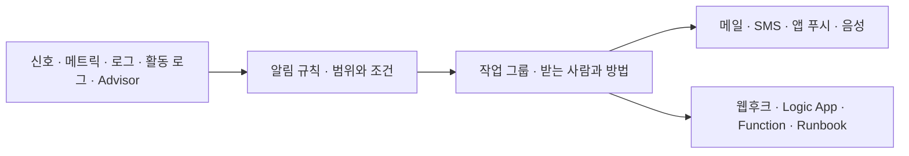
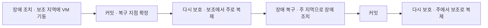

# 모니터링·백업

시험 영역 중 리소스 모니터링·유지 관리(10~15%)에 해당하는 내용이다. 백업과 Site Recovery도 이 영역에 들어간다.

## Log Analytics와 KQL

Log Analytics 작업 영역에 모은 로그는 KQL(Kusto 쿼리 언어)로 조회한다.

| 연산자 | SQL로 치면 |
|---|---|
| `where` | WHERE |
| `project` | SELECT로 컬럼 고르기 |
| `extend` | 계산한 컬럼 추가 |
| `summarize ... by` | GROUP BY |

```kusto
SecurityEvent
| summarize count() by Account
```

로그 쿼리 결과를 차트로 공유 대시보드에 고정하면 최대 30일치를 표시한다.

## 알림 규칙과 작업 그룹

Azure Monitor 알림은 두 부분으로 만든다.



| 부분 | 정하는 것 |
|---|---|
| 알림 규칙 | 범위(구독, RG)와 조건(메트릭, 로그 쿼리, 활동 로그 이벤트, Advisor 권장 사항) |
| 작업 그룹 | 받는 사람과 방법(메일, SMS, 앱 푸시, 음성), 자동 동작(웹후크, Logic App, Function, Automation Runbook) |

작업 그룹은 한 번 만들어 여러 알림 규칙이 같이 쓴다. Advisor 권장 사항이 생길 때마다 관리자 전원에게 알리라는 문제는 작업 그룹이다. 용량 예약 그룹은 리전에 VM 자리를 미리 확보하는 기능, 애플리케이션 보안 그룹은 NSG용 VM 묶음, Automation 계정은 Runbook 실행 서비스라 답이 아니다.

## Azure Backup과 Site Recovery

| 구분 | Azure Backup | Azure Site Recovery |
|---|---|---|
| 목적 | 데이터를 과거 시점으로 되돌린다 | 사이트 전체가 죽었을 때 다른 곳에서 VM을 바로 띄운다 |
| 방식 | 하루 한 번 같은 주기로 백업 사본을 쌓는다 | VM 디스크를 계속 복제해 둔다 |
| 장애 때 | 사본을 골라 복원한다. 시간이 걸린다 | 장애 조치(failover)로 복제본 VM을 켠다. 몇 분 안에 서비스를 넘긴다 |
| 예 | 실수로 지운 파일 되살리기 | 사내 서버실 정전 때 Azure에서 서비스 계속 |


## 온프레미스 Hyper-V VM을 Azure로 복제

Azure Site Recovery로 온프레미스 Hyper-V VM을 Azure에 복제한다. System Center VMM 없이 Hyper-V 호스트만 있을 때 만드는 것은 다음과 같다.

| 만드는 것 | 역할 |
|---|---|
| Recovery Services 자격 증명 모음 | Site Recovery 설정과 복제 항목을 담는 관리 단위 |
| Hyper-V 사이트 | 복제할 Hyper-V 호스트들을 묶는 단위. 호스트에 Site Recovery 공급자와 에이전트를 설치해 등록한다 |
| 복제 정책 | 복제 주기, 복구 지점 보존 기간, 앱 일관성 스냅샷 주기 |

복제 데이터는 Azure 관리 디스크로 바로 들어가므로 스토리지 계정은 만들지 않는다. Traffic Manager와 엔드포인트도 복제와 관계가 없다.

### 헷갈리는 것

- Site Recovery는 Recovery Services 자격 증명 모음에 만든다. Backup 자격 증명 모음이 아니다
- VMM이 있으면 Hyper-V 사이트 대신 VMM 서버를 등록한다

## 백업 정책과 자격 증명 모음 삭제

VM 기본 백업 정책은 하루 한 번 백업하고 일일 복구 지점을 30일 보존한다. 비슷한 숫자가 많아 헷갈린다.

| 숫자 | 무엇 |
|---|---|
| 30일 | VM 기본 백업 정책의 일일 백업 보존 |
| 2일(Enhanced 정책은 기본 7일) | 즉시 복원 스냅샷 보관 |
| 14일 | 일시 삭제 보관. 지운 백업을 되살릴 수 있는 기간 |
| 7일 | Azure Database for PostgreSQL·MySQL 유연한 서버의 기본 백업 보존(1~35일 조정) |
| 30일 | Log Analytics 기본 보존, 공유 대시보드 표시 최대 |
| 90일 | 활동 로그 기본 보존 |

Recovery Services 자격 증명 모음은 안에 백업 데이터가 남아 있으면 삭제되지 않는다.

1. 보호 중인 VM의 백업을 중지하고 백업 데이터를 삭제한다
2. 일시 삭제를 끈다
3. 일시 삭제 상태로 남은 항목을 영구 삭제한다

VM 자체를 지울 필요는 없다. 잠금을 걸면 오히려 삭제가 막힌다.

## Site Recovery 장애 조치 단계



| 단계 | 하는 일 |
|---|---|
| 장애 조치 | 보조 지역에 복제본으로 VM을 띄운다 |
| 커밋 | 복구 지점을 확정한다. 커밋 전에는 다른 복구 지점으로 바꿔 다시 띄울 수 있고, 커밋하면 되돌릴 수 없다 |
| 다시 보호 | 보조 지역에서 도는 VM을 주 지역으로 거꾸로 복제한다 |
| 장애 복구 | 주 지역이 살아나면 다시 장애 조치해서 돌아온다 |

다시 보호는 커밋이 끝난 상태(장애 조치 커밋됨)에서 시작한다. 커밋하는 중이면 끝날 때까지 기다린다. 상태 이름이 ~하는 중이면 진행 중, ~됨이면 완료다.
