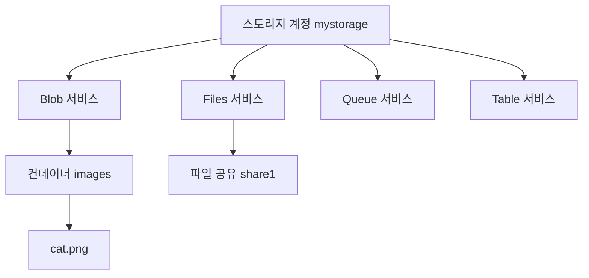

# 스토리지 1

시험 영역 중 스토리지 구현·관리(15~20%)에 해당하는 내용이다. 1편은 계정, 계층, 수명 주기, 이중화를 다룬다. 접근 제어와 Azure Files, AzCopy는 [2편](스토리지-2.md)에 있다.

## 스토리지 계정과 서비스

스토리지 계정은 Azure 저장소를 쓰는 최상위 단위다. 계정 하나에 고유한 이름(전 세계에서 유일, 소문자와 숫자 3~24자)이 붙고, 그 이름이 주소가 된다. 예: mystorage.blob.core.windows.net

계정 하나 안에 네 가지 서비스가 들어 있다.

| 서비스 | 저장하는 것 | 예 |
|---|---|---|
| Blob | 파일 형태의 비정형 데이터. 컨테이너 안에 담는다 | 이미지, 동영상, 백업 파일, 로그 |
| Files | SMB·NFS로 마운트하는 파일 공유 | 여러 VM이 같이 쓰는 공유 폴더, 온프레미스 파일 서버 대체 |
| Queue | 앱 사이에 주고받는 메시지 | 주문 처리 대기열 |
| Table | 스키마 없는 키-값 데이터 | 간단한 설정, 사용자 메타데이터 |



## 계정 종류

| 종류 | 성능 | 지원 서비스 | 쓰는 경우 |
|---|---|---|---|
| 범용 v2(Standard) | HDD 기반 | Blob, Files, Queue, Table 전부 | 대부분. 기본값이다 |
| Premium 블록 Blob | SSD | Blob만 | 작은 파일을 빠르게 많이 읽고 쓸 때 |
| Premium 파일 공유 | SSD | Files만 | 빠른 파일 공유, NFS 공유 |
| Premium 페이지 Blob | SSD | 페이지 Blob만 | 비관리 VM 디스크 같은 임의 접근 |

Premium 계정은 LRS와 ZRS만 된다. GRS 계열이 필요하면 범용 v2를 쓴다.

### Blob 종류

| 종류 | 구조 | 용도 |
|---|---|---|
| 블록 Blob | 블록 단위로 올리는 일반 파일 | 문서, 이미지, 로그, 분석 데이터. 대부분 이것이다 |
| 추가 Blob | 끝에 덧붙이기만 된다 | 로그 파일 |
| 페이지 Blob | 512바이트 페이지 단위로 아무 위치나 읽고 쓴다 | VM 디스크(VHD). 관리 디스크가 나온 뒤로 직접 쓸 일은 거의 없다 |

### Data Lake Storage Gen2

별도 서비스가 아니라 Blob에 계층 구조 네임스페이스(Hierarchical Namespace)를 켠 것이다. 일반 Blob의 폴더는 이름에 `/`가 들어간 것일 뿐이지만, 계층 구조 네임스페이스를 켜면 진짜 폴더가 생긴다.

| | 일반 Blob | ADLS Gen2 |
|---|---|---|
| 폴더 이름 변경·삭제 | 안의 파일을 하나씩 복사하고 지운다 | 한 번에 끝난다 |
| 권한 | 컨테이너 단위 | 폴더·파일 단위 ACL |
| 주 용도 | 일반 파일 저장 | Spark, Databricks, Synapse 같은 분석 |

블록 Blob 위에서 동작하므로 범용 v2와 Premium 블록 Blob 계정에서만 된다. Premium 파일 공유는 Blob이 아니고, Premium 페이지 Blob은 블록 Blob이 아니라서 안 된다. 계층 구조 네임스페이스는 보통 계정을 만들 때 켜고, 기존 계정도 업그레이드할 수 있지만 끌 수는 없다.

## Blob 액세스 계층

Blob은 얼마나 자주 읽느냐에 따라 계층을 고른다. 자주 안 읽을수록 저장 비용은 싸지고, 읽을 때 비용은 비싸진다.

| 계층 | 저장 비용 | 읽기 비용 | 최소 보관 기간 | 바로 읽기 |
|---|---|---|---|---|
| Hot | 가장 비쌈 | 가장 쌈 | 없음 | 된다 |
| Cool | 쌈 | 비쌈 | 30일 | 된다 |
| Cold | 더 쌈 | 더 비쌈 | 90일 | 된다 |
| Archive | 가장 쌈 | 가장 비쌈 | 180일 | 안 된다. 먼저 리하이드레이션 |

- 최소 보관 기간 전에 지우거나 다른 계층으로 옮기면 남은 기간만큼 조기 삭제 요금이 붙는다
- Archive는 오프라인 계층이다. 읽으려면 Hot이나 Cool로 되돌리는 리하이드레이션을 먼저 해야 하고, 표준 우선순위로 최대 15시간 걸린다
- 계정에는 기본 계층(Hot 또는 Cool)을 정하고, Blob마다 따로 바꿀 수 있다. Archive는 Blob 단위로만 지정한다

한국어 시험에서는 Hot이 핫이나 인기 있는, Cool이 쿨, Cold가 콜드나 비활성, Archive가 아카이브나 보관으로 번역되어 나온다. 같은 문제에 Cold와 쿨이 보기로 같이 나오기도 한다. 쿨은 Cool이고 Cold가 더 싸다.

| 문제의 요구 | 답 | 이유 |
|---|---|---|
| 장기 백업, 비용 최소 | Archive | 꺼내는 시간 조건이 없으면 가장 싼 계층 |
| 90일 이상 보관, 몇 초 안에 사용, 비용 최소 | Cold | 몇 초 안이라 Archive는 안 된다. 90일 넘게 둘 거라 Cool보다 저장 단가가 싼 Cold |
| 자주 안 읽지만 필요할 때 빨리 꺼내야 함, 비용 최소 | Cold | Archive는 꺼내는 데 몇 시간 걸린다. Cold는 온라인 계층이라 바로 읽힌다 |

## 수명 주기 관리

규칙으로 Blob을 기간에 따라 다른 계층으로 옮기거나 지운다. 날짜 기준은 세 가지다.

| 조건 | 기준 | 미리 켤 것 |
|---|---|---|
| `daysAfterModificationGreaterThan` | 마지막 수정 | 없다 |
| `daysAfterCreationGreaterThan` | 만든 날 | 없다 |
| `daysAfterLastAccessTimeGreaterThan` | 마지막으로 읽거나 쓴 날 | 마지막 액세스 시간 추적 |

Blob은 기본으로 수정 시간만 기록하고 읽은 시간은 기록하지 않는다. 그래서 액세스하지 않은 Blob을 옮기는 규칙을 만들려면 먼저 액세스 추적을 켠다. 기록이 늘어서 비용이 조금 더 든다.

```json
{
  "rules": [{
    "name": "cool-after-30d-no-access",
    "type": "Lifecycle",
    "definition": {
      "filters": { "blobTypes": ["blockBlob"] },
      "actions": {
        "baseBlob": {
          "tierToCool": { "daysAfterLastAccessTimeGreaterThan": 30 }
        }
      }
    }
  }]
}
```

같이 나오는 오답 보기다. 버전 관리는 덮어쓰거나 지운 Blob의 이전 버전을 남기는 기능이고, Blob 인벤토리는 Blob 목록과 속성을 주기적으로 보고서로 뽑는 기능이다. 둘 다 액세스 시간과 관계없다.

## 불변성 정책

정해진 기간 동안 Blob을 수정하거나 지우지 못하게 잠그는 기능이다. 한 번 쓰고 여러 번 읽는 WORM(Write Once, Read Many) 방식이라 계정 관리자도 기간 안에는 지우지 못한다. 컨테이너나 Blob 버전 단위로 건다.

| 정책 | 잠그는 기간 |
|---|---|
| 시간 기반 보존 | 정한 기간(예: 180일). 기간이 지나면 지울 수 있다 |
| 법적 보존 | 기한 없음. 보존을 해제할 때까지 |

마지막 수정 후 6개월 동안 수정·삭제되지 않게 하라는 문제는 불변성 정책(시간 기반 보존)이다. 같이 나오는 오답 보기와의 차이는 다음과 같다.

| 기능 | 하는 일 |
|---|---|
| 변경 피드 | Blob 생성·수정·삭제 내역을 기록만 한다. 막지는 못한다 |
| 수명 주기 관리 | 기간에 따라 계층을 옮기거나 지운다 |
| 사용자 지정 역할 | 권한을 좁힐 수는 있지만 소유자나 액세스 키를 가진 사람은 여전히 지울 수 있다 |

## 이중화

스토리지 계정은 데이터를 항상 여러 벌 복제한다. 옵션마다 복제본을 어디에 두는지가 다르다.

| 옵션 | 기본 리전 | 보조 리전 | 복제본 수 | 평상시 보조 리전 읽기 |
|---|---|---|---|---|
| LRS | 데이터센터 하나에 3개 | 없음 | 3 | 해당 없음 |
| ZRS | 가용성 영역 3개에 하나씩 | 없음 | 3 | 해당 없음 |
| GRS | LRS 방식 3개 | LRS 방식 3개 | 6 | 불가 |
| RA-GRS | LRS 방식 3개 | LRS 방식 3개 | 6 | 가능 |
| GZRS | ZRS 방식 3개 | LRS 방식 3개 | 6 | 불가 |
| RA-GZRS | ZRS 방식 3개 | LRS 방식 3개 | 6 | 가능 |

- LRS는 데이터센터 하나가 통째로 장애를 겪으면 데이터에 접근할 수 없다
- ZRS는 영역 하나가 죽어도 버티지만 리전 전체 장애는 못 버틴다
- GRS 계열은 보조 리전이 기본 리전에서 수백 km 떨어져 있다. 보조 리전으로는 비동기로 복제한다
- GZRS는 기본 리전을 ZRS로, 보조 리전을 LRS로 둔다. 영역 장애와 리전 장애를 둘 다 대비한다

### GRS와 RA-GRS의 차이

복제 구조는 같다. 차이는 평상시에 보조 리전 데이터를 읽을 수 있느냐다.

- GRS는 장애 조치(failover)가 끝나기 전까지 보조 리전 데이터를 읽을 수 없다
- RA-GRS는 보조 리전용 읽기 전용 엔드포인트를 따로 준다. 계정 이름 뒤에 -secondary가 붙은 주소다. 예를 들면 mystorage-secondary.blob.core.windows.net이다

### 헷갈리는 것

- RA-GRS의 RA는 Read-Access다. Read-only가 아니다. 보조 리전에는 읽기만 할 수 있다
- 보조 리전 복제는 비동기라서 장애 시점에 아직 복제되지 않은 최근 쓰기는 잃을 수 있다
