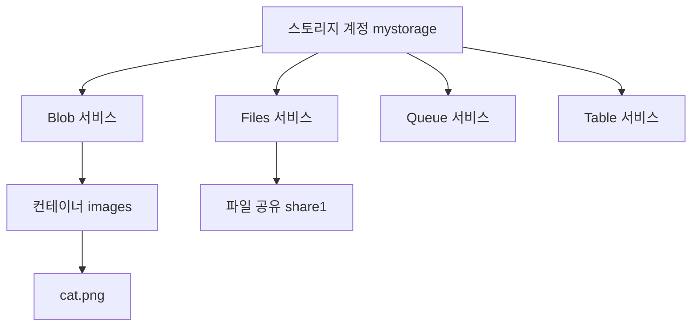

# 스토리지

시험 영역 중 스토리지 구현·관리(15~20%)에 해당하는 내용이다.

## 스토리지 계정과 서비스

스토리지 계정은 Azure 저장소를 쓰는 최상위 단위다. 계정 하나에 고유한 이름(전 세계에서 유일, 소문자와 숫자 3~24자)이 붙고, 그 이름이 주소가 된다. 예: mystorage.blob.core.windows.net

계정 하나 안에 네 가지 서비스가 들어 있다.

| 서비스 | 저장하는 것 | 예 |
|---|---|---|
| Blob | 파일 형태의 비정형 데이터. 컨테이너 안에 담는다 | 이미지, 동영상, 백업 파일, 로그 |
| Files | SMB·NFS로 마운트하는 파일 공유 | 여러 VM이 같이 쓰는 공유 폴더, 온프레미스 파일 서버 대체 |
| Queue | 앱 사이에 주고받는 메시지 | 주문 처리 대기열 |
| Table | 스키마 없는 키-값 데이터 | 간단한 설정, 사용자 메타데이터 |

## 계정 종류

| 종류 | 성능 | 지원 서비스 | 쓰는 경우 |
|---|---|---|---|
| 범용 v2(Standard) | HDD 기반 | Blob, Files, Queue, Table 전부 | 대부분. 기본값이다 |
| Premium 블록 Blob | SSD | Blob만 | 작은 파일을 빠르게 많이 읽고 쓸 때 |
| Premium 파일 공유 | SSD | Files만 | 빠른 파일 공유, NFS 공유 |
| Premium 페이지 Blob | SSD | 페이지 Blob만 | 비관리 VM 디스크 같은 임의 접근 |

Premium 계정은 LRS와 ZRS만 된다. GRS 계열이 필요하면 범용 v2를 쓴다.

## Blob 액세스 계층

Blob은 얼마나 자주 읽느냐에 따라 계층을 고른다. 자주 안 읽을수록 저장 비용은 싸지고, 읽을 때 비용은 비싸진다.

| 계층 | 저장 비용 | 읽기 비용 | 최소 보관 기간 | 바로 읽기 |
|---|---|---|---|---|
| Hot | 가장 비쌈 | 가장 쌈 | 없음 | 된다 |
| Cool | 쌈 | 비쌈 | 30일 | 된다 |
| Cold | 더 쌈 | 더 비쌈 | 90일 | 된다 |
| Archive | 가장 쌈 | 가장 비쌈 | 180일 | 안 된다. 먼저 리하이드레이션 |

- 최소 보관 기간 전에 지우거나 다른 계층으로 옮기면 남은 기간만큼 조기 삭제 요금이 붙는다
- Archive는 오프라인 계층이다. 읽으려면 Hot이나 Cool로 되돌리는 리하이드레이션을 먼저 해야 하고, 표준 우선순위로 최대 15시간 걸린다
- 계정에는 기본 계층(Hot 또는 Cool)을 정하고, Blob마다 따로 바꿀 수 있다. Archive는 Blob 단위로만 지정한다

## 이중화

스토리지 계정은 데이터를 항상 여러 벌 복제한다. 옵션마다 복제본을 어디에 두는지가 다르다.

| 옵션 | 기본 리전 | 보조 리전 | 복제본 수 | 평상시 보조 리전 읽기 |
|---|---|---|---|---|
| LRS | 데이터센터 하나에 3개 | 없음 | 3 | 해당 없음 |
| ZRS | 가용성 영역 3개에 하나씩 | 없음 | 3 | 해당 없음 |
| GRS | LRS 방식 3개 | LRS 방식 3개 | 6 | 불가 |
| RA-GRS | LRS 방식 3개 | LRS 방식 3개 | 6 | 가능 |
| GZRS | ZRS 방식 3개 | LRS 방식 3개 | 6 | 불가 |
| RA-GZRS | ZRS 방식 3개 | LRS 방식 3개 | 6 | 가능 |

- LRS는 데이터센터 하나가 통째로 장애를 겪으면 데이터에 접근할 수 없다
- ZRS는 영역 하나가 죽어도 버티지만 리전 전체 장애는 못 버틴다
- GRS 계열은 보조 리전이 기본 리전에서 수백 km 떨어져 있다. 보조 리전으로는 비동기로 복제한다
- GZRS는 기본 리전을 ZRS로, 보조 리전을 LRS로 둔다. 영역 장애와 리전 장애를 둘 다 대비한다

### GRS와 RA-GRS의 차이

복제 구조는 같다. 차이는 평상시에 보조 리전 데이터를 읽을 수 있느냐다.

- GRS는 장애 조치(failover)가 끝나기 전까지 보조 리전 데이터를 읽을 수 없다
- RA-GRS는 보조 리전용 읽기 전용 엔드포인트를 따로 준다. 계정 이름 뒤에 -secondary가 붙은 주소다. 예를 들면 mystorage-secondary.blob.core.windows.net이다

### 헷갈리는 것

- RA-GRS의 RA는 Read-Access다. Read-only가 아니다. 보조 리전에는 읽기만 할 수 있다
- 보조 리전 복제는 비동기라서 장애 시점에 아직 복제되지 않은 최근 쓰기는 잃을 수 있다
