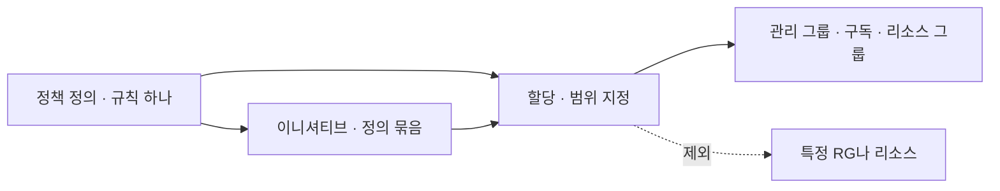
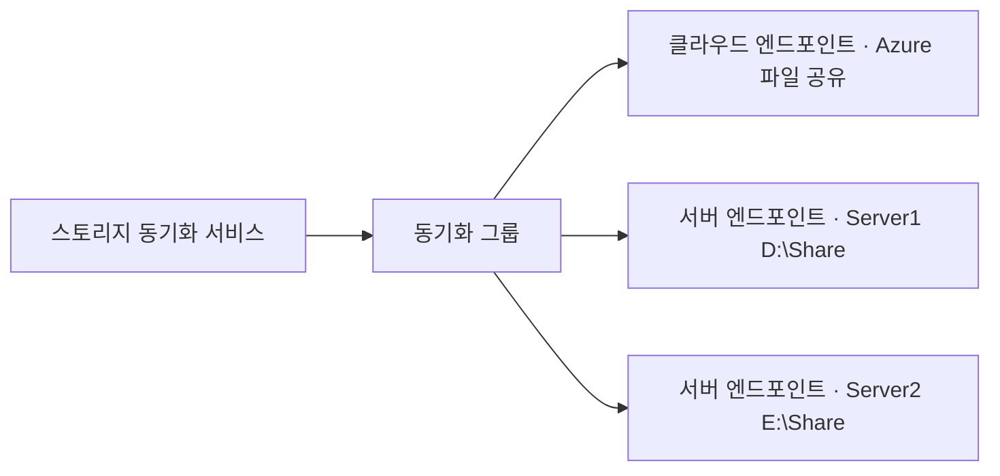

# 시험 직전 빈틈 1

공식 연습 평가에서는 안 나왔지만 시험 기술 개요에 들어 있는 주제를 모았다. 주제마다 시험에서 고르는 기준과 실무에서 알아 두면 좋은 것을 같이 적었다. 1편은 ID·거버넌스, 스토리지, 컴퓨팅이고 네트워킹과 모니터링·백업은 [2편](시험-직전-빈틈-2.md)에 있다.

## ID·거버넌스

### 그룹 종류와 동적 그룹

| 구분 | 값 | 설명 |
|---|---|---|
| 그룹 종류 | 보안 그룹 | 리소스 권한, 라이선스, 정책 대상 |
| 그룹 종류 | Microsoft 365 그룹 | 메일함, Teams, SharePoint가 같이 생기는 협업용 |
| 멤버 자격 | 할당됨 | 관리자가 직접 넣고 뺀다 |
| 멤버 자격 | 동적 사용자 | 사용자 특성 규칙으로 자동 가입 |
| 멤버 자격 | 동적 디바이스 | 디바이스 특성 규칙으로 자동 가입 |

동적 그룹 규칙의 예다.

```text
(user.department -eq "Sales") -and (user.country -eq "KR")
```

- 동적 그룹은 Entra ID P1 이상 라이선스가 필요하다
- 동적 그룹에는 멤버를 손으로 넣을 수 없다. 규칙에 맞는 사용자만 들어온다
- 한 그룹에 사용자와 디바이스를 섞을 수 없다
- 멤버 자격을 할당됨에서 동적으로 바꾸면 기존 멤버 중 규칙에 안 맞는 사람은 빠진다

실무에서는 부서·직급 같은 인사 정보가 Entra에 정확히 들어가 있어야 동적 그룹이 쓸모 있다. 부서명이 사람마다 "영업", "영업팀", "Sales"로 다르면 규칙이 새는 곳이 생긴다. 동적 그룹에 라이선스를 걸어 두면 입사자가 들어오는 순간 라이선스가 붙어서 온보딩 작업이 줄어든다.

### 사용자 대량 작업

| 작업 | 방법 |
|---|---|
| 사용자 여러 명 만들기 | Entra 포털 사용자 화면의 대량 작업, 대량 만들기. CSV 템플릿을 내려받아 채운 뒤 올린다 |
| 게스트 여러 명 초대 | 대량 작업, 대량 초대. 이메일 주소와 리디렉션 URL을 CSV로 |
| 스크립트로 처리 | Microsoft Graph PowerShell의 `New-MgUser`, `New-MgInvitation` |

실무에서는 대량 작업 결과에서 실패 행을 꼭 확인한다. UPN 도메인이 테넌트에 확인되지 않은 도메인이면 그 행만 조용히 실패한다.

### Azure Policy

RBAC는 누가 무엇을 할 수 있는지 정하고, Policy는 리소스 설정이 규칙을 따르는지 정한다. 소유자 권한이 있어도 Policy가 막으면 리소스를 만들 수 없다.



| 효과 | 동작 |
|---|---|
| Deny | 규칙에 어긋나는 생성·변경을 거부한다 |
| Audit | 허용은 하고 비준수로 표시만 한다 |
| Append | 요청에 필드를 덧붙인다 |
| Modify | 태그 같은 속성을 추가·변경한다. 기존 리소스는 수정 작업으로 고친다 |
| AuditIfNotExists | 관련 리소스(예: VM의 확장)가 없으면 비준수로 표시 |
| DeployIfNotExists | 관련 리소스가 없으면 배포한다. 기존 리소스는 수정 작업으로 고친다 |
| Disabled | 정책을 끈다 |

| 문제의 요구 | 답 |
|---|---|
| 특정 리전에만 리소스를 만들게 | 허용되는 위치(Allowed locations) 정책, Deny |
| 특정 VM 크기만 쓰게 | 허용되는 가상 머신 크기 SKU 정책 |
| 리소스에 태그가 없으면 RG 태그를 붙이게 | Modify 효과의 태그 상속 정책 |
| 이미 만들어진 비준수 리소스까지 고치게 | 수정 작업(Remediation task). 정책 할당에 관리 ID가 필요하다 |
| 여러 정책을 한 번에 할당 | 이니셔티브 |

- Deny는 앞으로의 요청만 막는다. 이미 있는 비준수 리소스는 지우거나 바꾸지 않는다
- 할당 뒤 평가가 반영되기까지 30분 정도 걸린다
- 정책은 보통 관리 그룹, 구독, 리소스 그룹에 할당하고 하위로 상속된다

실무에서는 새 정책을 Deny로 바로 걸지 않는다. Audit로 먼저 걸어서 비준수 목록을 보고, 예외가 정리된 뒤에 Deny로 올린다. 바로 Deny를 걸면 CI/CD 배포가 이유도 모른 채 실패한다.

### 리소스 이동

| 이동 | 도구 | 바뀌는 것 |
|---|---|---|
| 다른 리소스 그룹, 다른 구독 | 포털의 이동, `Move-AzResource` | 리소스 ID만 바뀐다. 리전과 데이터는 그대로 |
| 다른 리전 | Azure Resource Mover, 또는 다시 만들기 | 실제로 새 리전에 복제한다 |

- 이동하는 동안 원본과 대상 리소스 그룹은 잠겨서 생성·삭제가 막힌다. 리소스는 계속 동작한다
- VM을 옮길 때는 디스크, NIC, 공용 IP 같은 딸린 리소스도 같이 옮긴다
- 다른 구독으로 옮기려면 두 구독이 같은 Entra 테넌트에 있어야 하고, 대상 구독에 그 리소스 공급자가 등록되어 있어야 한다
- App Service는 웹앱과 App Service 계획을 같이 옮긴다. 대상 RG에 이미 App Service 리소스가 있으면 이동이 막히므로 RG2에 계획을 미리 만들면 안 된다. 업로드한 SSL 인증서는 원본에서 지우고 이동 뒤 다시 올린다
- 일부 리소스는 이동할 수 없다. 포털의 이동 검사가 미리 알려 준다

리소스 ID가 바뀌므로 실무에서는 ID를 하드코딩한 곳이 깨진다. 진단 설정, 경고 규칙 범위, 스크립트, IaC 상태 파일을 같이 고친다. RBAC 할당 중 리소스 자체에 걸린 것은 따라가지 않는다.

### 예산과 비용 알림

Cost Management의 예산은 구독이나 RG에 금액을 정하고 비율마다 알림을 보낸다.

- 실제 비용 기준과 예측 비용 기준 알림이 있다. 예측 기준은 월말에 넘을 것 같으면 미리 알린다
- 예산은 알림만 한다. 넘어도 리소스가 멈추지 않는다. 멈추게 하려면 작업 그룹에 Automation Runbook이나 Logic App을 연결해 직접 끈다
- 비용을 부서별로 나눠 보려면 태그를 붙이고 Cost Management에서 태그로 그룹화한다

실무에서 비용 사고는 대부분 켜 두고 잊은 리소스에서 난다. 테스트 구독에는 낮은 예산과 예측 기준 알림을 걸고, 개발 VM에는 자동 종료를 켠다.

## 스토리지

### 저장된 액세스 정책

SAS를 만들 때 권한과 만료를 SAS 안에 직접 넣지 않고, 컨테이너에 저장된 정책을 가리키게 할 수 있다.

| 항목 | 내용 |
|---|---|
| 붙는 곳 | Blob 컨테이너, 파일 공유, 큐, 테이블 |
| 개수 | 하나에 최대 5개 |
| 쓰는 SAS | 서비스 SAS만. 계정 SAS와 사용자 위임 SAS는 안 된다 |
| 취소 | 정책을 수정하거나 지우면 그 정책을 가리키는 SAS가 모두 바뀌거나 무효가 된다 |

키를 돌리면 그 키로 만든 SAS가 전부 죽지만, 정책을 지우면 그 정책에 묶인 SAS만 죽는다. 외부 업체마다 정책을 하나씩 만들어 두면 한 업체 접근만 끊을 수 있다.

### 개체 복제

한 스토리지 계정 컨테이너의 블록 Blob을 다른 계정 컨테이너로 비동기 복사한다.

- 원본과 대상 모두 Blob 버전 관리를 켜야 하고, 원본은 변경 피드도 켜야 한다
- 범용 v2와 Premium 블록 Blob 계정에서 된다. 계층 구조 네임스페이스(ADLS Gen2) 계정은 안 된다
- 리전이 달라도, 구독이나 테넌트가 달라도 된다

| | 개체 복제 | GRS |
|---|---|---|
| 대상 | 내가 고른 계정·컨테이너 | Azure가 정한 짝 리전 |
| 범위 | 규칙에 맞는 컨테이너, 접두사 | 계정 전체 |
| 대상 읽기 | 평소에도 된다 | RA-GRS만 된다 |

실무에서는 다른 리전 사용자에게 가까운 사본을 주거나, 운영 계정의 데이터를 분석 계정으로 복사할 때 쓴다. 복제는 비동기라 지연이 있다.

### 암호화

| 방식 | 키 | 비고 |
|---|---|---|
| 기본 서버 쪽 암호화 | Microsoft 관리 키 | 항상 켜져 있고 끌 수 없다 |
| 고객 관리 키(CMK) | Key Vault나 Managed HSM에 내가 둔 키 | Key Vault에 일시 삭제와 제거 보호가 켜져 있어야 한다. 스토리지 계정의 관리 ID에 키 권한을 준다 |
| 암호화 범위 | 컨테이너나 Blob마다 다른 키 | 한 계정에 여러 고객 데이터를 둘 때 |
| 인프라 암호화 | 두 번 암호화 | 계정 만들 때만 켤 수 있다 |

규제상 키를 직접 관리하고 회전해야 한다는 문제는 고객 관리 키다. 실무에서 CMK를 쓰면 Key Vault 키를 실수로 지우거나 권한을 빼는 순간 스토리지 데이터를 읽을 수 없게 된다. 그래서 제거 보호가 필수 조건이다.

### 파일 공유 스냅샷과 일시 삭제

| 기능 | 하는 일 |
|---|---|
| 공유 스냅샷 | 파일 공유 전체의 읽기 전용 특정 시점 사본. 공유 하나에 최대 200개 |
| 파일 공유 일시 삭제 | 지운 공유를 보존 기간(1~365일) 안에 되살린다 |
| Azure Backup for Azure Files | 스냅샷을 정책으로 만들고 보존한다 |

Windows에서는 공유를 연결한 드라이브의 이전 버전 탭으로 스냅샷의 파일을 꺼낼 수 있다. 스냅샷은 같은 스토리지 계정 안에 있어서 계정을 지우면 같이 사라진다. 계정 단위 사고까지 대비하려면 백업 데이터를 볼트로 옮기는 백업(vault 계층)을 쓴다.

### Azure File Sync

온프레미스 Windows 파일 서버와 Azure 파일 공유를 계속 동기화한다.



| 구성 요소 | 역할 |
|---|---|
| 스토리지 동기화 서비스 | 최상위 리소스 |
| 등록된 서버 | File Sync 에이전트를 설치하고 서비스에 등록한 서버. 서버 하나는 서비스 하나에만 등록된다 |
| 동기화 그룹 | 무엇을 무엇과 맞출지 정한다 |
| 클라우드 엔드포인트 | 동기화 그룹마다 Azure 파일 공유 하나 |
| 서버 엔드포인트 | 등록된 서버의 폴더 경로. 동기화 그룹에 여러 개 |

설정 순서는 동기화 서비스 만들기, 서버에 에이전트 설치와 등록, 동기화 그룹과 클라우드 엔드포인트 만들기, 서버 엔드포인트 추가다. 클라우드 계층화를 켜면 자주 안 쓰는 파일은 서버에 껍데기만 남기고 Azure에만 둔다. 실무에서는 지점마다 파일 서버를 두면서 원본은 Azure에 모으는 구성에 쓴다.

### 서비스 엔드포인트와 프라이빗 엔드포인트

| | 서비스 엔드포인트 | 프라이빗 엔드포인트 |
|---|---|---|
| 서비스 주소 | 공용 IP 그대로 | VNet 안 사설 IP |
| 설정 위치 | 서브넷에서 켜고, 스토리지 방화벽에서 그 서브넷 허용 | VNet에 엔드포인트 리소스를 만들고 프라이빗 DNS 연결 |
| 온프레미스에서 | 안 된다 | VPN이나 ExpressRoute로 된다 |
| 범위 | 서브넷에서 그 서비스 전체(모든 스토리지 계정)로 가는 길 | 특정 계정 하나 |
| 비용 | 무료 | 시간과 처리량 과금 |

VNet 서브넷에서만 스토리지에 접근하게, 비용 최소라면 서비스 엔드포인트다. 온프레미스에서 사설 IP로 접근하거나 데이터 유출 경로를 막아야 하면 프라이빗 엔드포인트다. 실무에서는 운영 DB와 스토리지에 프라이빗 엔드포인트를 쓰는 추세다. 서비스 엔드포인트는 그 서브넷에서 남의 스토리지 계정으로도 같은 길이 열려서 유출 통제가 약하다.

## 컴퓨팅

### Bicep 기본

Bicep은 ARM JSON을 짧게 쓰는 언어다. 배포할 때 ARM JSON으로 바뀌어서 기능은 같다.

```bicep
param location string = resourceGroup().location
param storageName string

var skuName = 'Standard_LRS'

resource sa 'Microsoft.Storage/storageAccounts@2023-05-01' = {
  name: storageName
  location: location
  sku: { name: skuName }
  kind: 'StorageV2'
}

output blobEndpoint string = sa.properties.primaryEndpoints.blob
```

| 키워드 | 뜻 |
|---|---|
| `param` | 배포할 때 받는 값 |
| `var` | 템플릿 안에서 계산하는 값 |
| `resource` | 만들 리소스. 앞의 `sa`는 템플릿 안에서 부르는 이름 |
| `output` | 배포 뒤 돌려주는 값 |
| `module` | 다른 Bicep 파일을 불러 쓴다 |

```bash
az deployment group create -g RG1 --template-file main.bicep --parameters storageName=st1234
az bicep decompile --file template.json
```

- `decompile`은 ARM JSON을 Bicep으로 바꾼다. 반대(Bicep을 JSON으로)는 `az bicep build`다
- 리소스끼리 참조(`sa.id`)하면 의존 순서를 Bicep이 알아서 정한다. JSON의 `dependsOn`을 손으로 쓸 일이 줄어든다

실무 관점에서 Bicep은 Terraform과 달리 상태 파일이 없다. Azure의 실제 상태와 비교해서 배포한다. 배포 모드 기본값은 증분(Incremental)이라 템플릿에서 뺀 리소스가 지워지지 않는다. 완전(Complete) 모드는 템플릿에 없는 RG 리소스를 지우니 조심한다.

### 디스크 종류와 암호화

| 종류 | 용도 | OS 디스크 |
|---|---|---|
| Standard HDD | 백업, 거의 안 쓰는 데이터 | 된다 |
| Standard SSD | 웹 서버, 개발 | 된다 |
| Premium SSD | 운영 DB 등 대부분 운영 | 된다 |
| Premium SSD v2 | 성능(IOPS, 처리량)을 크기와 따로 정함 | 안 된다 |
| Ultra Disk | 아주 높은 IOPS, 지연 민감 | 안 된다 |

- Premium SSD는 디스크 크기 단계에 따라 IOPS가 정해진다. 성능이 모자라면 크기를 키운다
- 디스크 종류를 바꾸려면 VM을 중지(할당 취소)한다
- VM 크기마다 붙일 수 있는 디스크 수와 전체 IOPS 한도가 있다. 디스크가 빨라도 VM 한도에 막힐 수 있다

| 암호화 | 범위 |
|---|---|
| 서버 쪽 암호화(SSE) | 저장된 디스크. 기본으로 켜져 있다. 키는 플랫폼 관리 또는 디스크 암호화 집합(CMK) |
| 호스트 암호화 | 임시 디스크와 디스크 캐시까지 호스트에서 암호화 |
| Azure Disk Encryption(ADE) | VM OS 안에서 BitLocker나 dm-crypt로 암호화. Key Vault에 디스크 암호화 사용을 켜고, VM과 같은 리전이어야 한다 |

ADE 문제는 Key Vault 조건을 묻는다. Key Vault가 VM과 같은 리전에 있고 디스크 암호화용 접근이 켜져 있어야 한다. 임시 디스크와 캐시까지 암호화하라는 문제는 호스트 암호화다.

### VMSS 오케스트레이션과 확장

| 항목 | 값 |
|---|---|
| 오케스트레이션 모드 | 유연(Flexible). 기본값이고 서로 다른 크기 VM을 섞을 수 있다. 균일(Uniform)은 같은 VM만 |
| 자동 크기 조정 | CPU 같은 메트릭 규칙으로 스케일 아웃·인. 규칙마다 재사용 대기 시간(기본 5분) |
| 축소 정책 | 줄일 때 어떤 VM을 지울지. 기본(영역 균형 후 가장 큰 ID), 최신 VM, 가장 오래된 VM |
| 업그레이드 정책 | 모델(이미지 등) 변경을 VM에 어떻게 반영할지. 수동, 자동, 롤링 |

스케일 아웃 규칙만 있고 스케일 인 규칙이 없으면 늘어난 VM이 줄지 않는다. 시험과 실무 둘 다 자주 걸리는 지점이다. 실무에서는 스케일 아웃은 빠르게, 스케일 인은 느리게 잡는다. 반대로 하면 늘었다 줄었다를 반복한다.

### Azure Container Registry

| 항목 | 내용 |
|---|---|
| 등급 | Basic, Standard, Premium. 지역 복제, 프라이빗 엔드포인트는 Premium |
| 인증 | Entra ID(`az acr login`), 관리 ID에 AcrPull 역할, 관리자 계정(기본 꺼짐) |
| 이미지 빌드 | ACR 작업(`az acr build`)으로 로컬 Docker 없이 Azure에서 빌드 |

App Service, Container Apps, AKS가 ACR에서 이미지를 받게 하라는 문제는 그 리소스의 관리 ID에 ACR의 AcrPull 역할을 주는 것이다. 관리자 계정은 비밀번호가 하나라 공유되므로 실무에서는 끈다.

### App Service 백업과 네트워크

| 기능 | 내용 |
|---|---|
| 자동 백업 | Basic 이상. 앱 파일과 설정을 주기적으로 백업한다 |
| 사용자 지정 백업 | Standard 이상. 내 스토리지 계정에 저장하고, 연결된 DB도 같이 넣을 수 있다 |
| VNet 통합 | 앱에서 나가는 트래픽이 VNet으로 간다. VNet 안 DB나 프라이빗 엔드포인트에 붙을 때 |
| 프라이빗 엔드포인트 | 앱으로 들어오는 트래픽을 VNet 사설 IP로 받는다 |
| 액세스 제한 | 들어오는 요청을 IP, 서비스 태그, 서브넷으로 허용·거부한다 |

방향이 헷갈리는 함정이 많다. VNet 통합은 나가는 쪽, 프라이빗 엔드포인트와 액세스 제한은 들어오는 쪽이다. 실무에서 Front Door 뒤에 App Service를 둘 때는 액세스 제한에 AzureFrontDoor.Backend 서비스 태그와 Front Door ID 헤더 조건을 걸어서 Front Door를 거치지 않은 직접 접속을 막는다.
