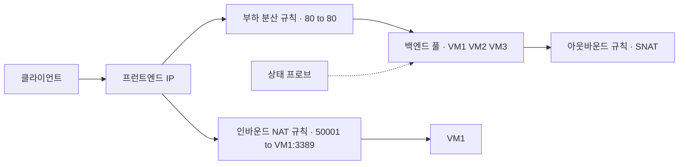
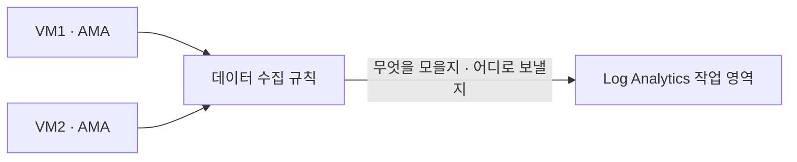

# 시험 직전 빈틈 2

[1편](시험-직전-빈틈-1.md)에 이어 네트워킹과 모니터링·백업에서 빠진 주제를 모았다.

## 네트워킹

### Azure DNS

| 종류 | 하는 일 |
|---|---|
| 공용 DNS 영역 | 인터넷에 공개할 도메인(contoso.com)의 레코드를 Azure가 호스팅한다 |
| 프라이빗 DNS 영역 | VNet 안에서만 풀리는 이름(contoso.internal, privatelink 영역)을 관리한다 |

공용 영역을 만든 뒤 도메인 등록 기관(가비아 등)에서 NS 레코드를 Azure가 준 이름 서버 4개로 바꿔야 실제로 Azure DNS가 응답한다. 이 단계를 위임이라고 한다. 시험에서 영역을 만들었는데 이름이 안 풀린다는 문제는 등록 기관의 NS 변경이 답이다.

| 레코드 | 용도 |
|---|---|
| A, AAAA | 이름을 IPv4, IPv6 주소로 |
| CNAME | 이름을 다른 이름으로. 영역 꼭대기(contoso.com 자체)에는 못 쓴다 |
| MX | 메일 서버 |
| TXT | 도메인 소유 확인, SPF |
| NS, SOA | 영역 위임과 영역 정보. 영역을 만들면 자동으로 생긴다 |
| SRV | 서비스 위치(포트 포함) |
| PTR | IP를 이름으로(역방향) |
| CAA | 이 도메인 인증서를 발급할 수 있는 CA |

별칭(alias) 레코드는 A나 CNAME 대신 Azure 리소스(공용 IP, Traffic Manager, Front Door)를 가리킨다. 리소스 IP가 바뀌면 레코드가 따라 바뀌고, 영역 꼭대기에도 쓸 수 있다.

프라이빗 DNS 영역은 VNet 링크로 VNet에 연결해야 그 VNet에서 쓸 수 있다. 링크에서 자동 등록을 켜면 VM을 만들 때 VM 이름의 A 레코드가 자동으로 생긴다.

- VNet 하나에 여러 프라이빗 영역을 링크할 수 있지만 자동 등록은 영역 하나만 된다
- 프라이빗 영역 하나에 여러 VNet을 링크할 수 있다
- VNet 기본 DNS는 Azure 제공 DNS(168.63.129.16)다. VNet의 DNS 서버 설정에서 사용자 지정 DNS 서버로 바꿀 수 있고, 바꾼 뒤에는 VM을 다시 시작해야 반영된다

실무에서 온프레미스와 Azure가 서로의 사설 이름을 풀어야 하면 Azure DNS Private Resolver를 둔다. 온프레미스 DNS는 Azure 쪽 이름을 Resolver 인바운드 엔드포인트로 넘기고, Azure는 회사 도메인을 아웃바운드 엔드포인트의 전달 규칙으로 온프레미스 DNS에 넘긴다.

### Load Balancer 구성 요소

| 구성 요소 | 역할 |
|---|---|
| 프런트엔드 IP | 클라이언트가 접속하는 주소. 공용 LB는 공용 IP, 내부 LB는 사설 IP |
| 백엔드 풀 | 트래픽을 받을 VM이나 VMSS 인스턴스의 NIC·IP |
| 상태 프로브 | 백엔드가 살았는지 주기적으로 확인한다 |
| 부하 분산 규칙 | 프런트엔드 포트를 백엔드 풀의 포트로 나눠 보낸다. 세션 지속성은 여기서 정한다 |
| 인바운드 NAT 규칙 | 프런트엔드의 특정 포트를 특정 VM 하나로 보낸다. 예: 50001은 VM1의 3389 |
| 아웃바운드 규칙 | 백엔드 VM이 인터넷으로 나갈 때 쓸 공용 IP(SNAT)를 정한다 |

- Standard LB는 기본이 닫혀 있다. 백엔드 VM의 NSG에서 허용해야 트래픽이 들어간다
- Standard 공용 LB 뒤 VM은 아웃바운드 규칙이나 NAT Gateway가 없으면 인터넷으로 나가는 길이 막힌다
- 내부 LB의 HA 포트 규칙은 모든 포트와 프로토콜을 한 규칙으로 넘긴다. 방화벽 같은 NVA 앞에 쓴다
- 백엔드 풀의 VM은 같은 VNet에 있어야 한다

VM 여러 대에 RDP를 하나의 공용 IP로 따로 붙게 하라는 문제는 인바운드 NAT 규칙이다. 실무에서는 관리 포트를 이렇게 열기보다 Bastion을 쓴다. 아웃바운드는 LB 아웃바운드 규칙보다 NAT Gateway가 SNAT 포트가 많고 설정이 단순해서 요즘 권장된다.

## 모니터링·백업

### Azure Monitor 에이전트와 데이터 수집 규칙

VM 안의 로그(이벤트 로그, syslog, 성능 카운터)는 VM에 에이전트를 깔아야 모인다. 그 에이전트가 Azure Monitor 에이전트(AMA)다.

| 구성 요소 | 역할 |
|---|---|
| Azure Monitor 에이전트 | VM에 확장으로 설치. Windows, Linux, Azure Arc 서버 |
| 데이터 수집 규칙(DCR) | 어떤 로그와 카운터를 모아 어느 작업 영역으로 보낼지. VM에 연결해서 쓴다 |
| VM Insights | AMA와 DCR로 성능과 프로세스 의존성 지도를 보여 준다 |

VM의 Windows 이벤트 로그를 작업 영역으로 모으라는 문제는 AMA 설치와 DCR 만들기다. 진단 설정은 Azure 리소스(플랫폼) 로그용이라 VM 안의 OS 로그는 못 모은다. 실무에서는 DCR을 VM마다 만들지 않고 Policy(DeployIfNotExists)로 AMA 설치와 DCR 연결을 자동화한다.

### Connection Monitor

| 도구 | 방식 |
|---|---|
| 연결 문제 해결 | 지금 한 번 테스트한다 |
| Connection Monitor | 정한 주기로 계속 테스트하고 지연, 패킷 손실, 경로를 기록한다. 임계값을 넘으면 경고 |

VM과 온프레미스 서버 사이 연결을 계속 감시하고 지연이 늘면 알리라는 문제는 Connection Monitor다. 원본 VM에 Network Watcher 에이전트가 필요하고, 온프레미스 서버는 Arc와 AMA로 참여한다. 실무에서는 VPN이나 ExpressRoute 품질을 이걸로 계속 지켜보면 끊긴 뒤가 아니라 느려지기 시작할 때 알 수 있다.

### VM 복원 방식

| 방식 | 하는 일 |
|---|---|
| 새 VM 만들기 | 복구 지점으로 새 VM을 만든다 |
| 디스크 복원 | 디스크만 만든다. 템플릿을 같이 주니 설정을 바꿔 VM을 만들 때 |
| 기존 디스크 바꾸기 | 지금 VM의 디스크를 복구 지점 것으로 갈아 끼운다 |
| 파일 복구 | 복구 지점을 VM에 드라이브로 연결하는 스크립트를 받아 필요한 파일만 꺼낸다 |
| 지역 간 복원 | 보조 리전에서 복원한다. 볼트가 GRS이고 지역 간 복원을 켜 둬야 한다 |

- 파일 몇 개만 되살리라는 문제는 파일 복구다. VM 전체를 복원할 필요가 없다
- 볼트의 스토리지 이중화(LRS, GRS)는 항목을 보호하기 전에 정해야 한다. 백업을 시작한 뒤에는 바꿀 수 없다
- 복원할 VM은 볼트와 같은 리전이어야 한다(지역 간 복원 제외)

실무에서 백업은 복원 연습을 한 번이라도 해 봐야 믿을 수 있다. 분기에 한 번 파일 복구나 새 VM 만들기로 실제로 되살려 보고 걸린 시간을 적어 둔다.

### Recovery Services 자격 증명 모음과 Backup 자격 증명 모음

| 볼트 | 백업 대상 |
|---|---|
| Recovery Services 자격 증명 모음 | Azure VM, VM 안의 SQL Server와 SAP HANA, Azure Files, MARS 에이전트, Site Recovery |
| Backup 자격 증명 모음 | Azure 디스크, Azure Blob, Azure Database for PostgreSQL, AKS |

Azure Blob이나 관리 디스크를 백업하라는 문제에서 볼트를 고르면 Backup 자격 증명 모음이다. VM과 Site Recovery는 Recovery Services다. 두 볼트를 한 화면에서 보는 곳이 비즈니스 연속성 센터다.

실무에서 Blob 백업은 운영 백업(같은 계정 안 특정 시점 복원)과 볼트 백업(별도 볼트에 사본)으로 나뉜다. 랜섬웨어나 계정 삭제까지 대비하려면 볼트 백업에 불변 볼트를 켠다.
