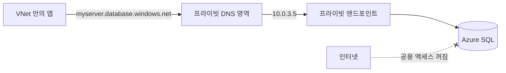
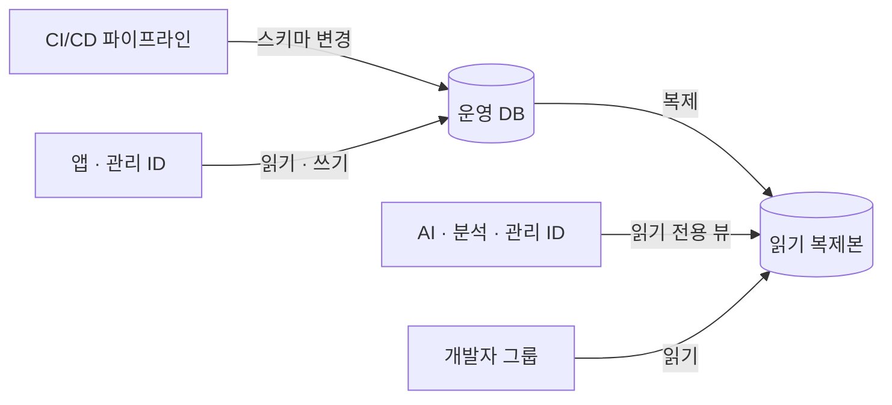

# DB 접근 관리

실무 질문이다. Azure SQL Database나 Azure Database for PostgreSQL에 붙을 때 네트워크와 계정을 보통 어떻게 관리하는지 정리했다.

DB 접근은 두 가지를 따로 정한다. 어디서 들어올 수 있나(네트워크)와 누구로 들어오나(인증)다.

## 네트워크

| 방식 | 구조 | 쓰는 곳 |
|---|---|---|
| 공용 엔드포인트 + 방화벽 | 인터넷 주소로 접속하고, 방화벽에 허용한 IP만 들어온다 | 개발, 개인 실습 |
| 프라이빗 엔드포인트 | VNet 서브넷에 DB용 사설 IP를 만들고, 공용 네트워크 액세스는 끈다 | 운영 |

운영 DB는 프라이빗 엔드포인트로 VNet 안에서만 붙게 하고 공용 접속을 끈다. 개발자가 로컬에서 붙어야 하면 VPN(P2S)이나 Bastion을 거쳐 VNet 안으로 들어온다.

### 프라이빗 엔드포인트를 만든 뒤 공용 접속 끄기

프라이빗 엔드포인트를 만들어도 공용 엔드포인트는 그대로 열려 있다. 따로 공용 네트워크 액세스를 사용 안 함(Disabled)으로 바꿔야 막힌다. 끄면 인터넷에서 들어오는 접속은 방화벽 규칙과 상관없이 거부된다.

접속 주소(예: myserver.database.windows.net)는 바꾸지 않는다. 프라이빗 DNS 영역(privatelink.database.windows.net)을 VNet에 연결해 두면, VNet 안에서는 같은 이름이 프라이빗 엔드포인트의 사설 IP로 풀린다. 앱 연결 문자열은 그대로 두고 네트워크 경로만 바뀐다.



DNS 연결을 빼먹으면 이름이 공용 IP로 풀려서, 공용 액세스를 끈 뒤 앱이 접속하지 못한다. 실무에서 가장 흔한 실수다.

## 인증

| 방식 | 비밀번호 | 판단 |
|---|---|---|
| DB 자체 계정(SQL 인증) | DB에 아이디와 비밀번호를 만든다 | 비밀번호를 어딘가 보관하고 돌려 줘야 한다. 퇴사자 계정 정리도 DB마다 따로 한다 |
| Entra ID 인증 | 사람은 회사 계정으로, 앱은 관리 ID로 접속한다 | 비밀번호가 없다. 계정 관리를 Entra ID 한 곳에서 한다. 권장 방식이다 |

관리 ID(Managed Identity)는 VM, App Service, 컨테이너 같은 Azure 리소스에 붙는 Entra ID 계정이다. 앱이 이 ID로 토큰을 받아 DB에 접속하므로 코드나 설정 파일에 비밀번호가 없다.

DB 자체 계정을 꼭 써야 하면(지원하지 않는 도구, 오래된 앱) 비밀번호를 Key Vault에 넣고, 앱은 관리 ID로 Key Vault에서 꺼내 쓴다.

## 용도별 계정

계정은 사람마다가 아니라 용도마다 나누고, 용도에 필요한 권한만 준다.

| 용도 | 주체 | 권한 |
|---|---|---|
| DB 관리자 | Entra 그룹(DBA 그룹) | 서버 관리자. 평소에는 비워 두고 PIM으로 필요할 때만 올린다 |
| 운영 배포(스키마 변경) | CI/CD 파이프라인의 서비스 주체 | 테이블 생성·변경(db_ddladmin) + 읽기·쓰기. 파이프라인에서만 쓴다 |
| 애플리케이션 실행 | 앱의 관리 ID | 읽기·쓰기(db_datareader, db_datawriter). 스키마 변경 권한은 없다 |
| 읽기 전용(분석, AI) | 전용 관리 ID나 서비스 주체 | 읽기(db_datareader)만. 가능하면 노출할 뷰에만 권한을 준다 |
| 개발자 조회 | Entra 그룹(개발자 그룹) | 운영은 읽기만, 개발 DB는 넓게 |



Azure SQL Database에서 Entra 주체를 DB 사용자로 만들고 역할을 주는 예다.

```sql
CREATE USER [app-orders-mi] FROM EXTERNAL PROVIDER;
ALTER ROLE db_datareader ADD MEMBER [app-orders-mi];
ALTER ROLE db_datawriter ADD MEMBER [app-orders-mi];

CREATE USER [ai-readonly-mi] FROM EXTERNAL PROVIDER;
GRANT SELECT ON SCHEMA::reporting TO [ai-readonly-mi];
```

## 읽기 복제본

읽기 복제본은 운영 DB(주 DB)의 변경을 계속 받아 따라가는 읽기 전용 사본이다. 쓰기는 주 DB에만 하고, 조회만 하는 작업은 복제본으로 보내서 주 DB의 부담을 덜어 준다.

| 서비스 | 방식 | 쓰는 법 |
|---|---|---|
| Azure SQL Database | 읽기 확장(read scale-out). Premium, 중요 비즈니스용, Hyperscale 계층에 기본으로 들어 있는 읽기 전용 복제본 | 연결 문자열에 ApplicationIntent=ReadOnly를 넣으면 복제본으로 간다. 추가 비용이 없다 |
| Azure SQL Database | 지역 복제(geo-replication)의 보조 DB | 다른 리전에 둔 보조 DB도 읽기 전용으로 붙을 수 있다 |
| Azure Database for PostgreSQL | 읽기 복제본 | 복제본 서버를 따로 만든다. 서버 하나만큼 비용이 더 든다 |

복제는 비동기라서 복제본은 주 DB보다 아주 조금 늦다. 방금 쓴 데이터를 바로 다시 읽어야 하는 화면은 주 DB에서 읽고, 통계, 리포트, AI 조회처럼 약간 늦어도 되는 작업을 복제본으로 보낸다.

## AI나 분석용 읽기 계정에서 따로 챙길 것

- 원본 테이블 전체가 아니라 필요한 컬럼만 담은 뷰나 별도 스키마에만 권한을 준다. 개인정보 컬럼은 뷰에서 뺀다
- 무거운 조회가 운영 트래픽을 느리게 하지 않도록 읽기 복제본(Azure SQL의 읽기 확장, PostgreSQL 읽기 복제본)으로 보낸다
- 운영 쓰기 계정을 같이 쓰지 않는다. AI가 실수로 쓰기 쿼리를 만들어도 권한에서 막힌다
