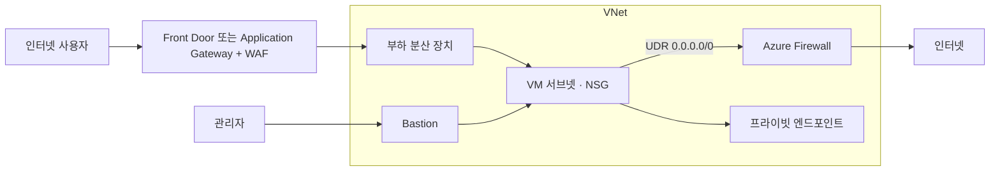

# VNet 보안·운영 옵션

실무 질문이다. NSG 인바운드·아웃바운드 규칙 말고 VNet에 흔히 붙이는 옵션을 정리했다. 대부분 AZ-104 가상 네트워킹 영역에도 나온다.

## 국가별 IP 차단

NSG에는 국가 조건이 없다. NSG가 아는 건 IP 주소, 포트, 서비스 태그(Internet, AzureCloud, Storage 같은 Azure 서비스 IP 묶음)뿐이다.

| 트래픽 | 방법 |
|---|---|
| 웹(HTTP·HTTPS) | Azure Front Door나 Application Gateway의 WAF에서 지역 필터(geo-match) 사용자 지정 규칙으로 국가를 막는다. 가장 흔한 방법이다 |
| 웹이 아닌 TCP·UDP | Azure 기본 기능으로는 국가 단위 차단이 없다. 국가별 IP 목록을 NSG나 Azure Firewall IP 그룹에 직접 넣거나, 서드파티 방화벽 장비를 쓴다 |

## 로그 남기기

| 무엇을 | 어디서 | 남는 내용 |
|---|---|---|
| VNet을 지나는 트래픽 | Network Watcher의 VNet 흐름 로그 | 출발지·목적지 IP, 포트, 허용·거부 여부. 스토리지 계정에 쌓는다 |
| 트래픽 요약과 시각화 | 트래픽 분석(Traffic Analytics) | 흐름 로그를 Log Analytics로 모아 상위 통신 대상, 차단된 시도, 외부 접속 국가를 대시보드로 보여 준다 |
| 웹 요청과 차단 기록 | WAF 로그(진단 설정) | 요청 URL, 걸린 규칙, 차단 여부 |
| 방화벽을 지난 트래픽 | Azure Firewall 로그(진단 설정) | 허용·거부된 연결, 위협 인텔리전스 탐지 |
| 리소스 설정 변경 | 활동 로그(Activity Log) | 누가 언제 NSG 규칙을 바꿨는지 같은 관리 작업 기록 |

NSG 흐름 로그는 은퇴 예정이라 새로 만들 수 없다. 지금은 VNet 흐름 로그를 쓴다. 활동 로그는 기본 90일만 보관되므로 오래 남기려면 진단 설정으로 Log Analytics나 스토리지 계정에 내보낸다.

## 관리 접속: Azure Bastion

VM에 공용 IP를 붙이고 RDP(3389)나 SSH(22)를 인터넷에 여는 건 가장 흔한 공격 대상이다. Bastion을 VNet에 두면 관리자가 Azure 포털(또는 네이티브 클라이언트)로 Bastion을 거쳐 VM의 사설 IP로 접속한다. VM에는 공용 IP가 필요 없다. Bastion은 AzureBastionSubnet이라는 이름의 전용 서브넷이 있어야 한다.

## 나가는 트래픽 통제

| 옵션 | 하는 일 |
|---|---|
| NAT Gateway | 서브넷의 나가는 트래픽을 고정 공용 IP로 내보낸다. 외부 업체에 우리 IP를 등록해야 할 때 쓴다 |
| Azure Firewall | 나가는 트래픽을 도메인(FQDN) 단위로 허용·차단하고, 알려진 악성 IP·도메인을 막는다. 여러 VNet의 출구를 한곳에 모은다 |
| 사용자 정의 경로(UDR) | 경로 테이블로 0.0.0.0/0을 방화벽으로 보내서 모든 외부 트래픽이 방화벽을 거치게 한다 |

새로 만드는 VNet은 기본 아웃바운드 액세스가 꺼진 비공개 서브넷이 기본이 되는 쪽으로 바뀌고 있다. VM이 인터넷으로 나가야 하면 NAT Gateway, 공용 IP, 부하 분산 장치 아웃바운드 규칙 중 하나를 명시적으로 붙인다.

## NSG를 관리하기 쉽게

| 옵션 | 하는 일 |
|---|---|
| 서비스 태그 | Azure 서비스의 IP 묶음을 이름으로 쓴다. 예: 아웃바운드에서 Storage.KoreaCentral만 허용 |
| 애플리케이션 보안 그룹(ASG) | VM을 웹, DB 같은 역할로 묶고 규칙을 IP 대신 역할로 쓴다. 예: 웹 ASG에서 DB ASG로 1433 허용 |

## 그 밖에 자주 붙이는 것

| 옵션 | 하는 일 |
|---|---|
| DDoS 보호 | 기본 인프라 보호는 무료로 항상 켜져 있다. DDoS Network Protection(유료)은 공용 IP별 맞춤 탐지, 공격 보고서, 공격 때 늘어난 비용 보상을 더한다 |
| 프라이빗 엔드포인트 + 프라이빗 DNS 영역 | PaaS 서비스를 VNet 사설 IP로 붙이고 공용 접속을 끈다 |
| Network Watcher 진단 도구 | IP 흐름 확인(어느 NSG 규칙에 걸렸는지), 유효 보안 규칙, 연결 문제 해결, 다음 홉. 연결이 안 될 때 원인을 찾는다 |

## 무료와 유료

VNet의 기본 통제 기능은 무료이고, 트래픽 내용을 들여다보거나 대신 처리해 주는 기능은 유료다. 유료 서비스는 대부분 켜 둔 시간만큼 시간 단위로 과금되고, 처리한 데이터 양만큼 추가로 붙는다. 정확한 금액은 리전과 시점에 따라 바뀌므로 Azure 가격 계산기로 확인한다.

| 구분 | 옵션 |
|---|---|
| 무료 | NSG, 애플리케이션 보안 그룹, 서비스 태그, 사용자 정의 경로, DDoS 기본 인프라 보호, 활동 로그 90일 보관 |
| 거의 무료 | 프라이빗 DNS 영역(영역과 쿼리 수 기준으로 소액), Network Watcher 진단 도구(무료 사용량 있음) |
| 데이터 양만큼 유료 | VNet 피어링(오가는 데이터 GB당), VNet 흐름 로그(수집 GB당 + 스토리지), 트래픽 분석(Log Analytics 수집량) |
| 켜 둔 시간 + 데이터 양만큼 유료 | 프라이빗 엔드포인트, NAT Gateway, Bastion, Application Gateway WAF, Front Door, Azure Firewall |
| 월 고정으로 비싼 편 | DDoS Network Protection |

Azure Firewall과 DDoS Network Protection은 작은 서비스에는 부담되는 금액이라 보통 허브에 하나만 두고 여러 VNet이 같이 쓴다. Bastion은 일부 리전에서 기능이 제한된 무료 Developer 계층을 제공한다.
