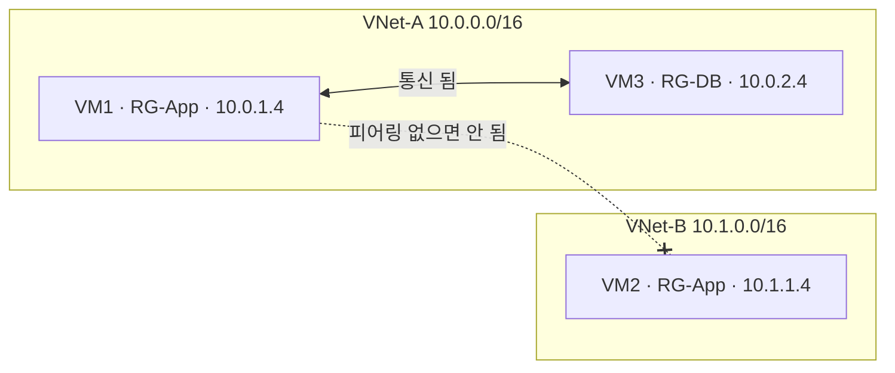
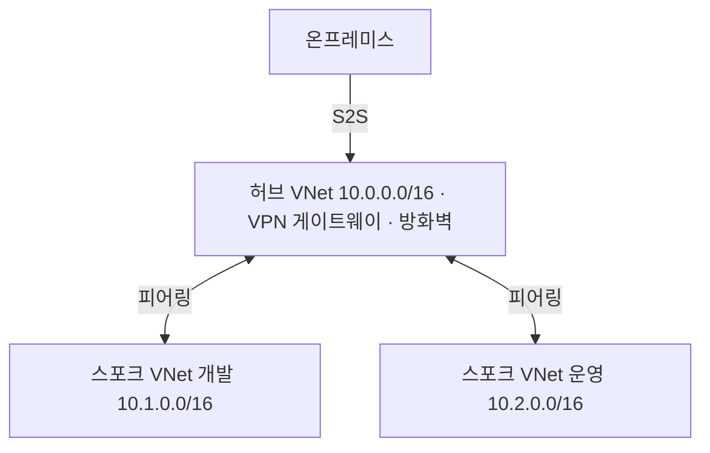

# VNet과 리소스 그룹

실무 질문이다. 같은 리소스 그룹 안이면 사설 IP로 서로 통신할 수 있는지 정리했다.

## 리소스 그룹은 네트워크 경계가 아니다

리소스 그룹은 관리용 폴더일 뿐이다. 권한(RBAC), 태그, 비용, 일괄 삭제를 묶는 단위이고 네트워크와는 관계가 없다. 통신할 수 있는지는 오직 VNet으로 정해진다.

| 경우 | 사설 IP로 통신 |
|---|---|
| 같은 리소스 그룹, 다른 VNet | 안 된다. 피어링이 필요하다 |
| 다른 리소스 그룹, 같은 VNet | 된다 |
| 다른 구독, 피어링한 VNet | 된다 |

위 그림에서 VM1과 VM3은 리소스 그룹이 달라도 같은 VNet-A에 있어서 통신한다. VM1과 VM2는 같은 리소스 그룹이어도 VNet이 달라서 피어링 없이는 통신하지 못한다.

VM은 네트워크 인터페이스(NIC)로 VNet의 서브넷에 붙는다. NIC는 VNet과 리소스 그룹이 달라도 되지만, 구독과 리전은 같아야 한다.

## VNet 안의 기준

- VNet 하나는 리전 하나에 속하고, 주소 공간(예: 10.0.0.0/16)을 갖는다
- VNet을 서브넷(예: 10.0.1.0/24 웹, 10.0.2.0/24 DB)으로 나눈다
- 같은 VNet 안의 서브넷끼리는 기본으로 다 통신된다. 막으려면 서브넷이나 NIC에 NSG를 건다
- 다른 VNet과는 기본으로 격리된다. 피어링이나 VPN으로만 연결한다

## 주소를 겹치지 않게 잡는다

포털에서 VNet을 만들면 기본 주소가 10.0.0.0/16이다. 기본값 그대로 VNet을 여러 개 만들면 주소가 겹치고, 주소가 겹치는 VNet끼리는 피어링할 수 없다. 온프레미스와 VPN으로 연결할 때도 마찬가지다. 그래서 처음부터 VNet마다 다른 대역을 나눠 준다.

## 흔한 구성: 허브-스포크

리소스 그룹을 기준으로 VNet을 나누지 않고, 역할과 격리 수준을 기준으로 나눈다.

- 허브에 VPN 게이트웨이, 방화벽처럼 같이 쓰는 것을 둔다
- 서비스나 환경(개발, 운영)마다 스포크 VNet을 두고 허브와 피어링한다
- 스포크끼리는 피어링이 전이되지 않아서 기본으로 격리된다. 서로 통신이 필요하면 허브의 방화벽을 거치게 하거나 따로 피어링한다

## PaaS는 기본적으로 VNet 밖에 있다

Storage 계정, Azure SQL Database 같은 PaaS 서비스는 VM과 달리 VNet 안에 있지 않다. 기본으로 공용 엔드포인트로 접속한다. VNet 안에서 사설 IP로 붙이려면 프라이빗 엔드포인트를 만들어 VNet 서브넷에 사설 IP를 하나 받는다.
