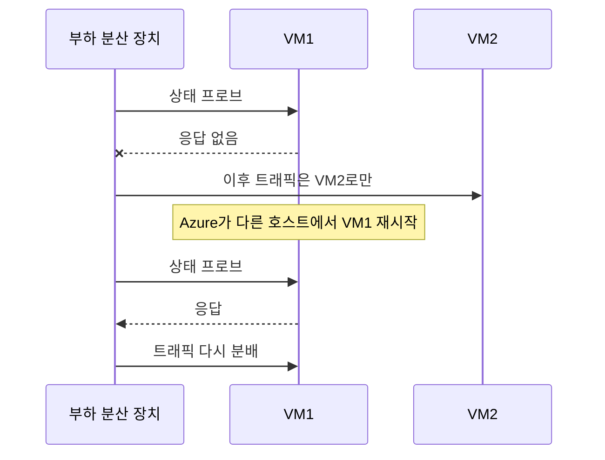
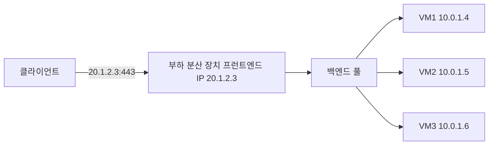
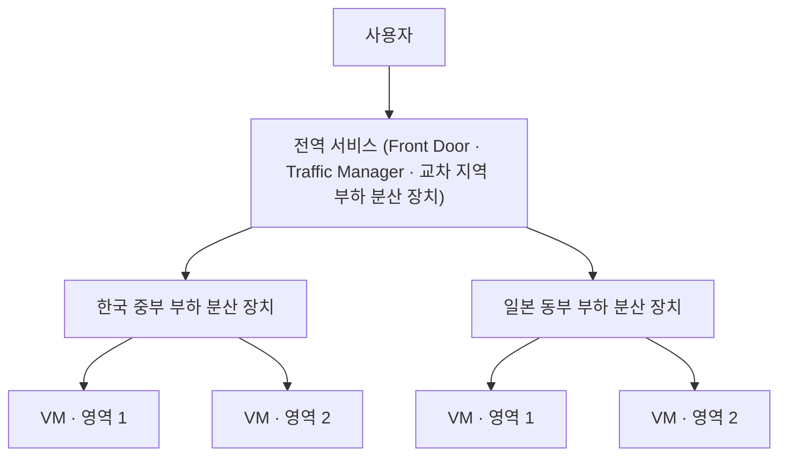

# 고가용성과 자동 전환

실무 질문이다. 가용성 집합에 VM을 여러 대 두었을 때 한 대가 멈추면 자동으로 넘어가는지 정리했다.

## 누가 무엇을 자동으로 하나

가용성 집합 자체는 아무것도 전환하지 않는다. VM을 흩어 놓을 뿐이다. 자동 전환은 다른 구성 요소가 나눠서 맡는다.

| 구성 요소 | 자동으로 하는 일 | 하지 않는 일 |
|---|---|---|
| 부하 분산 장치 상태 프로브 | 응답하지 않는 VM을 트래픽 대상에서 빼고, 살아나면 다시 넣는다 | VM을 고치거나 다시 켜지 않는다 |
| Azure 서비스 복구(service healing) | 호스트 하드웨어가 고장 나면 VM을 다른 호스트에서 다시 시작한다 | 재시작 동안의 중단은 막지 못한다 |
| 가상 머신 확장 집합의 자동 복구 | 상태가 나쁜 인스턴스를 지우고 새로 만든다 | 일반 VM에는 없다 |

상태 프로브는 몇 초 간격으로 VM의 포트나 HTTP 경로를 확인한다. 확인에 실패하면 그 VM으로 새 연결을 보내지 않는다. 사람이 손대지 않아도 되므로 웹 서버처럼 상태를 갖지 않는 서버는 사실상 자동 전환된다.

## 상태가 있는 서버는 다르다

데이터베이스처럼 데이터를 가진 서버는 부하 분산 장치만으로 전환되지 않는다. VM2가 VM1의 데이터를 갖고 있지 않으면 트래픽을 넘겨도 쓸 수가 없다. 이 경우 데이터 복제와 전환을 애플리케이션이나 제품이 따로 맡는다.

| 방식 | 구조 | 예 |
|---|---|---|
| 액티브-액티브 | 모든 VM이 동시에 요청을 받는다 | 상태 없는 웹 서버 여러 대 |
| 액티브-패시브 | 한 대만 요청을 받고 대기 서버가 데이터를 복제받다가 장애 시 승격된다 | SQL Server Always On 가용성 그룹, PostgreSQL 복제 |

DB를 직접 VM에 올리면 이 전환 구성을 직접 해야 한다. Azure SQL Database나 Azure Database for PostgreSQL 같은 관리형 서비스를 쓰면 Azure가 전환까지 맡는다.

## VM마다 IP가 다른데 어떻게 넘어가나

VM은 각자 다른 사설 IP를 그대로 갖는다. 클라이언트는 VM IP가 아니라 부하 분산 장치의 프런트엔드 IP 하나로만 접속한다. 부하 분산 장치가 그 요청을 백엔드 풀에 있는 VM들의 사설 IP 중 살아 있는 곳으로 보낸다.

| 구분 | IP | 바뀌나 |
|---|---|---|
| 프런트엔드 IP | 공용 IP(외부용 부하 분산 장치) 또는 사설 IP(내부용 부하 분산 장치) | 고정된다. 클라이언트가 아는 주소는 이것뿐이다 |
| 백엔드 VM IP | VM마다 다른 사설 IP | VM이 빠지고 들어와도 클라이언트는 모른다 |

그래서 백엔드 VM에는 공용 IP가 없어도 된다. 외부에서 VM으로 직접 들어오는 길을 열지 않아도 되어 보안상으로도 낫다.

DB 같은 액티브-패시브 구성도 같은 원리를 쓴다. 온프레미스에서는 장애 시 가상 IP를 대기 서버로 옮기는 방식을 흔히 쓰지만, Azure 가상 네트워크는 이렇게 IP를 서버 사이에서 옮기는 방식을 지원하지 않는다. 그래서 SQL Server Always On의 리스너도 Azure에서는 내부 부하 분산 장치나 분산 네트워크 이름(DNN)으로 구성한다. 내부 부하 분산 장치의 상태 프로브가 현재 주 서버에만 트래픽을 보낸다.

## 가용성 범위와 부하 분산 장치

VM을 흩어 놓는 기능과 트래픽을 나눠 주는 기능은 따로 있다. 가용성 집합이나 가용성 영역은 VM을 흩어 놓기만 하고, 클라이언트를 살아 있는 VM으로 보내는 건 부하 분산 장치가 한다. 그래서 둘을 같이 붙이는 게 기본 구성이다. HTTP 트래픽이면 부하 분산 장치 대신 Application Gateway를 쓰기도 한다.

고가용성이라고 해서 처음부터 여러 리전에 나누지는 않는다. 범위는 세 단계다.

| 범위 | 대비하는 장애 | 수단 |
|---|---|---|
| 데이터센터 안 | 랙 고장, 호스트 유지 관리 | 가용성 집합 |
| 리전 안 | 데이터센터 하나 전체 장애 | 가용성 영역 |
| 여러 리전 | 리전 전체 장애, 재해 | 다른 리전에 같은 구성 복제 |

보통 고가용성은 한 리전 안에서 가용성 영역으로 나누는 것을 말한다. 여러 리전 구성은 재해 복구(DR) 쪽이다. 데이터를 리전 사이로 복제해야 하고 비용도 두 배 가까이 들어서 필요한 서비스에만 쓴다.

## 다른 리전 VM을 한 부하 분산 장치에 붙일 수 있나

안 된다. Azure Load Balancer는 리전 리소스이고, 백엔드 풀의 VM은 부하 분산 장치와 같은 가상 네트워크에 있어야 한다. 가상 네트워크는 리전 하나에 속하므로 다른 리전 VM은 넣을 수 없다.

여러 리전에 나눌 때는 리전마다 부하 분산 장치를 두고, 그 위에 전역 서비스를 하나 더 둔다.

| 전역 서비스 | 동작 계층 | 방식 |
|---|---|---|
| Azure Front Door | L7, HTTP·HTTPS | 전 세계 엣지에서 요청을 받아 가까운 정상 리전으로 보낸다. WAF, 캐시도 붙는다 |
| Traffic Manager | DNS | DNS 응답으로 정상 리전의 주소를 알려 준다. 트래픽 자체는 거치지 않는다 |
| 교차 지역 부하 분산 장치 | L4, TCP·UDP | 전역 IP 하나로 받아 리전별 Standard 부하 분산 장치로 보낸다 |
