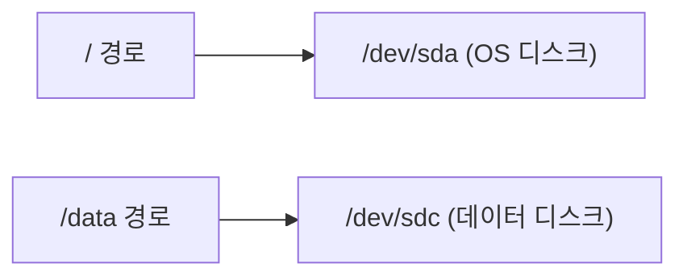
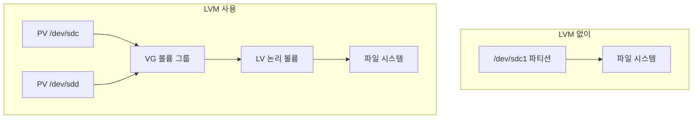
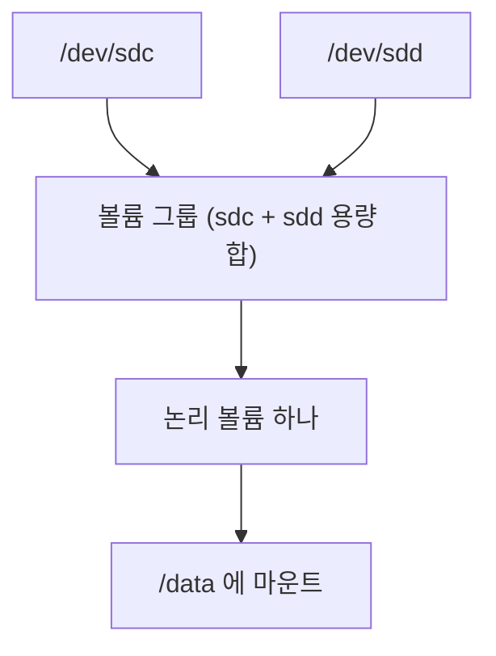

# 리눅스 디스크와 마운트

실무 질문이다. 데이터 디스크를 다른 VM에 붙이는 문제를 풀다가 나온 질문을 정리했다.

## 디스크를 붙여도 기존 공간이 늘지 않는 이유

리눅스에서 디스크는 장치일 뿐이다. 파일을 쓰려면 디스크에 파일 시스템을 만들고 디렉터리에 마운트해야 한다. 그리고 파일은 그 파일이 놓인 경로가 마운트된 디스크에만 써진다.



/dev/sdc를 /data에 마운트하면 /data 아래에 쓰는 파일만 sdc로 간다. /var나 /home처럼 다른 경로에 쓰는 파일은 계속 OS 디스크로 간다. 그래서 OS 디스크가 가득 차면 sdc가 비어 있어도 그 경로에는 더 못 쓴다. 디스크 두 개가 하나의 공간으로 합쳐지지 않는다.

마운트를 안 했으면 sdc는 아예 쓰이지 않는다. 마운트를 해도 데이터가 쌓이는 경로가 sdc 쪽이 아니면 결과는 같다.

## LVM

LVM(Logical Volume Manager)은 리눅스의 디스크 관리 계층이다. 물리 디스크와 파일 시스템 사이에 한 단계를 끼워 넣는다. LVM 없이는 파일 시스템이 디스크 파티션 위에 바로 올라가서 크기가 그 파티션에 묶인다. LVM을 쓰면 파일 시스템이 논리 볼륨 위에 올라가고, 논리 볼륨의 크기는 디스크 경계와 상관없이 정할 수 있다.



| 단계 | 이름 | 하는 일 |
|---|---|---|
| PV | 물리 볼륨(Physical Volume) | 디스크나 파티션을 LVM이 쓸 수 있게 표시한 것 |
| VG | 볼륨 그룹(Volume Group) | PV 여러 개의 용량을 합친 저장 공간 |
| LV | 논리 볼륨(Logical Volume) | VG에서 원하는 크기만큼 떼어낸 볼륨. 여기에 파일 시스템을 만들고 마운트한다 |

LVM으로 할 수 있는 일은 다음과 같다.

- 운영 중에 디스크를 VG에 추가하고 LV를 늘린다
- LV 하나를 여러 디스크에 걸쳐 만든다
- 스냅샷을 떠서 특정 시점 상태를 보존한다

Windows에서 비슷한 역할은 저장소 공간(Storage Spaces)이나 디스크 관리의 스팬 볼륨이 한다.

## 디스크를 이어 붙여 하나처럼 쓰기

디스크 여러 개를 이어서 공간 하나처럼 쓸 수 있다. 다만 OS가 알아서 해 주지 않고, 그렇게 구성해야 한다.



| 방법 | 하는 일 | 특징 |
|---|---|---|
| LVM | 디스크를 볼륨 그룹으로 묶고, 그 위에 논리 볼륨을 만든다 | 운영 중에 디스크를 추가해 볼륨을 늘릴 수 있다. 가장 일반적이다 |
| mdadm RAID 0 | 디스크를 스트라이프로 묶는다 | 디스크 여러 개에 나눠 써서 속도가 빨라진다. 디스크 추가로 늘리기는 어렵다 |
| 심볼릭 링크 | 특정 디렉터리만 다른 디스크로 연결한다 | 공간을 합치지 않는다. 그 경로만 sdc로 보낸다 |

LVM으로 새 디스크를 기존 볼륨에 붙이는 흐름은 다음과 같다.

```bash
pvcreate /dev/sdd                        # 새 디스크를 LVM용으로 준비
vgextend datavg /dev/sdd                 # 기존 볼륨 그룹에 추가
lvextend -r -l +100%FREE /dev/datavg/datalv   # 논리 볼륨과 파일 시스템을 함께 확장
```

주의할 점이 있다.

- 기존 디스크가 처음부터 LVM이어야 이렇게 붙일 수 있다. 일반 파티션으로 만든 OS 디스크에는 다른 디스크를 이어 붙일 수 없다. 이 경우 OS 디스크 자체를 키우거나 데이터를 새 디스크로 옮긴다
- 이어 붙인 디스크 중 하나가 망가지면 볼륨 전체를 잃는다. Azure 관리 디스크는 디스크 자체가 3중 복제라서 이 위험이 낮다
- Azure 문서는 데이터 디스크 여러 개를 쓸 때 LVM이나 mdadm으로 스트라이프해서 처리량을 합치라고 권장한다

심볼릭 링크로도 비슷한 효과를 낼 수 있다. 예를 들어 /var/log를 /data/log로 옮기고 원래 자리에 링크를 걸면 로그는 sdc에 쌓인다. 공간을 합치는 게 아니라 특정 경로만 다른 디스크로 보내는 방법이다.

## 공간이 부족할 때 고르는 방법

| 방법 | 하는 일 | 쓰는 경우 |
|---|---|---|
| 데이터를 새 디스크로 옮기기 | 용량을 많이 쓰는 디렉터리(로그, DB, 컨테이너 데이터)를 sdc로 옮기고 그 경로에 sdc를 마운트 | 가장 흔한 방법이다 |
| 디스크 자체 확장 | Azure에서 디스크 크기를 늘린 뒤 OS에서 파티션과 파일 시스템을 늘림(growpart, resize2fs 또는 xfs_growfs) | 같은 디스크의 공간이 더 필요할 때 |
| LVM으로 묶기 | 여러 디스크를 볼륨 그룹 하나로 묶어 논리 볼륨을 늘림 | 처음부터 LVM으로 구성한 경우 |

## 새 디스크를 쓰기까지의 순서

다른 VM에서 쓰던 디스크는 이미 파일 시스템이 있으니 1~2단계를 건너뛴다. 빈 디스크면 처음부터 한다.

1. 파티션을 만든다
2. 파일 시스템을 만든다(mkfs)
3. 디렉터리에 마운트한다
4. 재부팅 뒤에도 자동으로 붙도록 /etc/fstab에 UUID로 등록한다. Azure 문서는 nofail 옵션을 권장한다. 디스크가 빠져도 부팅이 멈추지 않는다

## Azure VM에서 주의할 장치

| 장치 | 용도 |
|---|---|
| /dev/sda | OS 디스크 |
| /dev/sdb | 임시 디스크. 많은 크기에서 /mnt에 붙는다. 할당 취소나 재배치 때 데이터가 사라진다 |
| /dev/sdc 이후 | 붙인 데이터 디스크 |

장치 이름은 부팅마다 바뀔 수 있다. fstab에 /dev/sdc처럼 이름으로 적지 않고 UUID로 적는 이유가 이것이다.
