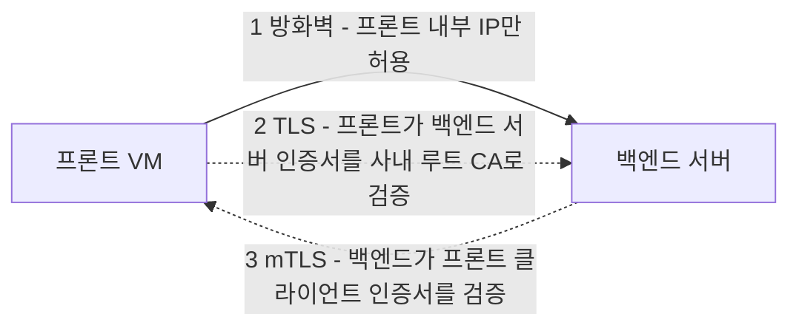

# 인증서와 mTLS

실무 질문이다. 리눅스 VM에 사내 루트 CA를 넣는 문제를 풀다가 나온 질문을 정리했다.

## 루트 CA를 OS에 넣는 이유

방향을 헷갈리기 쉽다. VM이 서버로서 클라이언트를 검사하려는 게 아니다. VM이 클라이언트로서 사내 다른 서버에 요청할 때, 상대가 진짜 사내 서버인지 VM이 직접 확인하기 위해서다.

- 웹서버를 띄우거나 443 포트를 열 필요가 없다
- VM에서 curl을 실행하거나 애플리케이션이 API를 호출하면, TLS 라이브러리가 OS 신뢰 저장소의 루트 CA로 상대 인증서를 검증한다
- 누군가 DNS를 조작해 트래픽을 가짜 서버로 돌려도, 그 서버가 사내 CA로 서명된 인증서를 내밀지 못하면 VM이 데이터를 보내기 전에 연결을 끊는다. 단, 사내 CA의 개인 키가 유출되면 이 방어는 의미가 없다

## 네트워크 차단과 인증서 검증

| 구분 | 계층 | 막는 방식 |
|---|---|---|
| NSG·방화벽 | 네트워크(L3·L4) | 허용하지 않은 IP와 포트는 연결 자체를 막는다 |
| 인증서 검증 | 애플리케이션(TLS) | 연결은 됐지만 상대 인증서를 신뢰할 수 없으면 통신을 거부한다 |

## 서버 간 통신 보안

프론트 VM에서 백엔드 서버로 가는 통신을 세 단계로 지킨다.

1. 방화벽: 백엔드 방화벽이나 NSG에서 프론트 VM의 내부 IP만 허용한다. 외부에서 들어오는 포트 스캔 같은 직접 접근을 네트워크 단에서 막는다.
2. 일반 TLS: 프론트 VM은 사내 루트 CA로 백엔드 서버 인증서를 검증한다. 이 단계가 지키는 건 프론트 쪽이다. 프론트가 가짜 백엔드로 데이터를 보내는 일을 막는다. 일반 TLS에서는 클라이언트가 인증서를 내지 않으므로, IP를 위조해 백엔드에 접근하는 쪽은 이 단계로 막지 못한다.
3. mTLS(상호 TLS): 프론트 VM도 자기 클라이언트 인증서를 백엔드에 제출한다. 백엔드(Nginx 등)는 그 인증서가 사내 CA로 서명됐는지 확인한 뒤에만 요청을 받는다. IP를 위조하거나 프론트를 거치지 않고 API를 직접 부르는 요청은 여기서 걸러진다.
