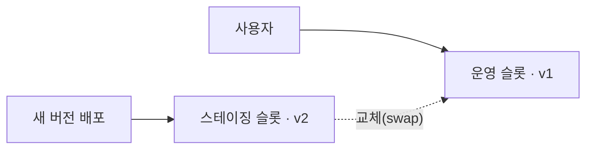

# 컴퓨팅 2

시험 영역 중 컴퓨팅 리소스 배포·관리(20~25%)에 해당하는 내용이다. 2편은 App Service와 컨테이너를 다룬다. ARM 템플릿과 VM은 [1편](컴퓨팅-1.md)에 있다.

## 앱을 올리는 서비스 고르기

| 서비스 | 성격 | 맞는 경우 |
|---|---|---|
| Container Instances(ACI) | 컨테이너 하나(그룹)를 바로 띄운다. 확장과 버전 전환이 없다 | 잠깐 돌리는 단발성 작업 |
| Container Apps | Azure가 관리하는 쿠버네티스 위에서 확장과 버전 관리를 대신 해 준다 | 컨테이너로 된 서비스 여러 개, 이벤트로 늘고 주는 워커 |
| App Service | 웹앱 전용 PaaS. 계획 단위로 VM을 빌린다 | 웹앱이나 API 하나를 코드로 올릴 때 |
| AKS | 쿠버네티스를 직접 운영한다 | 쿠버네티스 기능을 직접 다뤄야 할 때 |

## App Service와 Container Apps

App Service는 코드를 올리면 Azure가 런타임(.NET, Java, Node, Python, PHP)을 준비해 실행한다. 컨테이너 이미지도 올릴 수 있다. 앱은 App Service 계획(App Service Plan) 위에서 돈다. 계획은 앱이 올라갈 VM 묶음이라 요청이 없어도 VM 수만큼 요금이 나가고 0대로 줄일 수 없다. 계획 하나에 웹앱 여러 개를 올려 같은 VM을 나눠 쓴다.

Container Apps는 컨테이너 이미지만 올린다. 내부는 Azure가 관리하는 쿠버네티스이고 KEDA(이벤트 기반 확장), Envoy(트래픽 처리), Dapr(마이크로서비스 도구)가 들어 있다. `kubectl` 같은 쿠버네티스 접근은 없다. 앱은 환경(Environment) 안에 들어가고, 같은 환경의 앱끼리 VNet과 로그 작업 영역을 같이 쓰며 내부 이름으로 서로 호출한다.

| | App Service | Container Apps |
|---|---|---|
| 올리는 것 | 코드 또는 컨테이너 | 컨테이너 |
| 과금 | 계획의 VM 수 × 시간 | 쓴 만큼(vCPU 초, 메모리 초, 요청 수). 전용 워크로드 프로필은 예외 |
| 0으로 축소 | 안 된다 | 된다 |
| 자동 확장 기준 | CPU, 메모리, HTTP 큐 같은 메트릭 | HTTP 동시 요청, CPU, 메모리, 이벤트(KEDA) |
| 버전 전환 | 배포 슬롯(staging에 배포 후 swap) | 리비전(버전별 트래픽 비율) |
| 앱끼리 통신 | 각자 공용 주소. 내부 통신은 VNet 통합으로 따로 | 환경 안에서 내부 인그레스와 서비스 이름 |
| 배치·예약 작업 | WebJobs | Container Apps 작업(Jobs) |

Container Apps에서 Service Bus 메시지 수, Kafka, 큐 길이처럼 외부 이벤트로 복제본을 늘리는 규칙은 이벤트 기반(KEDA) 규칙이다.

웹앱 만들기 첫 화면에서 게시(Publish) 방식을 먼저 고른다.

| 게시 | 그다음 고르는 것 |
|---|---|
| 코드 | 런타임 스택(.NET, Node, Python, Java…)과 OS |
| 컨테이너 | 이미지 출처(ACR, Docker Hub, 개인 레지스트리)와 이미지, 태그 |

컨테이너 이미지를 웹앱에 쓰라는 문제는 게시다. 런타임 스택은 코드를 골랐을 때만 나오는 항목이고, 컨테이너는 이미지 안에 런타임이 들어 있다.

Linux 컨테이너 웹앱에 사용자 지정 도메인, 자동 스케일 아웃, 관리 최소, 비용 최소가 같이 나오면 App Service다. ACI는 자동 확장이 없고 AKS는 클러스터 관리 부담이 크다.

## App Service 계획 등급

| 등급 | 최대 인스턴스 | 자동 확장 | 배포 슬롯 | 사용자 지정 도메인 | 저장 공간 |
|---|---|---|---|---|---|
| Free, Shared | 공유 | 없다 | 없다 | Free는 없다 | 1GB |
| Basic | 3 | 없다 | 없다 | 있다 | 10GB |
| Standard | 10 | 있다 | 5 | 있다 | 50GB |
| Premium | 30 | 있다 | 20 | 있다 | 250GB |
| Isolated | 100 | 있다 | 20 | 있다. 전용 환경(ASE) | |

인스턴스 5대와 45GB, 사용자 지정 도메인, 비용 최소라면 Basic은 3대가 한도라 탈락하고 Standard다.

## 확장

| 용어 | 뜻 |
|---|---|
| 스케일 업 | 계획 등급이나 VM 크기를 올린다. 수직 확장 |
| 스케일 아웃 | 인스턴스 수를 늘린다. 수평 확장 |
| 배포 슬롯 | staging 같은 별도 배포 공간을 두고 운영과 swap한다. 확장과 관계없다 |

Basic 계획에는 자동 확장이 없다. CPU가 15분 동안 80%를 넘으면 늘리게 하려면 두 단계를 거친다.

1. 계획을 Standard 이상으로 스케일 업한다
2. 자동 확장에서 메트릭 기준 크기 조정을 고르고 CPU 규칙을 추가한다

인스턴스 수 기준 크기 조정은 대수를 고정하는 것이라 CPU 조건을 걸 수 없다.

## 배포 슬롯

배포 슬롯은 무중단 배포용 교체 공간이다. Standard 등급부터 쓸 수 있다.

1. 새 버전을 스테이징 슬롯에 배포한다. 슬롯마다 주소가 따로 있어서(`app-staging.azurewebsites.net`) 미리 확인할 수 있다
2. 교체하면 Azure가 스테이징 인스턴스를 먼저 깨워 둔 뒤 운영 트래픽을 넘긴다. 다운타임과 콜드 스타트가 없다
3. 문제가 생기면 다시 교체해서 롤백한다. 이전 버전이 스테이징 슬롯에 남아 있다

앱 설정이나 연결 문자열에 배포 슬롯 설정 표시를 하면 교체할 때 따라가지 않고 그 슬롯에 남는다. 스테이징은 테스트 DB, 운영은 운영 DB를 계속 쓰게 할 때 쓴다. 운영 트래픽 일부만 스테이징 슬롯으로 보내는 트래픽 비율 라우팅도 있다.

## 진단 로깅

| 로그 | 수준 선택 |
|---|---|
| 애플리케이션 로깅(파일 시스템) | 오류, 경고, 정보, 자세히 중 고른다 |
| 애플리케이션 로깅(Blob) | 오류, 경고, 정보, 자세히 중 고른다 |
| 자세한 오류 메시지 | 켜기·끄기만 |
| 웹 서버 로깅 | 켜기·끄기만 |

경고 이상을 남기라는 문제는 애플리케이션 로깅 두 가지의 수준을 경고로 맞춘다.

## 사용자 지정 도메인

| 레코드 | 가리키는 것 | App Service에서 |
|---|---|---|
| A | IP 주소 | App Service IP가 바뀌면 끊긴다 |
| CNAME | 다른 도메인 이름 | `webapp1.contoso.com`을 `app1.azurewebsites.net`으로 보낸다. IP가 바뀌어도 따라간다 |

IP가 바뀌어도 계속 접속되게 하라는 문제는 CNAME이다. 루트 도메인(`contoso.com`)에는 CNAME을 쓸 수 없어서 A 레코드와 소유권 확인용 TXT 레코드(`asuid`)를 만든다. 보기의 SOA는 Start of Authority 레코드다. 서비스 지향 아키텍처로 번역된 건 오역이다.

## Container Instances 영구 저장소

컨테이너가 재시작돼도 데이터가 남게 하려면 스토리지 계정에 파일 공유를 만들고 Azure Files 볼륨으로 마운트한다. Blob, 큐, 테이블은 볼륨으로 마운트하지 않는다.

## AKS API 서버 접근 제한

| 방법 | 동작 |
|---|---|
| 권한 있는 IP 범위(authorized IP ranges) | API 서버는 공용으로 두고 허용한 IP만 들어오게 한다 |
| 프라이빗 클러스터 | API 서버에 사설 IP만 줘서 VNet 안에서만 붙게 한다 |

스토리지 네트워크 설정과 같은 구조다. 공용 엔드포인트에 IP 제한을 걸거나 프라이빗으로 돌린다. 태그는 접근 제어와 관계없다.
