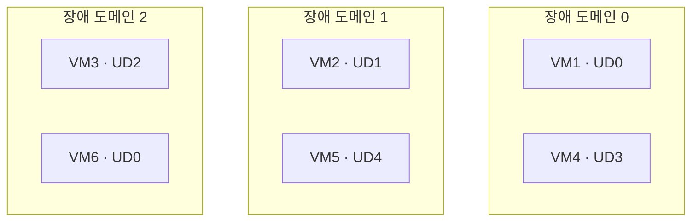
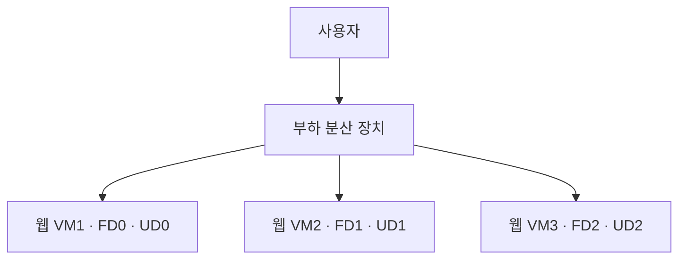
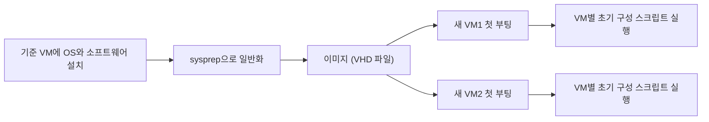

# 컴퓨팅

시험 영역 중 컴퓨팅 리소스 배포·관리(20~25%)에 해당하는 내용이다. ARM 템플릿과 Bicep도 이 영역에 들어간다.

## ARM 템플릿 배포

### 배포 기록 확인

ARM 템플릿으로 여러 리소스를 한 번에 배포했을 때 그 기록은 개별 리소스가 아니라 배포 대상 범위에 남는다. 리소스 그룹에 배포했다면 리소스 그룹의 배포(Deployments) 메뉴에서 본다.

배포 항목 하나를 열면 다음을 볼 수 있다.

- 당시 사용한 원본 템플릿
- 넘긴 매개변수 값
- 출력값과 리소스별 배포 결과

구독 범위로 배포했다면 구독의 배포 메뉴에 기록이 남는다.

### 비밀 값을 템플릿에 넘기기

관리자 암호 같은 비밀 값을 템플릿에 평문으로 적지 않으려면 Azure Key Vault에 비밀(secret)로 저장하고 매개변수 파일에서 참조한다. 준비할 것은 다음과 같다.

1. Key Vault를 만들고 암호를 비밀로 저장한다
2. Key Vault의 액세스 구성에서 템플릿 배포용 Azure Resource Manager 액세스를 켠다. 속성 이름은 enabledForTemplateDeployment다
3. 배포하는 사용자에게 Key Vault의 배포 권한(Microsoft.KeyVault/vaults/deploy/action)을 준다. 소유자나 기여자 역할에 들어 있다
4. 템플릿의 매개변수 형식을 securestring으로 두고, 매개변수 파일에서 Key Vault 비밀을 참조한다

```json
"adminPassword": {
  "reference": {
    "keyVault": { "id": "/subscriptions/<구독 ID>/resourceGroups/<RG>/providers/Microsoft.KeyVault/vaults/<KV 이름>" },
    "secretName": "vmAdminPassword"
  }
}
```

배포할 때 Resource Manager가 Key Vault에서 값을 직접 꺼내 쓴다. 암호는 템플릿, 매개변수 파일, 배포 기록 어디에도 평문으로 남지 않는다.

### 헷갈리는 것

- 배포 메뉴의 템플릿은 배포 당시의 원본이다. 리소스 그룹의 템플릿 내보내기(Export template)는 지금 리소스 상태를 템플릿으로 뽑아 준다. 배포 후 누군가 설정을 바꿨다면 둘이 다르다

## 가용성 집합

가용성 집합은 VM을 여러 하드웨어에 나눠 배치해서 한꺼번에 멈추지 않게 하는 묶음이다. 나누는 기준은 두 가지다.

| 구분 | 무엇을 대비하나 | 묶는 단위 | 최대값 | 기본값 |
|---|---|---|---|---|
| 장애 도메인(Fault Domain) | 하드웨어 장애(fabric failure) | 전원과 네트워크 스위치를 같이 쓰는 랙 | 3 (리전에 따라 2) | 2 |
| 업데이트 도메인(Update Domain) | 계획된 유지 관리 | 같이 재부팅되는 VM 묶음 | 20 | 5 |



VM은 장애 도메인과 업데이트 도메인에 차례로 하나씩 배정된다. 랙 하나가 죽으면 그 장애 도메인의 VM만 멈춘다. 유지 관리 때는 업데이트 도메인을 한 번에 하나씩 재부팅한다.

도메인 수가 많을수록 한 번에 멈추는 VM 비율이 줄어든다. 그래서 장애와 유지 관리 때 최대한 많은 VM을 살려 두라는 문제는 두 속성 모두 최대값이 답이다.

| ARM 속성 | 답 |
|---|---|
| platformFaultDomainCount | 최대값 3 |
| platformUpdateDomainCount | 최대값 20 |

### VM 한 대에는 의미가 없다

가용성 집합은 VM이 안 멈추게 해 주는 기능이 아니다. 같은 역할의 VM 여러 대가 한꺼번에 멈추지 않게 흩어 놓는 기능이다. VM 한 대만 넣으면 그 VM이 있는 랙이 고장 나거나 재부팅될 때 그대로 멈춘다.

의미가 생기려면 같은 일을 하는 VM을 2대 이상 두고 앞에 부하 분산 장치(Load Balancer)를 둔다. 한 대가 멈추면 부하 분산 장치가 나머지 VM으로 트래픽을 보낸다. 애플리케이션도 어느 VM이 요청을 받아도 같은 결과를 내도록 만들어야 한다.



배치 방식에 따른 SLA는 다음과 같다.

| 배치 | VM 연결 SLA |
|---|---|
| 단일 VM, 모든 디스크가 Premium SSD 또는 Ultra Disk | 99.9% |
| 같은 가용성 집합에 VM 2대 이상 | 99.95% |
| 서로 다른 가용성 영역에 VM 2대 이상 | 99.99% |

### 3과 20이 다른 이유

장애 도메인은 물리적인 구분이다. 가용성 집합 하나는 데이터센터 안의 한 클러스터에 배치되고, 그 클러스터에서 따로 나눌 수 있는 랙 그룹이 최대 3개다. 그래서 숫자를 더 키울 수 없다.

업데이트 도메인은 논리적인 구분이다. 같은 랙 안에서도 VM마다 다른 번호를 줄 수 있다. 하드웨어 제약이 없으니 플랫폼 한도인 20까지 쓸 수 있다.

### VM 6대로 비교

| 설정 | 랙 하나 고장 | 유지 관리 중 최악 |
|---|---|---|
| 장애 도메인 2 | 3대 멈춤, 3대 남음 | |
| 장애 도메인 3 | 2대 멈춤, 4대 남음 | |
| 업데이트 도메인 5 | | 한 도메인에 2대가 들어가서 2대 멈춤 |
| 업데이트 도메인 20 | | VM마다 도메인이 달라서 1대씩만 멈춤 |

VM이 업데이트 도메인 수보다 많으면 다시 0번부터 배정한다. 업데이트 도메인 20에 VM 25대면 21번째 VM이 0번 도메인으로 간다.

### ARM 템플릿과의 관계

ARM 템플릿은 배포 방법일 뿐이다. 두 값은 가용성 집합 리소스의 속성이고, 포털에서 가용성 집합을 만들 때 입력하는 장애 도메인 수, 업데이트 도메인 수와 같은 값이다. 문제에 ARM이 나온 건 템플릿 JSON에서 이 이름으로 적기 때문이다.

```json
{
  "type": "Microsoft.Compute/availabilitySets",
  "apiVersion": "2023-09-01",
  "name": "avset1",
  "location": "[resourceGroup().location]",
  "sku": { "name": "Aligned" },
  "properties": {
    "platformFaultDomainCount": 3,
    "platformUpdateDomainCount": 20
  }
}
```

VM 쪽에서는 availabilitySet 속성에 이 가용성 집합의 ID를 넣어 묶는다. sku의 Aligned는 관리 디스크를 쓰는 VM에 필요한 값이다. 디스크 저장소도 VM과 같은 장애 도메인 구분을 따르게 맞춘다.

### 헷갈리는 것

- 장애 도메인은 최대 3, 업데이트 도메인은 최대 20이다. 숫자를 바꿔 내는 보기가 함정이다
- 가용성 집합은 한 데이터센터 안에서 나누는 방식이다. 데이터센터 장애까지 대비하려면 가용성 영역을 쓴다
- VM은 만들 때만 가용성 집합에 넣을 수 있다. 이미 있는 VM을 나중에 넣으려면 VM을 다시 만든다

## VM 크기 변경

VM 크기는 바꿀 수 있지만, 새 크기를 지금 VM이 올라가 있는 하드웨어 클러스터가 지원해야 한다. 지원하지 않으면 할당 실패(Allocation failure)가 난다.

가용성 집합에 묶인 VM은 같은 하드웨어 클러스터에 배치된다. 이 상태에서 한 VM만 새 크기로 바꾸려다 할당 실패가 나면 다음 순서로 처리한다.

1. 가용성 집합의 VM을 모두 중지(할당 취소, deallocate)한다
2. 원하는 VM의 크기를 바꾼다
3. VM을 다시 시작한다. Azure가 새 크기를 지원하는 클러스터로 VM을 옮겨 배치한다

한 대만 중지하면 나머지 VM이 기존 클러스터를 붙잡고 있어서 옮길 수 없다.

### 헷갈리는 것

- 새 크기를 현재 클러스터가 지원하면 중지 없이도 크기 변경이 된다. 전부 중지해야 하는 건 할당 실패가 났을 때다
- 중지는 OS 안에서 종료하는 게 아니라 Azure에서 할당 취소까지 해야 한다. 그래야 하드웨어에서 풀려난다

## 데이터 디스크 이동

데이터 디스크는 VM이 실행 중일 때도 분리(detach)하고 붙일(attach) 수 있다. 다운타임을 최소로 하며 디스크를 다른 VM으로 옮기는 순서는 다음과 같다.

1. 원래 VM에서 데이터 디스크를 분리한다. 문제에서 가장 먼저 할 일을 물으면 이게 답이다
2. 대상 VM에 그 디스크를 붙인다
3. 대상 VM의 OS에서 디스크를 인식시킨다. 재부팅은 필요 없다

| OS | 인식시키는 방법 |
|---|---|
| Windows | 디스크 관리에서 디스크 다시 검색 후 온라인으로 전환 |
| Linux | lsblk로 새 장치(예: /dev/sdc) 확인 후 mount |

### 헷갈리는 것

- VM을 먼저 중지하는 보기는 오답이다. 데이터 디스크는 중지 없이 옮길 수 있다
- OS 디스크는 실행 중에 분리할 수 없다
- 디스크 하나는 한 번에 VM 하나에만 붙는다. 공유 디스크 기능을 따로 켠 경우만 예외다

## VM 이미지와 초기 구성

### 용어

| 용어 | 뜻 |
|---|---|
| Hyper-V | Windows Server에 들어 있는 마이크로소프트의 가상화 기능. 서버 한 대 위에 VM 여러 대를 띄운다. VMware와 같은 역할이다 |
| VHD | VM의 하드디스크를 파일 하나로 만든 것. VM의 C 드라이브 전체가 이 파일에 들어 있다. VHDX는 Hyper-V의 새 형식이다 |
| 이미지 | 새 VM을 찍어내는 틀. OS와 소프트웨어를 설치해 둔 VHD를 일반화해서 만든다 |
| 일반화(sysprep) | 컴퓨터 이름, 보안 식별자(SID) 같은 그 VM만의 정보를 지워서 여러 VM의 틀로 쓸 수 있게 만드는 작업 |



### 새 VM에서 스크립트를 자동 실행

Windows 이미지로 새 VM을 만들 때마다 구성 스크립트를 돌리려면 %windir%\Setup\Scripts\SetupComplete.cmd에 넣는다. Windows 설치(sysprep 후 첫 부팅)가 끝나고 로그온 화면이 뜨기 전에 시스템 권한으로 한 번 실행된다.

| 보기 | 판단 |
|---|---|
| SetupComplete.cmd | 답. 도메인 가입 여부와 상관없이 새 VM마다 한 번 실행된다 |
| GPO 로그온 스크립트 | 사용자가 로그온해야 실행되고, 로그온할 때마다 반복된다 |
| GPO 시작 스크립트 | 도메인에 가입된 뒤에야 적용된다. 새 VM은 아직 가입 전일 수 있다 |
| 새 VHD에 스크립트 넣기 | 넣기만 하고 실행해 주는 장치가 없다 |

Azure VM이라면 같은 목적으로 사용자 지정 스크립트 확장(Custom Script Extension)이나 cloud-init을 쓴다.

### 온프레미스 이미지를 Azure로 올리기

온프레미스에서 sysprep으로 일반화한 VHD를 Azure에 올리는 PowerShell 명령은 Add-AzVhd다. 올린 뒤 New-AzImage로 이미지를 만들면 VM을 만들 때 고를 수 있다.

| 보기 | 하는 일 |
|---|---|
| Add-AzVhd | 로컬 VHD를 Azure로 업로드한다. 답이다 |
| Add-AzVM | 이런 명령은 없다. VM 생성은 New-AzVM이다 |
| Add-AzImage | 이런 명령은 없다. 이미지 생성은 New-AzImage다 |
| Add-AzImageDataDisk | 이미지 구성 개체에 데이터 디스크를 추가한다. 업로드와 관계없다 |

### 헷갈리는 것

- Azure는 VHD 형식만 받는다. Hyper-V의 VHDX는 VHD로 바꾼 뒤 올린다. 크기도 고정 크기여야 한다
- 이미지로 쓸 VM은 먼저 일반화(Windows는 sysprep)한다
